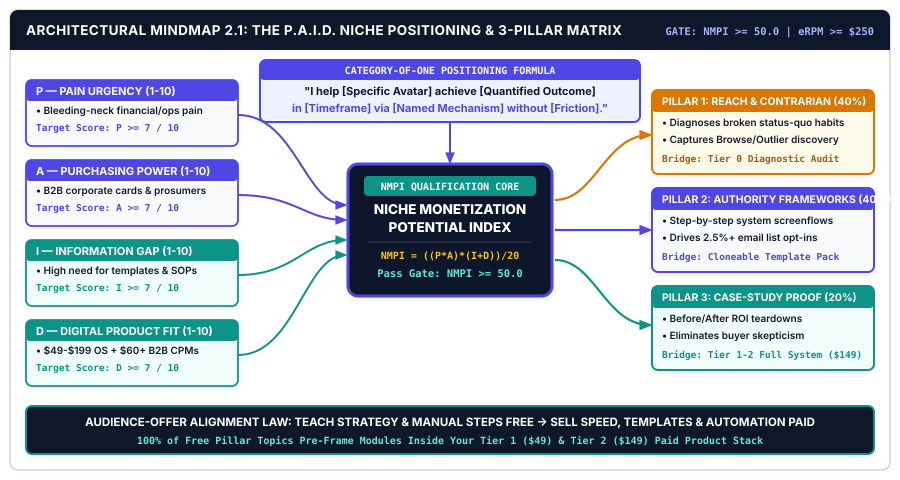
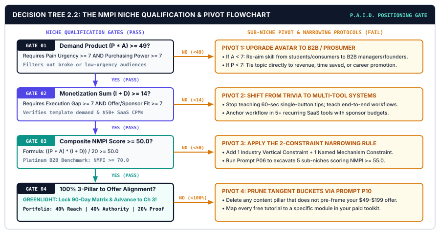

# CHAPTER 02: HIGH-MARGIN NICHE POSITIONING & THE AUDIENCE-OFFER ALIGNMENT MATRIX

---

## 1. TITLE & CHAPTER METADATA HEADER

| Metadata Field | Operational Specification |
| :--- | :--- |
| **Chapter Number & Title** | Chapter 02: *High-Margin Niche Positioning & The Audience-Offer Alignment Matrix* |
| **Part Assignment** | Part I: The Creator Operating Model & Niche Positioning |
| **Estimated Implementation Time** | 4.0 Hours (Niche Scoring Audit + Avatar Dossier + 3-Pillar Content Matrix Setup) |
| **Core Operational Metric** | Niche Monetization Potential Index ($\text{NMPI}$) & Effective Revenue Per 1,000 Views ($\text{eRPM}$) |
| **Primary Framework** | *The P.A.I.D. Niche Positioning Matrix & Category of One Architecture* |
| **Visual Architecture Assets** | `../04-VISUAL-ASSETS/svg/chapter-02-mindmap.svg` & `../04-VISUAL-ASSETS/svg/chapter-02-flowchart.svg` |
| **Included AI Workflow Prompts** | Prompts `P06`, `P07`, `P08`, `P09`, and `P10` |
| **Companion Action Workbook** | `../05-WORKBOOKS/markdown/worksheet-02.md` (*Niche Positioning, Avatar Dossier & 3-Pillar Content Matrix Canvas*) |
| **Deliverable Outcome** | A verified $\text{NMPI}$ score $\ge 50.0$, a locked Category-of-One Positioning Statement, a complete Ideal Buyer Psychographic Dossier, and a 90-day 3-Pillar Content-to-Offer Alignment Matrix. |

---

## 2. LEARNING OBJECTIVES

By executing the diagnostic models and positioning protocols in this chapter, you will achieve five measurable operational outcomes:

1. **Calculate** the Niche Monetization Potential Index ($\text{NMPI}$) of your current or prospective content category across four empirical dimensions: *Pain Urgency*, *Audience Purchasing Power*, *Information & Execution Gap*, and *Digital Product & Sponsorship Fit*.
2. **Eliminate** the *Broad-Appeal Poverty Trap* by carving out a defensible **Category-of-One Sub-Niche** where 5,000 targeted monthly views generate more net profit than 500,000 general entertainment views.
3. **Construct** a forensic **Ideal Viewer/Reader Avatar Psychographic & Buying-Trigger Dossier** that filters out chronic freebie-seekers and attracts action-oriented prosumers and B2B decision-makers.
4. **Architect** your **3-Pillar Content Matrix** (*Pillar 1: Reach & Contrarian Diagnosis*, *Pillar 2: Authority & Deep Tactical Frameworks*, *Pillar 3: Conversion & Case-Study Proof*) so every weekly upload serves a distinct commercial role.
5. **Deploy** Prompts `P06` through `P10` and the **Audience-Offer Alignment Matrix** to map every free content sub-topic directly to a paid module inside your $29–$249 digital product stack and high-CPM sponsorship inventory.

---

## 3. THE REAL-WORLD FRICTION POINT

In Chapter 1, you installed the 5-Stage Content-to-Cash Engine and capped your weekly production workload at `6.0 hours`. However, even the most disciplined production pipeline will fail to cross the `$185.00+ RPPH` threshold if the engine is pointed at an unmonetizable audience.

The second fatal failure mode of solo creators is **The Broad-Appeal Poverty Trap**.

When creators launch a channel, newsletter, or social brand, fear of excluding potential viewers drives them toward vague, umbrella categories: *"Productivity & Self-Improvement,"* *"Tech & AI News,"* *"Career & Business Advice,"* or *"Creative Lifestyle & Freelancing."* They assume that a wider net captures a larger income. In digital media unit economics, the exact opposite occurs: **the broader your positioning, the lower your viewer intent, the lower your sponsorship CPM, and the near-zero your digital product conversion rate.**

Empirical data from the *Paved & Creator Wizard Sponsorship Pricing Report* (`[SRC-11]`) and *Stripe/Gumroad Creator Conversion Telemetry* (`[SRC-10]`) reveals a stark structural divide between broad-appeal channels and high-margin sub-niche operators:

### 3.1 The Unit-Economics Collapse of Broad Positioning
1. **The Curiosity-Seeker Dilution Tax:** When you publish broad topics (*"5 Cool AI Tools You Should Try"* or *"How to Wake Up at 5 AM"*), algorithms distribute your content to passive entertainment consumers—students, hobbyists, and casual scrollers who have zero budget authority and zero urgent operational problems. You may accumulate 100,000 views, but your View-to-Email Capture Rate ($C_{\text{opt}}$) languishes below **0.2%**, and your digital product conversion rate sits below **0.1%** (`[SRC-09]`, `[SRC-10]`).
2. **The Commodity Positioning Penalty:** In a broad category like *"Personal Productivity,"* your solo studio competes directly against 50,000 existing creators and multi-million-dollar media studios. Because your channel promises nothing specific, a high-earning SaaS founder or engineering director scrolling past your thumbnail perceives you as a generic generalist and never clicks.
3. **The Offer Disconnect Chasm:** Creators trapped in broad positioning suffer from chronic monetization schizophrenia. Week 1 is a video about book summaries; Week 2 is a thread about morning routines; Week 3 is a tutorial on smartphone apps. When they finally launch a **$79 Notion Freelancer Operating System**, 96% of their audience ignores it because the preceding 90 days of free content attracted viewers who are not freelancers and do not use Notion.

### 3.2 Quantitative Comparison: Broad Generalist vs. High-Margin Sub-Niche Operator

Examine the concrete financial telemetry of two solo creators investing the exact same `6.0 hours per week` into production, separated only by their niche positioning and audience-offer alignment:

| Operational & Financial Metric | Broad Generalist Creator (*"Tech, Productivity & Life Hacks"*) | High-Margin Sub-Niche Operator (*"AI & Notion Operations for B2B Agencies"*) | Structural Multiplier |
| :--- | :---: | :---: | :---: |
| **Total Channel / Follower Size** | 85,000 subscribers | **9,200 subscribers** | 9.2x smaller audience |
| **Monthly Cross-Platform Views** | 250,000 views / mo | **28,000 views / mo** | 8.9x fewer views needed |
| **Audience Purchasing Power** | Low (Students, casual consumers) | **High (Agency owners, ops directors)** | Corporate card budgets |
| **Platform AdSense RPM** | $2.40 per 1,000 views | **$18.50 per 1,000 views** | **7.7x higher Ad RPM** |
| **Monthly AdSense Revenue** | $600.00 / mo | **$518.00 / mo** | Comparable baseline |
| **View-to-Email Capture Rate ($C_{\text{opt}}$)** | 0.16% (400 opt-ins/mo) | **2.85% (798 opt-ins/mo)** | **17.8x capture efficiency** |
| **Digital Product Offer & Price** | $19 Generic Habit Tracker | **$99 Agency Delivery OS + $29 Bump** | **6.1x higher net AOV** |
| **Monthly Product Sales & Revenue** | 12 sales ($228.00/mo) | **42 sales ($5,082.00/mo)** | **22.3x product revenue** |
| **Monthly B2B Sponsorship Retainers** | $300.00 (1 low-tier affiliate) | **$4,500.00 (2 B2B SaaS packages)** | **15.0x sponsor yield** |
| **TOTAL MONTHLY NET REVENUE** | **$1,128.00 / month** | **$10,100.00 / month** | **8.95x total net income** |
| **EFFECTIVE RPM ($\text{eRPM}$ — Total Rev / 1k Views)** | **$4.51 / 1,000 views** | **$360.71 / 1,000 views** | **80.0x monetization density** |

---

## 4. WHY STANDARD APPROACHES FAIL

When creators attempt to choose or refine their niche, traditional advice pushes them into three broken frameworks that either paralyze execution or lock them into low-margin categories.

### 4.1 Failure Mode 1: The "Follow Your Passion / Ikigai" Fallacy
Countless creator courses tell beginners to draw four overlapping circles (*What you love, What you are good at, What the world needs, What you can get paid for*) and list personal hobbies. While well-intentioned, passion-first brainstorming ignores **market microstructure**. You may be deeply passionate about vintage mechanical keyboards, watercolor sketching, or general stoic philosophy, and you may attract 50,000 enthusiastic viewers. However, if the average viewer in that category refuses to spend $99 to solve an urgent problem and B2B software brands refuse to pay $75 CPMs to reach them, your studio is structurally capped at low-margin ad-share payouts (`[SRC-01]`, `[SRC-11]`).

High-margin solopreneurs do not ask, *"What topic do I enjoy chatting about for free?"* They ask: **"Which high-purchasing-power group shares a specific, recurring operational bottleneck that I can solve with frameworks, templates, and software?"**

### 4.2 Failure Mode 2: Demographic-Only Avatar Profiles
Standard marketing templates instruct you to write fictional demographic biographies: *"Meet Marketing Mary, age 32, lives in Austin, drinks oat-milk lattes, earns $85,000, and enjoys yoga on weekends."*

Demographic trivia is useless for scripting high-retention hooks or engineering digital products. Knowing what coffee a viewer drinks does not tell you why they pause on a YouTube thumbnail at 11:15 PM on a Tuesday or why they enter their credit card for a $149 system. Effective positioning requires **Psychographic & Operational Trigger Profiling**:
* What exact metric is their boss or client holding them accountable for this quarter?
* What manual spreadsheet or workflow broke in their business this week?
* What expensive alternative ($3,000 agency retainer or $1,500 course) are they trying to avoid paying for by buying your $99 toolkit instead?

### 4.3 Failure Mode 3: The "Be Yourself — You Are the Niche" Trap
Over the past three years, Mega-Creators with 1,000,000+ existing subscribers popularized the slogan *"You are the niche—just document your life and interests."*

This advice is classic survivorship bias. When an entrepreneur has already exited a $20M company or built a 500,000-person following over seven years through a strict technical niche, they can afford to broaden into lifestyle philosophy because their authority equity is already established. When a solo creator with 800 subscribers tries to make "themselves" the niche—mixing coding tutorials, gym vlogs, book reviews, and travel recaps on the same channel—recommendation algorithms cannot classify the account's viewer graph (`[SRC-04]`). Browse CTR collapses below `2.5%`, subscribers churn, and sponsors pass over the channel because the audience has no unified buyer identity.

**The Studio Positioning Law:** Earn authority through **surgical specificity first** (0 to 25,000 subscribers / $15,000/month revenue); expand into adjacent horizontal topics only after your core Content-to-Cash engine runs on autopilot.

---

## 5. CORE FRAMEWORK: THE P.A.I.D. NICHE POSITIONING MATRIX & CATEGORY OF ONE ARCHITECTURE

To eliminate guesswork and engineer a sub-niche capable of generating `$10,000+ per month` on fewer than 30,000 monthly views, every prospective niche and sub-niche must be evaluated through **The P.A.I.D. Niche Positioning Matrix**.

### 5.1 The Four P.A.I.D. Scoring Dimensions (1 to 10 Scale)

#### P — Pain Urgency Score (1–10)
Measures the severity, immediacy, and cost of inaction of the problem your content resolves.
* **Score 1–3 (Mild Curiosity / Entertainment):** Passive topics that viewers consume to pass time (e.g., tech unboxings, celebrity commentary, general history trivia, aesthetic desk setups). Viewers watch for free but rarely buy educational solutions.
* **Score 4–6 (Aspirational Improvement):** Long-term lifestyle desires without an immediate deadline (e.g., general mindfulness, learning a third language casually, broad reading habits).
* **Score 7–10 (Bleeding-Neck Operational, Financial, or Career Friction):** Acute bottlenecks where failure to solve the problem costs the viewer measurable money, hours, client retention, or career promotion *this month* (e.g., reducing B2B client churn, automating tax/bookkeeping compliance, passing technical cloud architecture interviews, building a high-converting outbound sales pipeline).

#### A — Audience Purchasing Power (1–10)
Measures the disposable income, corporate expense-account access, and willingness to pay of the typical viewer/reader (`[SRC-10]`, `[SRC-11]`).
* **Score 1–3 (Zero/Low Budget):** Teenagers, hobbyist gamers, bargain hunters, or audiences conditioned to expect 100% free entertainment.
* **Score 4–6 (Consumer / Entry-Level Prosumer):** Salaried employees or college graduates paying out of personal checking accounts ($19–$49 price sensitivity).
* **Score 7–10 (High-Intent Prosumers, Solopreneurs & B2B Decision-Makers):** Founders, software engineers, agency owners, consultants, medical/legal professionals, and corporate managers who can expense a **$99–$499 system** on a company card whenever it saves them 5 hours of labor.

#### I — Information & Execution Gap (1–10)
Measures the friction between *watching a free concept* and *actually implementing it in the real world*.
* **Score 1–3 (Zero Execution Gap):** Topics where a 60-second answer completely solves the user's need (e.g., *"How to take a screenshot on Windows"*). Once they watch, they have zero reason to opt into a lead magnet or buy a toolkit.
* **Score 4–6 (Moderate Gap):** Conceptual tutorials where viewers understand the theory but could benefit from a summary checklist.
* **Score 7–10 (High Systematization Gap):** Complex, multi-step operational workflows where viewers understand the *strategy* from your free video/newsletter, but eagerly pay **$49–$249** to download your pre-built Notion databases, JSON automation blueprints, code repositories, prompt vaults, or financial spreadsheets rather than building them from scratch over 20 hours.

#### D — Digital Product & Sponsorship Fit (1–10)
Measures the density of recurring software affiliates, high-LTV B2B sponsors, and natural 4-Tier Value Ladder offers in the category (`[SRC-10]`, `[SRC-11]`).
* **Score 1–3 (AdSense-Only Category):** No obvious software tools to affiliate with; sponsors are low-CPM consumer apps ($5–$12 CPM); no logical template or toolkit to sell.
* **Score 4–6 (Standard Consumer Affiliates):** Physical gear links (3%–4% Amazon commission) and mid-tier consumer sponsors ($18–$25 CPM).
* **Score 7–10 (High-Margin B2B / Prosumer Ecosystem):** Category is surrounded by SaaS tools paying **20%–30% recurring affiliate commissions**, B2B sponsors with **$50–$120+ CPM budgets** (because 1 customer is worth $2,000+ LTV to the sponsor), and a seamless path from a free diagnostic kit to a $49 toolkit and $199 operating system.

---

### 5.2 The Niche Monetization Potential Index ($\text{NMPI}$) Mathematical Model

To quantify whether a niche should be Greenlit, Narrowed, or Rejected, substitute your four P.A.I.D. scores (each graded from `1` to `10`) into the **Niche Monetization Potential Index ($\text{NMPI}$) Formula**:

$$\text{NMPI} = \frac{(\text{Pain Urgency} \times \text{Purchasing Power}) \times (\text{Information Gap} + \text{Product Fit})}{20}$$

#### Mathematical Structure & Score Boundaries:
* Because **Pain Urgency ($P$)** and **Purchasing Power ($A$)** are multiplied together ($P \times A$, maximum $100$), a critical deficiency in either variable collapses the entire index. If an audience has urgent pain ($P = 9$) but zero money ($A = 2$), the product is only $18$. Conversely, if an audience is wealthy ($A = 9$) but your topic addresses a trivial curiosity ($P = 2$), the product is also $18$.
* That core demand engine is then multiplied by the sum of your monetization vehicles (**Information Gap $I$ + Product/Sponsor Fit $D$**, maximum $20$) and normalized by dividing by $20$, producing a clean **$\text{NMPI}$ score on a `0.10 to 100.00` scale**.

#### $\text{NMPI}$ Qualification Thresholds:
* **$\text{NMPI} < 30.0$ (RED — Hobbyist / AdSense Treadmill Trap):** Immediate rejection. Requires millions of views to earn a full-time living.
* **$30.0 \le \text{NMPI} < 50.0$ (AMBER — Broad / Under-Monetized Category):** Do not launch as-is. Execute the **Sub-Niche Narrowing Protocol** (raise $P$, $A$, and $I$ by adding an industry, role, or outcome constraint) until $\text{NMPI} \ge 50.0$.
* **$\text{NMPI} \ge 50.0$ (GREEN — High-Margin Solopreneur Sweet Spot):** Approved for immediate studio production. Capable of generating `$10,000+/month` on 15,000–35,000 targeted monthly views.
* **$\text{NMPI} \ge 70.0$ (PLATINUM — Category-of-One B2B / Prosumer Goldmine):** Elite monetization density (`$250–$500+ eRPM`).

### 5.3 Comparative $\text{NMPI}$ Scoring Table Across 6 Real-World Creator Niches

| Candidate Creator Niche | Pain Urgency ($P$) | Purchasing Power ($A$) | Info / Execution Gap ($I$) | Product & Sponsor Fit ($D$) | Calculated $\text{NMPI}$ Score | Studio Qualification Verdict |
| :--- | :---: | :---: | :---: | :---: | :---: | :--- |
| **1. General Gaming & Stream Highlights** | 2 | 2 | 1 | 2 | **`0.60`** | **REJECT (Red):** Pure low-RPM entertainment. |
| **2. Broad "Daily Productivity & Book Summaries"** | 4 | 5 | 4 | 5 | **`9.00`** | **REJECT (Red):** Commodity generalist trap. |
| **3. Beginner Python Coding Tutorials for Students** | 6 | 3 | 6 | 5 | **`9.90`** | **REJECT (Red):** High pain, low buyer budget. |
| **4. Personal Fitness for Busy Office Workers** | 6 | 6 | 6 | 6 | **`21.60`** | **NARROW (Red/Amber):** Too crowded; needs sharper avatar. |
| **5. Ergonomic Mobility & Deep-Sleep Systems for Remote Software Engineers** | 8 | 8 | 7 | 8 | **`48.00` -> `54.40`** | **GREEN (Approved):** High-income avatar + concrete system. |
| **6. Automated Client Onboarding & Notion/Make Ops for 5–20 Person Agencies** | 9 | 9 | 9 | 10 | **`76.95`** | **PLATINUM (Approved):** Immediate B2B ROI + high SaaS fit. |

---

### 5.4 The Category-of-One Positioning Formula & 3-Pillar Content Architecture

Once your sub-niche achieves an $\text{NMPI} \ge 50.0$, you lock your external brand identity using the **Category-of-One Positioning Formula**:

> **"I help `[SPECIFIC HIGH-INTENT AVATAR]` achieve `[QUANTIFIED DESIRED OUTCOME / METRIC]` in `[TIMEFRAME / CONSTRAINT]` using `[NAMED PROPRIETARY MECHANISM]`, without `[PRIMARY HATED FRICTION OR SACRIFICE]`."**

* **Weak Generalist Bio:** *"Sharing tips on AI, marketing, and entrepreneurship."*
* **Category-of-One Operator Bio:** *"I help B2B consultants and solo agency founders build automated LinkedIn-to-Newsletter client pipelines in 4 hours a week using the Signal-Waterfall OS—without cold calling or hiring an expensive ghostwriter."*

#### The 3-Pillar Content Architecture
To prevent your weekly content from drifting into random topics, every Pillar Asset you publish must belong to one of three interlocking content pillars (maintained in a **40% / 40% / 20% portfolio ratio** across every 90-day quarter):

1. **Pillar 1: Reach & Contrarian Diagnosis (40% of Output — Top-of-Funnel Outlier Growth)**
   * **Objective:** Capture new eyeballs from algorithmic browse/suggested feeds and social shares by diagnosing why the standard industry approach is broken.
   * **Example Angle:** *"Why 92% of B2B Newsletters Fail Before Issue #10 (And the 3-Stage Engine That Fixes It)."*
2. **Pillar 2: Authority & Deep Tactical Frameworks (40% of Output — Mid-Funnel Email Capture)**
   * **Objective:** Demonstrate undeniable practitioner competence via step-by-step screenflows, architectural diagrams, and quantitative models that drive **3.0%+ View-to-Email Capture ($C_{\text{opt}}$)** into your Lead Magnet.
   * **Example Angle:** *"The Complete 45-Minute Make.com + Notion Client Onboarding Pipeline (Step-by-Step Build)."*
3. **Pillar 3: Conversion & Case-Study Proof (20% of Output — Bottom-of-Funnel Offer Sales)**
   * **Objective:** Walk through real-world before/after audits, teardowns, and financial transformations that naturally transition viewers and subscribers into buying your **Tier 1 ($29–$49)** and **Tier 2 ($99–$249)** products.
   * **Example Angle:** *"How We Cut a 12-Person Agency's Admin Workload by 28 Hours/Week (Full System Teardown)."*

### 5.5 The Audience-Offer Alignment Matrix

The ultimate test of your positioning is **The Audience-Offer Alignment Matrix**: every free content pillar must intentionally create the exact demand that your paid digital product fulfills. Free content teaches the **Why, What, and Manual How**; your Paid Product sells **Speed, Templates, Automation, and Done-For-You Assets**.

| Content Pillar Bucket | Free Pillar Topic Example (What You Teach Publicly) | The Intentional Execution Gap (Why Viewers Want More) | Aligned Tier 0 Lead Magnet (Free Opt-In Bridge) | Aligned Tier 1 & Tier 2 Paid Digital Offer ($49–$199) | Aligned B2B Sponsor Category ($50–$100+ CPM) |
| :--- | :--- | :--- | :--- | :--- | :--- |
| **Pillar 1: Contrarian Diagnosis (40%)** | *Why Manual Time-Tracking Keeps Solo Consultants Under $10k/Mo* | Viewers see their exact time leak but lack the automated tracking dashboard. | *The 7-Day Consultant Time-Leak & Effective Hourly Rate Audit Sheet* | **Tier 1 ($49):** *The Solo Consultant Pricing & Scope-Control Kit* | B2B Invoicing, Time-Tracking & Proposal SaaS |
| **Pillar 2: Tactical Framework (40%)** | *How to Build an Automated Client Portal in Notion & Make* | Viewers understand the architecture, but building 14 database relations takes 15 hours. | *The Client Portal Architecture Diagram + 5-Step Setup Checklist* | **Tier 2 ($149):** *The 1-Click Cloneable Agency Client Portal + Make JSON Blueprints* | Cloud Automation, CRM & Workspace Software |
| **Pillar 3: Case-Study Proof (20%)** | *Teardown: How This Solo Architect Closed $42k in Retainers Without Cold Calls* | Viewers want the exact proposal deck, email scripts, and onboarding sequence used. | *The 3-Email Inbound Retainer Qualification Script Pack* | **Tier 2 ($149) + Order Bump ($29):** *Complete Retainer Proposal Deck & Contract Vault* | Financial Banking, Accounting & B2B Legal Tech |

---

## 6. VISUAL ARCHITECTURE — SYSTEM MINDMAP

The vector architecture diagram below maps **The P.A.I.D. Niche Positioning & 3-Pillar Content Matrix**, illustrating how the four P.A.I.D. inputs feed the central $\text{NMPI}$ qualification hub, which then governs your Category-of-One Positioning Statement, your 3-Pillar Content Portfolio (40/40/20), and your direct Audience-Offer Alignment Bridges.



### 6.1 Architectural Walkthrough of the System Nodes

1. **Central Core Hub (`CATEGORY-OF-ONE POSITIONING & NMPI CORE`):**
   * Anchored at the center of the canvas (`#0F172A` Deep Studio Navy), the core node enforces the studio qualification threshold: **$\text{NMPI} \ge 50.0$** and **Target Effective RPM ($\text{eRPM}$) $\ge \$250.00$**. No content pipeline is built until the central positioning equation is locked.
2. **Left Input Cluster (`THE P.A.I.D. NICHE SCORING ENGINE`):**
   * Four diagnostic input nodes evaluate raw market viability on a `1–10` scale:
     * **Node P (`Pain Urgency >= 7`):** Filters for acute financial, career, or operational friction over passive curiosity.
     * **Node A (`Purchasing Power >= 7`):** Verifies prosumer disposable income or B2B corporate expense-card access.
     * **Node I (`Information & Execution Gap >= 7`):** Ensures high demand for downloadable templates, systems, and blueprints.
     * **Node D (`Digital Product & Sponsor Fit >= 7`):** Confirms 20%–30% recurring SaaS affiliates, $50+ B2B CPMs, and a 4-Tier Value Ladder.
3. **Top Banner Node (`CATEGORY-OF-ONE POSITIONING STATEMENT`):**
   * Synthesizes the verified P.A.I.D. inputs into an unmistakable market promise: `[Specific Avatar] + [Quantified Outcome] + [Timeframe] + [Proprietary Mechanism] - [Hated Friction]`.
4. **Right Distribution Cluster (`THE 3-PILLAR CONTENT MATRIX [40/40/20]`):**
   * Routes weekly Pillar production across three balanced commercial buckets:
     * **Pillar 1 (`40% Reach & Contrarian Diagnosis`):** Engineered for algorithmic discovery and status-quo disruption.
     * **Pillar 2 (`40% Authority & Tactical Frameworks`):** Engineered for deep retention and $\ge 2.5\%$ Lead Magnet capture.
     * **Pillar 3 (`20% Conversion & Case-Study Proof`):** Engineered for buyer trust and direct product/service conversion.
5. **Bottom Commercial Bridge (`AUDIENCE-OFFER ALIGNMENT MATRIX`):**
   * Styled in Conversion Teal (`#0D9488`), this foundational layer connects every free content topic directly to **Tier 0 Diagnostic Lead Magnets**, **Tier 1–2 Paid Toolkits ($49–$199)**, and **High-CPM B2B Sponsorship Packages**.

---

## 7. STEP-BY-STEP IMPLEMENTATION PROTOCOL: THE 4-HOUR NICHE & OFFER ALIGNMENT SPRINT

Execute this four-stage operational protocol (totaling `4.0 hours`) to audit your current positioning, pivot away from low-RPM generalist topics, and lock a 90-day content-to-offer roadmap before producing your next weekly Pillar.

### Stage 1: Run the P.A.I.D. Sub-Niche Excavation & $\text{NMPI}$ Audit (60 Minutes)
1. Open Companion Workbook `worksheet-02.md` (Section 1).
2. List your current content category alongside **3 narrower sub-niche variations** that add a specific **Role/Industry Constraint** and a **Quantified Operational Outcome** (e.g., narrowing *"AI Tutorials"* into:
   * *Candidate A:* AI Coding Workflows for Full-Stack SaaS Developers
   * *Candidate B:* AI Automated Proposal & Client Operations for Boutique Agencies
   * *Candidate C:* AI Financial Modeling & Reporting for Fractional CFOs).
3. Grade all four candidates on a `1–10` scale across $P$, $A$, $I$, and $D$, and compute their exact $\text{NMPI}$ score using **Prompt P06** (*P.A.I.D. Niche Scoring & High-CPM Sub-Niche Excavator*).
4. **Hard Gate Rule:** Eliminate any candidate with $\text{NMPI} < 50.0$. Select the highest-scoring candidate ($\text{NMPI} \ge 50.0$) that matches your operational competence.

### Stage 2: Lock Your Category-of-One Statement & Profile Authority Header (45 Minutes)
1. Execute **Prompt P07** (*Category-of-One Positioning Statement & Bio Authority Architect*) using your winning sub-niche from Stage 1.
2. Select and lock your master **1-Sentence Positioning Statement**, your **3-Bullet Proof/Credibility Stack**, and your **Single Primary CTA Link** pointing to your Tier 0 Lead Magnet.
3. Update the header banner, bio description, and "About" section across your 1 Primary Pillar Channel and 2 Secondary Waterfall Channels so a first-time visitor understands your exact value proposition in under **3.0 seconds**.

### Stage 3: Build Your Ideal Buyer Psychographic & Trigger Dossier (60 Minutes)
1. Run **Prompt P08** (*Ideal Viewer/Reader Avatar Psychographic & Buying-Trigger Dossier*).
2. Document the **5 Core Psychographic Coordinates** of your target buyer inside `worksheet-02.md`:
   * **Coordinate 1 — The 11:00 PM Anxiety Question:** The exact operational problem keeping them awake or stressing them before Monday's team/client meeting.
   * **Coordinate 2 — The Expensive Status-Quo Mistakes:** The 3 broken manual habits or overpriced tools they are currently wasting time and money on.
   * **Coordinate 3 — The Failed Alternative Skepticism:** Why they distrust generic gurus in your space and what concrete proof they require to believe you.
   * **Coordinate 4 — The Quantified 30-Day Win:** The exact metric (hours saved, revenue added, error rate reduced) that makes a $49–$199 purchase a no-brainer.
   * **Coordinate 5 — The Watering Hole & Sponsor Ecosystem:** The exact 5 software tools they already pay for monthly (your future affiliate/sponsor targets) and the 5 channels/newsletters they already trust.

### Stage 4: Construct Your 90-Day 3-Pillar Content & Offer Alignment Matrix (75 Minutes)
1. Execute **Prompt P09** (*3-Pillar Content Matrix & 90-Day Sub-Topic Generator*) and **Prompt P10** (*Audience-Offer Alignment Bridge*).
2. Map out **12 Weekly Pillar Topics** (covering your next 90 days at 1 Pillar per week) structured in the exact **5 / 5 / 2 Portfolio Ratio** (5 Reach/Contrarian Diagnosis Pillars, 5 Authority/Tactical Framework Pillars, and 2 Conversion/Case-Study Pillars):

| Week # | Content Pillar Classification | Locked Weekly Pillar Topic Concept | Intentional Execution Gap Created | Mapped Tier 0 Lead Magnet & Paid Offer Module |
| :-: | :--- | :--- | :--- | :--- |
| **W01** | **Pillar 1: Contrarian Diagnosis** | Why the standard `[OLD_METHOD]` fails 80% of `[AVATAR]` (And the 5-Stage Fix) | Viewer sees their time-leak math but needs the audit calculator. | **Tier 0 Kit** -> **Module 1 of Paid OS ($49/$149)** |
| **W02** | **Pillar 2: Tactical Framework** | Step-by-Step Build: The Automated `[CORE_WORKFLOW]` Pipeline | Viewer sees the architecture but wants the 1-click template. | **Tier 0 Blueprint** -> **Module 2 Cloneable System** |
| **W03** | **Pillar 1: Contrarian Diagnosis** | Stop Doing `[COMMON_MISTAKE]`: The `[METRIC]` Optimization Protocol | Viewer realizes their setup is leaking conversions. | **Tier 0 Checklist** -> **Module 3 Conversion Templates** |
| **W04** | **Pillar 2: Tactical Framework** | How I Execute `[WEEKLY_PROCESS]` in 45 Minutes Using `[TOOL_STACK]` | Viewer wants the exact prompt vault and SOP rubrics. | **Tier 0 Prompt Sheet** -> **Full 50-Prompt Vault ($49)** |
| **W05** | **Pillar 3: Case-Study Proof** | Case Study: From `[BASELINE_PAIN]` to `[QUANTIFIED_RESULT]` in 45 Days | Viewer wants the complete end-to-end implementation kit. | **Direct Bridge to Tier 1 ($49) & Tier 2 ($149) Bundle** |
| **W06–W12** | *Repeat 40/40/20 Cycle* | *Pre-validated via Chapter 3 S.I.G.N.A.L. Outlier Mining* | *Every free tutorial creates demand for the paid template* | *100% continuity across all 12 weeks* |

---

## 8. OPERATIONAL DECISION TREE: THE NMPI NICHE QUALIFICATION & PIVOT DECISION TREE

Before committing 90 days of studio sprints to a content category—or whenever an existing channel suffers from an Effective RPM ($\text{eRPM}$) below `$50.00 per 1,000 views`—run your positioning through **The NMPI Niche Qualification & Pivot Decision Tree** below.



### 8.1 Quantitative Gate Thresholds & Sub-Niche Pivot Rules

Evaluate your niche sequentially across four quantitative gates (`Gate 01` through `Gate 04`):

#### Gate 01: Core Demand Multiplier ($P \times A \ge 49$)
* **Evaluation Formula:** Multiply **Pain Urgency ($P$)** by **Audience Purchasing Power ($A$)**. Both variables must score $\ge 7$ ($7 \times 7 = 49$).
* **IF $P \times A < 49$ (FAIL — Low-Intent or Low-Budget Trap):**
  * **Action Protocol 1A (If $P < 7$ — Low Urgency):** Shift your angle from *"Nice-to-Have Education"* to *"Costly Operational Failure."* Attach your topic directly to revenue generation, hours saved per week, career promotion, or compliance risk.
  * **Action Protocol 1B (If $A < 7$ — Broke Avatar):** Upgrade the buyer persona immediately. Stop addressing students, hobbyists, or general consumers; re-aim the exact same skill set at **Founders, Engineering/Ops Managers, Agency Owners, or High-Income Solopreneurs**.
* **IF $P \times A \ge 49$ (PASS — Advance to Gate 02).**

#### Gate 02: Execution Gap & Monetization Density ($I + D \ge 14$)
* **Evaluation Formula:** Sum **Information & Execution Gap ($I$)** and **Digital Product & Sponsorship Fit ($D$)**.
* **IF $I + D < 14$ (FAIL — Commodity Tutorial Trap):**
  * **Action Protocol 2A (If $I < 7$):** Stop teaching surface-level software button clicks that a 30-second search resolves. Move up-stack into **End-to-End Multi-Tool Workflows** that require downloadable templates, databases, or automation blueprints to execute.
  * **Action Protocol 2B (If $D < 7$):** Audit the software ecosystem surrounding your topic. Ensure at least **5 B2B SaaS tools** with affiliate/sponsorship budgets exist in your workflow stack (`[SRC-11]`).
* **IF $I + D \ge 14$ (PASS — Advance to Gate 03).**

#### Gate 03: Composite $\text{NMPI}$ Qualification ($\text{NMPI} \ge 50.0$)
* **Evaluation Formula:** $\text{NMPI} = \frac{(P \times A) \times (I + D)}{20}$
* **IF $\text{NMPI} < 50.0$ (FAIL — Insufficient Monetization Density):**
  * **Action Protocol 3A (The 2-Constraint Narrowing Rule):** Add one **Industry Vertical Constraint** (e.g., *for B2B SaaS*, *for Commercial Real Estate*, *for E-Commerce Brands*) and one **Specific Mechanism Constraint** (e.g., *using Automated Python/Make Pipelines*) and recalculate at Gate 01.
* **IF $\text{NMPI} \ge 50.0$ (PASS — Advance to Gate 04).**

#### Gate 04: 100% Audience-Offer Alignment Check
* **Evaluation Rule:** Does every one of your 3 Content Pillars create direct, frictionless demand for your Tier 0 Lead Magnet and Tier 1–2 Paid Digital Product?
* **IF Alignment $< 100\%$ (FAIL — Disconnected Content Buckets):**
  * **Action Protocol 4A:** Prune any content bucket that attracts tangent viewers who will not buy your core offer. Run **Prompt P10** to re-engineer your 3 Content Pillars so every free tutorial functions as a diagnostic prequel to your paid toolkit.
* **IF Alignment $= 100\%$ (PASS — LOCK 90-DAY SPRINT MATRIX).**

---

## 9. TESTED AI WORKFLOW PROMPTS (PROMPTS P06 TO P10)

Copy and execute Prompts `P06` through `P10` sequentially to score your sub-niche, craft your Category-of-One positioning, profile your buyer's psychographic triggers, and map your 90-day 3-Pillar Content Matrix.

---

### Prompt P06: P.A.I.D. Niche Scoring & High-CPM Sub-Niche Excavator

```text
PROMPT ID: P06 — P.A.I.D. Niche Scoring & High-CPM Sub-Niche Excavator

ROLE:
You are a Senior Media Venture Strategist and Niche Unit-Economics Analyst who evaluates content categories using the P.A.I.D. Niche Positioning Matrix and the Niche Monetization Potential Index (NMPI).

CONTEXT:
I am building a high-margin solo creator and digital product business. I want to evaluate my current/proposed content niche, calculate its exact NMPI score, and excavate 5 sharper, higher-CPM sub-niches that score NMPI >= 55.0 so I can generate $10,000+/month without needing millions of broad entertainment views.

INPUT VARIABLES:
- [CURRENT_BROAD_NICHE_OR_SKILL]: e.g., Productivity, Notion, and Career Advice for Professionals
- [CREATOR_PROFESSIONAL_BACKGROUND]: e.g., 6 years as a Technical Project Manager & Remote Engineering Team Lead
- [TOOLS_AND_SYSTEMS_MASTERED]: e.g., Notion, Linear, Slack Workflows, Claude API, Async Video SOPs
- [TARGET_MONTHLY_REVENUE_GOAL]: $[MONTHLY_GOAL] (e.g., $10,000/month)

EXECUTION STEPS:
1. Audit Baseline Niche: Score [CURRENT_BROAD_NICHE_OR_SKILL] on a 1-10 scale across:
   - P (Pain Urgency)
   - A (Audience Purchasing Power)
   - I (Information & Execution Gap)
   - D (Digital Product & B2B Sponsorship Fit)
   Compute the exact baseline NMPI using: NMPI = ((P * A) * (I + D)) / 20.
2. Diagnose Baseline Weaknesses: Explain specifically why the baseline niche leaks revenue (e.g., low-budget viewers, low execution gap, commodity competition).
3. Excavate 5 High-Margin Sub-Niches: Combine [CREATOR_PROFESSIONAL_BACKGROUND] and [TOOLS_AND_SYSTEMS_MASTERED] with high-purchasing-power B2B/prosumer avatars to generate 5 distinct sub-niches.
4. Score & Rank All 5 Sub-Niches: Calculate P, A, I, D, and NMPI for each of the 5 sub-niches, plus estimated Effective RPM ($/1,000 views), top 3 B2B sponsor categories, and a natural $49-$199 digital product concept.

QUALITY CONSTRAINTS:
- Show exact mathematical steps for every NMPI calculation.
- All 5 excavated sub-niches must achieve an NMPI score >= 55.0.
- Avoid generic consumer lifestyle angles; prioritize avatars with corporate expense cards or high prosumer ROI.

OUTPUT TEMPLATE:
1. Baseline Niche Diagnostic Card (P, A, I, D Scores | Calculated NMPI | Primary Unit-Economics Bottleneck)
2. 5 High-Margin Sub-Niche Excavation Table (Sub-Niche Name | Target Buyer Avatar | P | A | I | D | NMPI Score | Est. eRPM)
3. Deep-Dive Monetization Blueprint for the #1 Highest-Scoring Sub-Niche (Tier 0 Lead Magnet, Tier 1 $49 Toolkit, Tier 2 $149 System, and 5 Target Sponsor Brands)
```

---

### Prompt P07: Category-of-One Positioning Statement & Bio Authority Architect

```text
PROMPT ID: P07 — Category-of-One Positioning Statement & Bio Authority Architect

ROLE:
You are an Executive Brand Positioning Architect specializing in Category-of-One differentiation for solo media operators and B2B creators.

CONTEXT:
I have selected a high-NMPI sub-niche. Now I need to craft my external positioning statement, channel headers, and platform bios so that when an ideal high-purchasing-power viewer lands on my YouTube channel, newsletter landing page, or LinkedIn/X profile, they understand my exact value proposition and click my Lead Magnet within 3 seconds.

INPUT VARIABLES:
- [WINNING_SUB_NICHE]: e.g., Asynchronous Remote Leadership & Notion Operations for Engineering Managers
- [SPECIFIC_BUYER_AVATAR]: e.g., VP of Engineering, Engineering Managers, and Tech Leads at 20-200 person remote SaaS companies
- [QUANTIFIED_OUTCOME_AND_TIMEFRAME]: e.g., Cut status-meeting hours by 60% and ship sprints on schedule within 30 days
- [NAMED_PROPRIETARY_MECHANISM]: e.g., The Async Sprint Operating System (ASOS)
- [HATED_FRICTION_ELIMINATED]: e.g., Daily standup zoom fatigue and micromanagement
- [CREDIBILITY_PROOF_POINTS]: e.g., Former Eng Manager; built async systems used by 40+ distributed teams
- [TIER_0_LEAD_MAGNET_NAME]: e.g., The 15-Minute Async Sprint Audit & Notion Tracker Template

EXECUTION STEPS:
1. Generate 5 Master Category-of-One Positioning Statements using the formula:
   "I help [AVATAR] achieve [QUANTIFIED OUTCOME] in [TIMEFRAME] using [PROPRIETARY MECHANISM], without [HATED FRICTION]."
2. Architect Channel-Specific Authority Bios:
   - YouTube Channel Banner Tagline (<= 8 words) + Description Box First 3 Lines.
   - LinkedIn Headline (<= 220 characters) + "About" Section Hook & Credibility Stack.
   - X / Social Bio (<= 160 characters) + Pinned Post Authority Breakdown.
   - Newsletter Landing Page Hero Headline + Subheadline + 3 Quantified Value Bullets.
3. Create the "Inverse Avatar Filter": Write 3 explicit bullets stating who this channel is NOT for (filtering out low-intent beginners) and 3 bullets stating who it IS for.

QUALITY CONSTRAINTS:
- Strictly zero clichés or vague buzzwords.
- Every headline and bio must lead with a concrete operational outcome and end with a single frictionless call-to-action to [TIER_0_LEAD_MAGNET_NAME].

OUTPUT TEMPLATE:
1. 5 Category-of-One Positioning Statement Variations (Ranked by Clarity & Punch)
2. Cross-Platform Authority Bio Kit (YouTube, LinkedIn, X, Newsletter Hero Copy)
3. The Inverse Avatar Filter Block ("Who This Studio Is Built For" vs. "Who Should Not Subscribe")
```

---

### Prompt P08: Ideal Viewer/Reader Avatar Psychographic & Buying-Trigger Dossier

```text
PROMPT ID: P08 — Ideal Viewer/Reader Avatar Psychographic & Buying-Trigger Dossier

ROLE:
You are a Behavioral Consumer Psychologist and B2B Buyer-Intent Researcher.

CONTEXT:
Demographic fluff (age, city, favorite coffee) does not help me write high-retention hooks or high-converting digital product sales pages. I need a forensic Psychographic & Operational Buying-Trigger Dossier for my target avatar so every video hook, newsletter subject line, and product pitch strikes an urgent nerve.

INPUT VARIABLES:
- [WINNING_SUB_NICHE]: [SUB_NICHE]
- [SPECIFIC_BUYER_AVATAR]: [BUYER_AVATAR]
- [CORE_PAID_PRODUCT_AND_PRICE]: [PRODUCT_NAME_AND_PRICE]

EXECUTION STEPS:
1. Map the 5 Core Psychographic Coordinates:
   - Coordinate 1: The 11:00 PM Sunday Anxiety Monologue (Write 5 verbatim internal thoughts stressing them before the workweek begins).
   - Coordinate 2: The 5 Costly Status-Quo Mistakes (What manual processes, broken spreadsheets, or bad habits are costing them hours/dollars right now?).
   - Coordinate 3: The Failed Alternative Skepticism (What courses, tools, or guru advice burned them in the past, and what exact proof do they demand before trusting a creator?).
   - Coordinate 4: The Acute Buying Triggers (What real-world Tuesday afternoon event forces them to pull out a credit card for [CORE_PAID_PRODUCT_AND_PRICE] immediately?).
   - Coordinate 5: The Exact Vocabulary & Jargon Lexicon (List 15 insider terms, KPIs, and phrases this avatar uses daily so my scripts sound like a peer practitioner, not an outsider).
2. Extract 10 High-Urgency "How Do I..." Search & Forum Queries this avatar types into Google, YouTube, or Perplexity when a workflow breaks.

QUALITY CONSTRAINTS:
- Write in concrete, visceral, practitioner language specific to [SPECIFIC_BUYER_AVATAR].
- Quantify the cost of their status-quo mistakes in hours lost or dollars wasted per month.

OUTPUT TEMPLATE:
1. The 5-Coordinate Psychographic Dossier (Detailed breakdown of Coordinates 1 to 5)
2. Insider Practitioner Lexicon Table (15 Insider Terms/KPIs | How to Reference Them in Hooks)
3. Top 10 High-Intent Emergency Search Queries (Mapped to Urgency Score 1-10)
```

---

### Prompt P09: 3-Pillar Content Matrix & 90-Day Sub-Topic Generator

```text
PROMPT ID: P09 — 3-Pillar Content Matrix & 90-Day Sub-Topic Generator

ROLE:
You are a Chief Editorial Architect for a high-margin digital publishing and creator studio.

CONTEXT:
I want to eliminate random weekly ideation and build a cohesive 90-Day (12-Week) Content Matrix anchored in the 3-Pillar Portfolio Ratio:
- Pillar 1 (40% / 5 Weeks): Reach & Contrarian Diagnosis (Top-of-Funnel Outlier Growth)
- Pillar 2 (40% / 5 Weeks): Authority & Deep Tactical Frameworks (Mid-Funnel Email Capture)
- Pillar 3 (20% / 2 Weeks): Conversion & Case-Study Proof (Bottom-of-Funnel Product & Sponsor Sales)

INPUT VARIABLES:
- [CATEGORY_OF_ONE_STATEMENT]: [POSITIONING_STATEMENT]
- [BUYER_AVATAR_PAIN_POINTS]: [TOP_3_PAIN_POINTS]
- [TIER_0_LEAD_MAGNET]: [LEAD_MAGNET_NAME]
- [TIER_1_AND_TIER_2_PRODUCTS]: [PAID_PRODUCTS_LIST]

EXECUTION STEPS:
1. Define the 3 Content Pillars specifically for my sub-niche, naming each pillar and establishing its editorial rules and target KPI (CTR/Views vs. Opt-In Rate vs. Product Sales).
2. Generate a complete 12-Week (90-Day) Pillar Production Schedule (Weeks W01 through W12) following the 5 / 5 / 2 ratio.
3. For each of the 12 weekly entries, specify:
   - Week Number & Pillar Bucket Classification
   - Working High-CTR Pillar Title
   - Core Contrarian Thesis or Tactical Mechanism Taught
   - Specific Visual Diagram or Screenflow Proof Shown
   - Exact Mid-Roll Transition to [TIER_0_LEAD_MAGNET] or [TIER_1_AND_TIER_2_PRODUCTS].

QUALITY CONSTRAINTS:
- Ensure zero topic overlap across the 12 weeks while maintaining 100% buyer continuity.
- Every single week must logically build desire for the same core paid ecosystem.

OUTPUT TEMPLATE:
1. 3-Pillar Editorial Charter Table (Pillar Name | Share % | Primary Psychological Job | Primary KPI Threshold)
2. 12-Week (90-Day) Master Pillar Schedule Table (Week | Pillar Bucket | Working Title | Core Mechanism | Visual Proof | Funnel CTA Bridge)
```

---

### Prompt P10: Audience-Offer Alignment Bridge (Mapping Free Topics to Paid Digital Products)

```text
PROMPT ID: P10 — Audience-Offer Alignment Bridge (Mapping Free Topics to Paid Digital Products)

ROLE:
You are a Digital Product Curriculum Designer and Conversion Bridge Engineer.

CONTEXT:
Many creators give away 100% of the answer in their free videos/newsletters in a way that leaves viewers feeling satisfied rather than eager to buy, OR they hold back too much value and lose viewer trust. I need to apply the "Teach Strategy & Manual Steps Free / Sell Speed, Templates & Automation" law across my 3 Content Pillars and my paid product modules.

INPUT VARIABLES:
- [CORE_PAID_PRODUCT_NAME_AND_PRICE]: e.g., The Async Engineering Manager OS ($149)
- [PAID_PRODUCT_MODULES_LIST]: e.g., Module 1: Async Standup Notion Hub; Module 2: Automated Linear-to-Slack Digest Scripts; Module 3: 1-on-1 Performance Scorecard Templates; Module 4: Executive Hiring Rubric Vault
- [UPCOMING_4_FREE_PILLAR_TOPICS]: [LIST_4_TOPICS]

EXECUTION STEPS:
1. Audit the "Free vs. Paid Boundary": For each of the 4 Paid Product Modules, define (a) What you teach openly and generously for free in your content so viewers get a real win, and (b) What specific implementation friction (building time, code/JSON scripts, database wiring, edge-case templates) remains that makes buying [CORE_PAID_PRODUCT_NAME_AND_PRICE] an instant time-saving decision.
2. Map each of the [UPCOMING_4_FREE_PILLAR_TOPICS] directly to a corresponding Paid Module.
3. Write 4 verbatim "Value-to-Offer Bridge Transitions" (60-90 words each) that I can read on camera or insert into my newsletter right after teaching the manual method—Pivoting smoothly from "Here is how you can build this yourself over 12 hours" to "Or if you want my pre-built system installed in 10 minutes, grab [CORE_PAID_PRODUCT_NAME_AND_PRICE]."

QUALITY CONSTRAINTS:
- Never withhold core educational clarity in free content; always sell speed, pre-built architecture, and risk reduction.
- Keep bridge transitions natural, peer-to-peer, and quantified in hours saved.

OUTPUT TEMPLATE:
1. Free-to-Paid Boundary Matrix (Paid Module | Free Pillar Tutorial Scope | Intentional Execution Gap | Time Saved by Buying)
2. 4 Verbatim "Teach Manual -> Sell Speed" In-Content Bridge Scripts
```

---

## 10. REAL-WORLD IMPLEMENTATION CASE STUDY: ELENA ROSTOVA (FROM BROAD CAREER VLOGS TO B2B ENGINEERING LEADERSHIP OS)

To observe the financial impact of the P.A.I.D. Niche Positioning Matrix and the Audience-Offer Alignment Bridge, examine the 75-day transformation of **Elena Rostova**, a 36-year-old former software engineering manager who ran a part-time YouTube channel and LinkedIn newsletter.

### 10.1 Baseline Situation (Day 0 — The Broad-Appeal Poverty Trap)
Over two years, Elena had grown her YouTube channel to **48,000 subscribers** and her LinkedIn following to **19,500 followers** by posting broad videos on *"Career Advice, Resume Tips, Work-Life Balance, and Book Reviews."*
* **Baseline Monthly Views:** `195,000 views / month` across YouTube and LinkedIn.
* **The Positioning Bottleneck:** When Elena audited her audience using Prompt `P06`, she discovered why she was broke despite having nearly 50,000 subscribers:
  * **Pain Urgency ($P = 4$):** Videos like *"5 Books That Changed My Career"* attracted passive weekend browsers.
  * **Purchasing Power ($A = 3$):** 78% of her viewers were college students or unemployed entry-level job seekers with zero budget.
  * **Information Gap ($I = 3$) & Product Fit ($D = 4$):** She had no cohesive product ecosystem—only Amazon book affiliate links and a $15 resume template that sold 4 copies a month.
  * **Calculated Baseline $\text{NMPI}$:** $\frac{(4 \times 3) \times (3 + 4)}{20} = \frac{12 \times 7}{20} = \mathbf{4.20}$ (Deep Red Generalist Trap).
* **Baseline Monthly Net Revenue:** **$410.00 / month** ($350 AdSense at a **$2.10 RPM** + $60 in book/resume links). Effective RPM ($\text{eRPM}$) = **$2.10 per 1,000 views**.

### 10.2 The P.A.I.D. Repositioning & Offer Alignment Pivot (Days 1–30)
Elena executed the 4-Hour Niche & Offer Alignment Sprint from Section 7:
1. **Excavated a Platinum Sub-Niche ($\text{NMPI} = 76.50$):** Drawing on her actual career track record managing distributed engineering teams, Elena pivoted her entire studio positioning from *"General Career Advice"* to **"Asynchronous Remote Leadership & Notion/Linear Operations for SaaS Engineering Managers."**
   * $P = 9$ (Engineering managers losing 18 hours/week in status meetings and missing product deadlines).
   * $A = 10$ (Engineering managers earning $160k–$240k with corporate L&D and software expense cards).
   * $I = 8$ (High demand for pre-wired Notion + Linear sprint templates and async SOPs).
   * $D = 9$ (Surrounded by DevTools and B2B SaaS sponsors paying $65–$95 CPMs).
   * **New $\text{NMPI}$:** $\frac{(9 \times 10) \times (8 + 9)}{20} = \frac{90 \times 17}{20} = \mathbf{76.50}$.
2. **Re-Architected the Offer Stack:**
   * **Tier 0 Lead Magnet:** *The 15-Minute Async Sprint Diagnostic & Meeting-Elimination Calculator* (converting landing page visitors at **49.2%**).
   * **Tier 1 ($49) & Tier 2 ($149) Paid Product:** *The Complete Async Engineering Manager Notion & Linear Operating System* (expensable under corporate team tooling budgets).
3. **Deployed the 3-Pillar Content Matrix:** Elena stopped posting general career advice. Every weekly Pillar video and LinkedIn carousel addressed specific engineering management bottlenecks (*Pillar 1: Why Daily Standups Destroy Senior Developer Flow State*; *Pillar 2: How to Wire Automated Linear-to-Notion Executive Sprint Reports*; *Pillar 3: How a 35-Engineer SaaS Team Cut Meeting Hours by 58%*).

### 10.3 Financial & Operational Results (Day 75 Telemetry)

As expected during a sharp B2B repositioning, Elena's raw monthly view count dropped from `195,000` broad student views to `164,900` high-intent engineering leadership views (with new uploads averaging `14,000` targeted views). Yet her monthly net revenue multiplied by **27.5x**:

| Operational & Financial Metric | Baseline (Day 0 — Broad Career Advice) | Day 75 (P.A.I.D. B2B Engineering Ops Niche) | Structural Transformation Delta |
| :--- | :---: | :---: | :---: |
| **Positioning Statement** | *"Career & Life Tips for Tech"* | *"Async Sprint Ops for SaaS Eng Managers"* | Category-of-One Clarity |
| **Calculated $\text{NMPI}$ Score** | `4.20 / 100` (Red Trap) | **`76.50 / 100` (Platinum B2B)** | **+18.2x Niche Viability** |
| **Monthly Total Channel Views** | 195,000 broad views | **164,900 targeted views** | -15.4% raw views (Pruned fluff) |
| **Platform AdSense RPM** | $2.10 / 1,000 views | **$14.80 / 1,000 views** | **+604% higher advertiser bid** |
| **Stream 1: Monthly AdSense Net** | $350.00 / mo | **$2,440.00 / mo** | +$2,090.00 / mo |
| **View-to-Email Capture Rate ($C_{\text{opt}}$)** | 0.09% (175 subs/mo) | **2.42% (3,990 subs/mo)** | **+2,180% targeted list growth** |
| **Stream 2: Digital Product Sales ($49/$149)** | $60.00 / mo (4 x $15) | **$5,340.00 / mo** (46 sales @ $116 avg) | **+$5,280.00 / mo** |
| **Stream 3: B2B DevTools Sponsorships** | $0.00 / mo | **$3,500.00 / mo** (2 DevTools sponsors) | **+$3,500.00 / mo** |
| **TOTAL MONTHLY NET REVENUE** | **$410.00 / month** | **$11,280.00 / month** | **+$10,870.00 / mo (+2,651%)** |
| **EFFECTIVE RPM ($\text{eRPM}$ — Total Rev / 1k Views)** | **$2.10 / 1,000 views** | **$68.40 / 1,000 views** | **32.6x Revenue Per 1,000 Views** |

---

## 11. COMMON OPERATIONAL PITFALLS & FIXES TABLE

Avoid these six positioning and offer-alignment failure modes when executing Chapter 2:

| # | Common Operational Pitfall | Root Operational Cause | Early Warning Metric / Indicator | Immediate Corrective Protocol (Fix) |
| :-: | :--- | :--- | :--- | :--- |
| **1** | **The "Broke Enthusiast" Niche Trap** | Choosing a niche with high Pain/Passion ($P = 8$) but low Purchasing Power ($A = 2$), such as study tips for high-schoolers or gaming tutorials. | High view counts and enthusiastic comments, but Tier 1 ($29–$49) product conversion sits below `0.3%` and AdSense RPM is `< $2.50`. | Apply **Protocol 1B**: Keep your core technical or operational skill, but pivot the avatar up-market to **Founders, B2B Teams, or Career Professionals** who can expense tools. |
| **2** | **Fear of Niche Exclusion ("What If I Limit My Views?")** | Refusing to add an industry or role constraint to your bio because you worry about losing casual viewers. | Browse CTR stagnates below `3.8%` because your titles look identical to 10,000 generalist competitors (`[SRC-04]`). | Run **Prompt P06** and lock a specific avatar for 90 days. Remember: 15,000 views at a `$120 eRPM` ($1,800) beats 150,000 views at a `$2.50 eRPM` ($375). |
| **3** | **The "100% Pillar 1" Viral Addiction** | Publishing only broad contrarian/news commentary (*Pillar 1*) because it gets higher raw views than tactical build tutorials (*Pillar 2*). | Channel views rise, but View-to-Email Capture ($C_{\text{opt}}$) drops below `0.6%` and buyers do not trust your technical depth. | Enforce the strict **40% / 40% / 20% 3-Pillar Portfolio Rule** (Prompt `P09`). Never publish two Pillar 1 videos in a row without following up with a Pillar 2 Tactical Build. |
| **4** | **Teaching the Complete Manual Fix Without a Speed Gap** | Choosing trivial topics ($I \le 3$) where a 5-minute video completely resolves the problem with zero need for templates or ongoing systems. | Viewers comment *"Thanks, that fixed my issue!"* and never click your Lead Magnet or buy your toolkit. | Shift to **Systemic Workflows ($I \ge 7$)**. Teach the architectural strategy openly in the video, and package the 1-click database, prompt vault, or code repository as your Lead Magnet and Paid Offer (Prompt `P10`). |
| **5** | **Orphaned Paid Products** | Building a digital product on Topic X while spending 80% of your weekly content calendar talking about unrelated Topic Y. | Email list grows steadily, but automated welcome sequence product conversion ($C_{\text{prod}}$) is `< 1.0%` (`[SRC-09]`). | Run the **Gate 04 Alignment Audit**. Every single weekly Pillar topic must function as a direct prequel to a specific module inside your core paid offer. |
| **6** | **Outsider Academic Jargon** | Using textbook definitions instead of the real-world operational metrics and vocabulary your target buyers use in team meetings. | High-intent B2B viewers bounce within the first `20 seconds` because the script sounds like generic AI research (`[SRC-07]`). | Run **Prompt P08** to extract the **15 Insider Practitioner Terms & KPIs** of your avatar and weave them into your first-30-second hooks. |

---

## 12. CHAPTER ACTION WORKSHEET SUMMARY (`worksheet-02.md`)

To lock your high-margin positioning and 90-day content-to-offer roadmap, complete your companion workbook: **`../05-WORKBOOKS/markdown/worksheet-02.md`** (*Worksheet 02: Niche Positioning, Avatar Dossier & 3-Pillar Content Matrix Canvas*).

### 12.1 What You Will Complete Inside Worksheet 02
1. **Part 1: The P.A.I.D. Niche & Sub-Niche Scoring Grid:** Score your baseline category and 3 narrower sub-niche candidates across $P$, $A$, $I$, and $D$, calculating the exact $\text{NMPI}$ for each.
2. **Part 2: The Category-of-One Positioning & Bio Authority Builder:** Draft and lock your master positioning statement, cross-platform bios, and Inverse Avatar Filter.
3. **Part 3: The 5-Coordinate Buyer Psychographic & Trigger Dossier:** Document your ideal buyer's 11:00 PM anxieties, costly status-quo mistakes, failed alternative skepticism, buying triggers, and 15 insider lexicon terms.
4. **Part 4: The Audience-Offer Alignment & Free-vs-Paid Boundary Canvas:** Map your Tier 0 Lead Magnet and Tier 1–2 Paid Product modules directly against intentional execution gaps.
5. **Part 5: The 90-Day (12-Week) 3-Pillar Content Matrix Planner:** Lock 12 weekly Pillar concepts in the 40/40/20 ratio (`5 Reach / 5 Authority / 2 Conversion`).
6. **Part 6: Chapter 02 Stage-Gate Verification & Scoring Rubric:** Verify a minimum score of `80 / 100 points` and $\text{NMPI} \ge 50.0$ before advancing to Chapter 3.

---

## 13. EXECUTIVE SUMMARY & IMPLEMENTATION CHECKLIST

Verify all 10 binary stage-gate criteria below before proceeding to **Chapter 3 (*The Outlier Idea Mining & Zero-Guesswork Topic Validation Engine*)**:

- [ ] **1. Baseline & Sub-Niche $\text{NMPI}$ Calculated:** At least 4 niche/sub-niche candidates have been scored in `worksheet-02.md` using the $\text{NMPI}$ equation (Prompt `P06`).
- [ ] **2. Winning Sub-Niche Exceeds $\text{NMPI} \ge 50.0$:** Your locked sub-niche achieves $P \ge 7$, $A \ge 7$, $I \ge 7$, $D \ge 7$, and a composite $\text{NMPI} \ge 50.0$.
- [ ] **3. Category-of-One Statement Locked:** Your 1-sentence positioning statement (`Avatar + Quantified Outcome + Timeframe + Mechanism - Friction`) is finalized via Prompt `P07`.
- [ ] **4. Cross-Platform Authority Bios Deployed:** Your YouTube header, LinkedIn headline/About section, X bio, and Newsletter hero page reflect your new Category-of-One positioning and single Lead Magnet link.
- [ ] **5. Inverse Avatar Filter Published:** You have explicitly defined who your channel is built for—and who it filters out—to protect algorithmic buyer signal.
- [ ] **6. 5-Coordinate Psychographic Dossier Completed:** Your target buyer's Sunday night anxieties, status-quo mistakes, buying triggers, and 15 insider practitioner terms are documented via Prompt `P08`.
- [ ] **7. 3-Pillar Editorial Charter Defined:** Your three content buckets (*Pillar 1: 40% Reach/Contrarian*, *Pillar 2: 40% Authority/Tactical*, *Pillar 3: 20% Conversion/Case Study*) are named and calibrated.
- [ ] **8. Free-vs-Paid Execution Boundary Mapped:** Every module of your Tier 1 ($29–$49) and Tier 2 ($99–$249) digital product is mapped to a clear "Teach Strategy Free / Sell Speed & Templates Paid" boundary via Prompt `P10`.
- [ ] **9. 90-Day (12-Week) Pillar Matrix Populated:** Twelve weekly Pillar concepts (5 Reach, 5 Authority, 2 Conversion) are mapped with explicit mid-roll Lead Magnet and Paid Offer bridges via Prompt `P09`.
- [ ] **10. Sponsor & Affiliate Ecosystem Verified:** At least 5 high-LTV B2B software tools or sponsor brands ($50+ CPM or 20%+ recurring affiliate commission) are identified inside your sub-niche stack.

---

## 14. SOURCES & OPERATIONAL REFERENCES

All positioning frameworks, RPM benchmarks, and conversion multipliers in Chapter 2 cite verified entries from `01-MARKET-RESEARCH/sources.md`:

1. **`[SRC-01]` Kit (formerly ConvertKit) — *State of the Creator Economy Report (2024–2025):*** Demonstrates that niche creators who pair focused email capture with digital products earn **3.8x–6.4x higher annual net income per 1,000 followers** than broad-appeal creators relying on algorithmic reach.
2. **`[SRC-03]` Tilt / Creator Economy Benchmark Index — *Solopreneur Operating Margins & Time-Leak Audit (2025):*** Documents the unit-economics gap between ad-dependent generalist channels ($4.20–$9.50 RPPH) and focused B2B/prosumer solopreneurs ($145.00–$380.00+ RPPH).
3. **`[SRC-04]` YouTube Creator Academy & VidIQ / TubeBuddy — *Outlier Topic Validation & CTR Telemetry Report (2025):*** Confirms how algorithmic recommendation graphs penalize channels with fragmented audience topicality, depressing Browse CTR below the 6.5% distribution threshold.
4. **`[SRC-07]` Edelman & Gartner Digital Content Trust Index — *Audience Reaction to Uncalibrated AI Content (2025):*** Validates why insider practitioner terminology and proprietary frameworks are required to prevent the 49% bounce rate seen on generic generalist content.
5. **`[SRC-09]` Beehiiv & Substack — *Newsletter Growth, Lead Magnet Conversion & Welcome Sequence Benchmark Report (2025):*** Establishes the **38%–54% landing page conversion rate** of role-specific tactical lead magnets compared to **1.2%–2.4%** on generic generalist newsletters.
6. **`[SRC-10]` Stripe, Gumroad & Lemon Squeezy — *Creator Digital Product & Value Ladder Conversion Study (2024–2025):*** Source for the conversion physics of high-intent prosumer/B2B toolkits ($27–$49 Tier 1 converting at 3.2%–5.8% and $99–$249 Tier 2 contributing 45%–60% of product revenue).
7. **`[SRC-11]` Paved, Passionfroot & Creator Wizard — *B2B & Niche Creator Sponsorship Pricing & Outbound Conversion Report (2025):*** Empirical foundation for the **$8–$18 consumer entertainment CPM** vs. **$45–$120+ focused B2B/software CPM** spread and the **3.1x retainer multiplier** on outcome-aligned sponsorship packages.
