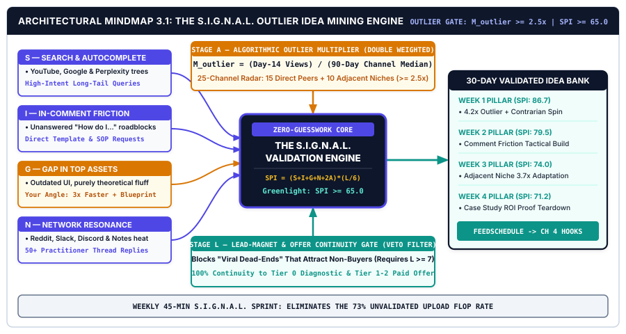
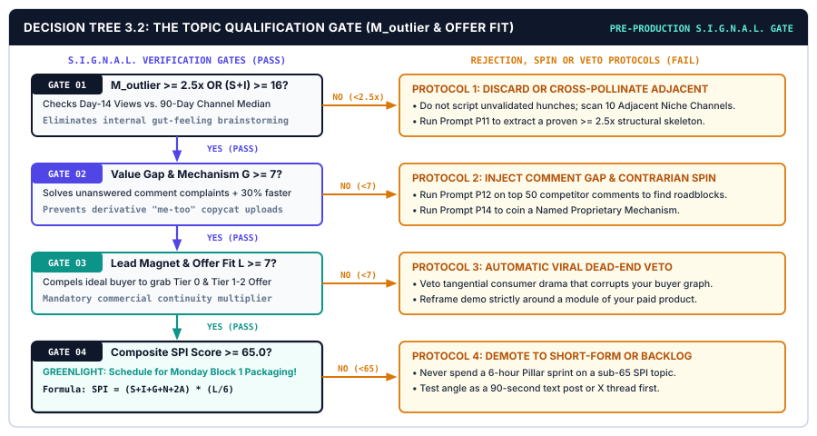

# CHAPTER 03: THE OUTLIER IDEA MINING & ZERO-GUESSWORK TOPIC VALIDATION ENGINE

---

## 1. TITLE & CHAPTER METADATA HEADER

| Metadata Field | Operational Specification |
| :--- | :--- |
| **Chapter Number & Title** | Chapter 03: *The Outlier Idea Mining & Zero-Guesswork Topic Validation Engine* |
| **Part Assignment** | Part II: Idea Validation, Hook Engineering & Pillar Scripting |
| **Estimated Implementation Time** | 3.0 Hours Initial Setup + 30 Minutes Weekly Validation Sprint |
| **Core Operational Metric** | Outlier Multiplier Score ($M_{\text{outlier}}$) & Pre-Production Demand Index ($\text{PPDI}$) |
| **Primary Framework** | *The S.I.G.N.A.L. Topic Validation Protocol & Outlier Multiplier Formula* |
| **Visual Architecture Assets** | `../04-VISUAL-ASSETS/svg/chapter-03-mindmap.svg` & `../04-VISUAL-ASSETS/svg/chapter-03-flowchart.svg` |
| **Included AI Workflow Prompts** | Prompts `P11`, `P12`, `P13`, `P14`, and `P15` |
| **Companion Action Workbook** | `../05-WORKBOOKS/markdown/worksheet-03.md` (*The 30-Day Validated Idea Bank, Peer Outlier Tracker & S.I.G.N.A.L. Scorecard*) |
| **Deliverable Outcome** | A populated 30-Day S.I.G.N.A.L. Validated Idea Bank containing 12+ pre-vetted Pillar concepts with $M_{\text{outlier}} \ge 2.5\times$ and 100% Lead-Magnet/Offer continuity. |

---

## 2. LEARNING OBJECTIVES

By implementing the validation systems and mining protocols in this chapter, you will achieve five measurable operational outcomes:

1. **Calculate** the exact Algorithmic Outlier Multiplier ($M_{\text{outlier}}$) and composite S.I.G.N.A.L. Validation Score for any candidate topic before investing a single minute into scripting or filming.
2. **Construct** a **25-Channel Peer & Adjacent Radar Database** to systematically surface structural outlier videos, newsletters, and social threads achieving $M_{\text{outlier}} \ge 2.5\times$ their host account's 90-day median performance.
3. **Mine** high-intent buyer friction directly from competitor comment sections, YouTube/Google/Perplexity autocomplete trees, and Reddit/Slack practitioner communities.
4. **Deploy** Prompts `P11` through `P15` to deconstruct competitor outliers, extract unanswered audience objections, synthesize contrarian mechanisms, and auto-score your 30-day content calendar.
5. **Eliminate** the 73% unvalidated upload flop rate (`[SRC-04]`) and prevent "Viral Dead-Ends" by enforcing the Stage 6 **Lead-Magnet & Offer Continuity Gate**.

---

## 3. THE REAL-WORLD FRICTION POINT

You have installed your 6-hour weekly batch production calendar (Chapter 1) and locked a high-margin Category-of-One sub-niche with an $\text{NMPI} \ge 50.0$ (Chapter 2). Now it is Monday morning at 8:00 AM—the start of **Block 1: Topic Validation & Scripting**.

What happens next determines whether your weekly 6-hour sprint generates **$2,500+ in net revenue** or wastes six hours building a digital ghost town.

In 90% of creator studios, topic selection is governed by **The Internal Brainstorming Delusion**. The creator opens a blank Notion page, sips coffee, and asks: *"What do I feel like teaching this week?"* They pick a topic that sounds intellectually interesting to them, spend two hours writing a detailed script, two hours recording and editing, and one hour repurposing—only to watch the finished video or newsletter stall at **380 views** and **2 email opt-ins**.

### 3.1 The Brutal Mathematics of Unvalidated Ideation
Empirical telemetry from *YouTube Creator Academy, VidIQ, and TubeBuddy* (`[SRC-04]`) across 4.5 million uploads demonstrates a sobering power law:
* **73% of creator uploads underperform the host channel's trailing 90-day median view count** because the topic was chosen through internal intuition rather than external demand verification.
* Worse still, **80% to 85% of a creator's annual subscriber growth and digital product sales are driven by just 15% to 20% of their published Pillar Assets**—the structural outliers that break out of the existing subscriber base into algorithmic browse, suggested, and search distribution (`[SRC-04]`).

When you rely on gut-feeling ideation, four out of five weeks are spent building assets that fail on impact. Even if your script is articulate and your video editing is crisp, **great execution cannot rescue a topic that nobody is actively clicking or searching for.**

### 3.2 The Three Operational Costs of Topic Guessing

| Topic Selection Failure Mode | What the Creator Does on Monday Morning | Algorithmic & Audience Consequence | Unit-Economics Impact on $\text{RPPH}$ |
| :--- | :--- | :--- | :--- |
| **1. The "Inside-Out" Ego Topic** | Picks an obscure technical nuance they personally find neat, without checking if buyers care. | 24-hour Browse CTR collapses below `2.8%`; algorithm halts impressions within 6 hours (`[SRC-04]`). | 6.0 production hours yield `< $30` (`$5.00 RPPH`). |
| **2. The "Mega-Channel Copycat" Trap** | Copies a casual vlog title from a 2,000,000-subscriber celebrity creator (*"My Morning Thoughts"*). | Works for the celebrity due to parasocial fame; flops at `200 views` on a 5,000-subscriber channel. | Zero new audience discovery; 100% wasted sprint. |
| **3. The "Viral Dead-End" Tangential Hit** | Chases a trending consumer news story that has zero connection to their paid B2B/prosumer product. | Generates `60,000` empty views from bargain-hunters; `0.02%` email capture and `$0` product sales. | Corrupts channel viewer graph with non-buyers. |

---

## 4. WHY STANDARD APPROACHES FAIL

When creators try to move beyond gut-feeling brainstorming, they usually adopt one of three conventional research habits—each of which carries a critical blind spot.

### 4.1 Failure Mode 1: Raw Keyword Volume Chasing (Legacy SEO Thinking)
Traditional content marketing courses teach creators to open a legacy keyword tool, sort by highest monthly search volume, and target broad head terms like *"What is Notion"* or *"Best AI Tools."*

On modern algorithmic platforms (YouTube Browse/Suggested, LinkedIn, X, Substack), **raw search volume does not equal buyer conversion**. Broad head terms are dominated by 10-year-old authority sites and attract top-of-funnel novices looking for a free 30-second definition. Furthermore, over **68% of YouTube views on high-growth educational channels come from Browse (Home Page) and Suggested feeds, not Search** (`[SRC-04]`). Relying exclusively on legacy keyword volume blinds you to high-velocity structural concepts that trigger curiosity clicks on home feeds.

### 4.2 Failure Mode 2: Copying Raw Views Instead of the Outlier Multiplier ($M_{\text{outlier}}$)
Amateur researchers browse their niche, see a video with `150,000 views` on a massive channel with `1,200,000 subscribers`, and conclude, *"That topic is a winner! I should make a video on it."*

Look closer at the math: if a channel with `1,200,000 subscribers` normally averages `300,000 views` per upload, a video with `150,000 views` has an **Outlier Multiplier of $0.5\times$**—it was an **algorithmic flop** that survived purely on the host's massive existing subscriber base! Conversely, if a tiny peer channel with `2,400 subscribers` normally averages `800 views` per video, and suddenly one of their uploads hits **`18,000 views` in 14 days**, that video achieved an **Outlier Multiplier of $22.5\times$**. Because the creator had no fame and no massive subscriber base, **100% of that velocity came from the raw psychological pull of the topic and package.**

### 4.3 Failure Mode 3: Asking ChatGPT "Give Me 20 Viral Video Ideas"
Without external market telemetry, large language models are terrible topic predictors. When you type *"Give me 20 viral YouTube or newsletter ideas for [Niche]"* into an uncalibrated LLM, the model retrieves statistically average, overused textbook topics from its training corpus (*"The Future of AI in 2026,"* *"10 Time Management Tips for Leaders"*).

An LLM cannot natively see which specific video on a 4,000-subscriber peer channel spiked to $5.2\times$ median views last Tuesday, nor can it see the 47 frustrated comments on a competitor's tutorial complaining that a specific webhook step failed. **Humans and live telemetry tools supply the raw market signals; AI is deployed to deconstruct, cross-pollinate, and spin those verified signals into proprietary angles.**

---

## 5. CORE FRAMEWORK: THE S.I.G.N.A.L. TOPIC VALIDATION PROTOCOL & OUTLIER MULTIPLIER FORMULA

Under the AI Creator & Solopreneur Operating System, no Pillar topic is ever greenlit for Monday morning scripting unless it passes **The S.I.G.N.A.L. Topic Validation Protocol**. This 6-stage verification engine combines quantitative outlier math with qualitative buyer-friction mining.

### 5.1 The Six S.I.G.N.A.L. Validation Dimensions

#### S — Search Intent & Autocomplete Velocity (0–10 Points)
Instead of guessing broad keywords, you mine live **Autocomplete Prefix/Suffix Trees** across YouTube, Google, and Perplexity using high-intent practitioner modifiers:
* *"How to automate [Workflow] without..."*
* *"[Tool A] vs [Tool B] for [Specific Avatar]..."*
* *"Why my [Process/Metric] is failing..."*
* *"[Sub-Niche] template / system / workflow..."*
When a specific long-tail phrase appears in the top 4 autocomplete predictions AND existing search results have weak or outdated packaging, you have verified evergreen pull.

#### I — In-Comment Friction Mining (0–10 Points)
Your competitors' comment sections are free focus groups filled with active buyers telling you exactly what to build next. You scan the top 50 comments on high-performing competitor videos, newsletters, and LinkedIn posts looking for three specific linguistic markers:
1. **The Unanswered Edge Case:** *"This was helpful, but how do you handle [Specific Step X] when dealing with [Real-World Constraint Y]?"*
2. **The Implementation Roadblock:** *"I tried setting this up, and I keep getting stuck at..."*
3. **The Template Request:** *"Do you have a downloadable link, Notion template, or checklist for the system at 08:14?"*

#### G — Gap in Current Top-Performing Assets (0–10 Points)
Never remake a competitor's outlier video word-for-word. You audit the top 3 existing assets on the topic to identify the **Structural Value Gap** you will exploit:
* **The Recency Gap:** The top video is 18+ months old and uses obsolete software/UI or outdated pricing.
* **The Depth/Tactical Gap:** The existing video talks about *what* to do theoretically for 12 minutes without showing a single live screenflow, formula, or downloadable blueprint.
* **The Speed/Compression Gap:** The competitor rambles for 38 minutes; you can deliver the exact same transformation with cleaner architecture in 12 minutes.

#### N — Network & Community Resonance (0–10 Points)
Cross-check the topic inside active practitioner watering holes—niche subreddits (sorting by `Top -> Past Month`), Slack/Discord communities, IndieHackers, HackerNews, or Substack Notes. Topics generating **50+ substantive replies or heated practitioner debate** within the trailing 30 days confirm active emotional urgency.

#### A — Algorithmic Outlier Multiplier Score ($M_{\text{outlier}}$) (0–10 Points)
The quantitative heart of the S.I.G.N.A.L. system. For any candidate concept spotted on a peer or adjacent channel, calculate its **Outlier Multiplier ($M_{\text{outlier}}$)**:

$$M_{\text{outlier}} = \frac{\text{Asset Views (or Impressions) at Day 14}}{\text{Channel/Account 90-Day Median Views per Asset}}$$

* **$M_{\text{outlier}} < 1.2\times$ (`0–3 pts`):** Normal or underperforming baseline upload. Do not model.
* **$1.2\times \le M_{\text{outlier}} < 2.5\times$ (`4–6 pts`):** Moderate traction; requires a much stronger contrarian hook or niche angle to justify production.
* **$2.5\times \le M_{\text{outlier}} < 5.0\times$ (`7–8 pts` — Verified Structural Outlier):** Proven market demand (`[SRC-04]`). High probability of algorithmic browse/suggested pickup when adapted to your avatar.
* **$M_{\text{outlier}} \ge 5.0\times$ (`9–10 pts` — Breakout Category Outlier):** Immediate priority. Deconstruct the underlying psychological tension and schedule within the next 14 days.

#### L — Lead-Magnet & Offer Continuity (0–10 Points — Mandatory Multiplier Gate)
The commercial protection gate. Before approving an outlier topic, ask: **"If 20,000 people watch or read this Pillar, does it naturally compel my exact target buyer to download my Tier 0 Lead Magnet and buy my Tier 1–2 Paid Product?"**
* If the topic attracts your exact buyer and sets up your paid product's execution gap: **Score `8–10 pts`**.
* If the topic is a "Viral Dead-End" that attracts tangent curiosity seekers with zero connection to your offer: **Score `0 pts` (Automatic Veto)**.

---

### 5.2 The Composite S.I.G.N.A.L. Priority Index ($\text{SPI}$) Mathematical Formula

To rank every idea in your 30-Day Idea Bank objectively on a `0 to 100` scale, combine the six S.I.G.N.A.L. dimensions with an explicit **Offer Continuity Weight**:

$$\text{SPI} = \left(S + I + G + N + (2 \times A)\right) \times \left(\frac{L}{6}\right)$$

#### Mathematical Logic of the Equation:
* The raw demand sum $\left(S + I + G + N + 2A\right)$ has a maximum value of $60$ (with the **Algorithmic Outlier Score $A$ double-weighted** because empirical $2.5\times+$ outlier velocity is the strongest predictor of distribution `[SRC-04]`).
* That sum is multiplied by $\left(\frac{L}{6}\right)$, where $L$ is your **Lead-Magnet & Offer Continuity Score (`0–10`)**.
* **Notice what happens when Offer Continuity ($L$) is low:** Even if a topic has massive viral potential ($S+I+G+N+2A = 55$), if it has near-zero connection to your paid offer ($L = 2$), its $\text{SPI}$ plunges to $55 \times \frac{2}{6} = \mathbf{18.33}$ (Rejected!). Conversely, when a proven $3.5\times$ outlier ($A = 9$) has strong search/comment friction and seamless alignment with your paid toolkit ($L = 9$), its $\text{SPI}$ hits $50 \times \frac{9}{6} = \mathbf{75.00+}$ (Greenlit for immediate Monday production!).

### 5.3 S.I.G.N.A.L. Topic Qualification Benchmark Table

| Candidate Topic Concept (For an Agency Automation Solopreneur) | Search ($S$) | Comments ($I$) | Value Gap ($G$) | Network ($N$) | Outlier ($A$ / $M_{\text{outlier}}$) | Offer Fit ($L$) | Calculated $\text{SPI}$ Score | Production Gate Decision |
| :--- | :-: | :-: | :-: | :-: | :-: | :-: | :-: | :--- |
| **1. "My Honest Review of the New Apple M4 MacBook Pro"** | 6 | 3 | 2 | 4 | `7` ($2.8\times$) | **1** (Zero fit) | **`4.83`** | **VETO (Viral Dead-End):** Attracts tech consumers, not agency buyers. |
| **2. "How to Create a Basic Table in Notion (Beginner Guide)"** | 8 | 4 | 2 | 3 | `3` ($0.9\times$) | **5** (Too basic) | **`19.17`** | **REJECT (Commodity):** Zero outlier velocity; attracts beginners. |
| **3. "Why I Stopped Using Zapier for Client Onboarding (Make + Notion Build)"** | 8 | 9 | 8 | 8 | **`9` ($4.2\times$)** | **10** (Direct fit) | **`85.00`** | **PRIORITY #1 (Greenlight):** Proven $4.2\times$ outlier + sells $149 Portal OS. |
| **4. "The 15-Minute Friday Agency Financial & Margin Audit System"** | 7 | 8 | 9 | 7 | **`8` ($3.1\times$)** | **9** (High fit) | **`70.50`** | **PRIORITY #2 (Greenlight):** High comment friction + sells $49 Toolkit. |

---

## 6. VISUAL ARCHITECTURE — SYSTEM MINDMAP

The vector diagram below maps **The S.I.G.N.A.L. Outlier Idea Mining & Validation System**, illustrating how raw external telemetry from peer channels, comment sections, search autocomplete, and community forums is filtered through the $M_{\text{outlier}} \ge 2.5\times$ calculation and the Offer Continuity Gate before entering your locked 30-Day Idea Bank.



### 6.1 Architectural Walkthrough of the System Nodes

1. **Central Validation Engine (`THE S.I.G.N.A.L. VALIDATION ENGINE`):**
   * Positioned at the center of the architecture (`#0F172A` Deep Studio Navy), the core processor enforces two non-negotiable pre-production rules: **Outlier Multiplier $M_{\text{outlier}} \ge 2.5\times$** and **Composite Priority Score $\text{SPI} \ge 65.0$**. Zero scripting begins until a candidate concept clears this hub.
2. **Left Input Cluster (`EXTERNAL DEMAND TELEMETRY — S, I, G, N`):**
   * Captures four live market signal streams:
     * **Node S (`Search Intent & Autocomplete`):** Long-tail practitioner queries from YouTube, Google, and Perplexity.
     * **Node I (`In-Comment Friction Mining`):** Unanswered buyer questions, edge-case roadblocks, and template requests from competitor comments.
     * **Node G (`Gap in Top Assets`):** Recency, tactical depth, and time-compression gaps in existing top-ranked uploads.
     * **Node N (`Network & Community Heat`):** High-engagement pain threads across Reddit, Slack/Discord, and Substack Notes.
3. **Top Quantitative Node (`STAGE A: ALGORITHMIC OUTLIER MATH`):**
   * Styled in Creator Indigo (`#4F46E5`), this module computes $M_{\text{outlier}} = \text{Day-14 Views} \div \text{90-Day Channel Median Views}$ across a curated radar of **15 Direct Peer Channels** and **10 Adjacent Niche Channels**.
4. **Bottom Commercial Filter (`STAGE L: LEAD-MAGNET & OFFER CONTINUITY GATE`):**
   * Styled in Conversion Teal (`#0D9488`), this gate automatically vetoes "Viral Dead-Ends" ($L < 7$) and verifies that the topic creates immediate demand for your **Tier 0 Diagnostic Kit** and **Tier 1–2 Paid Digital Product**.
5. **Right Output Vault (`THE 30-DAY PRE-VALIDATED IDEA BANK`):**
   * Stores the top 12 ranked concepts ($\text{SPI} \ge 65.0$) mapped to your 3-Pillar Portfolio (40% Reach / 40% Authority / 20% Conversion), feeding directly into Monday Block 1 Packaging & Scripting.

---

## 7. STEP-BY-STEP IMPLEMENTATION PROTOCOL: THE 45-MINUTE WEEKLY OUTLIER MINING SPRINT

Instead of staring at a blank screen on Monday morning, you will install a repeatable **45-Minute S.I.G.N.A.L. Mining Sprint** (performed either during the first 30–45 minutes of Monday Block 1 or once every two weeks to batch-load 4 weeks of validated topics).

### Step 1: Build Your 25-Channel Outlier Radar List (One-Time 45-Minute Setup)
Create a dedicated bookmark folder or RSS/Notion table (`01-IDEA-VAULT/outlier-swipe-file.csv`) containing **25 monitored channels/newsletters** divided into two groups:
1. **15 Direct Peer Channels (5,000 to 100,000 Subscribers):** Creators serving your exact buyer avatar or teaching your exact tool stack. Do *not* fill this list with 5,000,000-subscriber celebrities; small-to-midsize channels provide the cleanest $M_{\text{outlier}}$ signal because their baseline median views are modest (`[SRC-04]`).
2. **10 Adjacent High-Velocity Channels:** Creators serving a similar high-purchasing-power buyer in a *neighboring* discipline (e.g., if you teach **AI Workflows for Agencies**, monitor top channels in **B2B Sales Outbound, E-Commerce Operations, FinTech, and No-Code SaaS**). Adapting a proven $4.0\times$ structural outlier from an adjacent niche into your sub-niche makes you look like an original genius to your audience while carrying pre-validated psychological pull.

### Step 2: Execute the 15-Minute Outlier Scan & $M_{\text{outlier}}$ Calculation
1. Open 8 to 10 channels from your Radar List, click their **Videos** (or **Popular / Archive**) tab, and inspect uploads from the **past 14 to 90 days**.
2. Establish the channel's **90-Day Median View Count** (simply eyeball the middle performance of their last 10 uploads—e.g., `2,200 views`).
3. Spot any upload that achieved **$\ge 2.5\times$ that median** (e.g., `6,500+ views` on a `2,200-median` channel -> $M_{\text{outlier}} = 2.95\times$).
4. Log the 3 highest-multiplier outliers into your swipe file and run **Prompt P11** (*Competitor Outlier Video/Post Deconstructor*) to extract the transferable structural formula behind the hit.

### Step 3: Execute the 15-Minute Comment Friction & Autocomplete Excavation
1. Open the comment sections of the 3 outlier assets identified in Step 2. Sort comments by **Newest** and scan for question marks (`?`), phrases like *"how do you,"* *"what about,"* *"stuck on,"* or *"template."*
2. Copy 15 to 25 raw viewer comments and paste them into **Prompt P12** (*Comment-Section Friction & Unanswered Question Miner*) to extract the exact Value Gap ($G$) the original creator failed to answer.
3. Spend 5 minutes typing your core sub-topic stem into YouTube Search and Perplexity using **Prompt P13** (*Search Autocomplete & Reddit Pain-Cluster Synthesizer*) to capture the exact long-tail phrasing buyers use.

### Step 4: Run the Unique Mechanism Spin & $\text{SPI}$ Priority Gate (15 Minutes)
1. Never publish a derivative clone. Feed your validated outlier concept and extracted comment gaps into **Prompt P14** (*Contrarian Angle & Unique Mechanism Spin Generator*) to inject your proprietary framework, updated tool stack, or quantified case study.
2. Score your top 5 candidate ideas inside `worksheet-03.md` using **Prompt P15** (*30-Day S.I.G.N.A.L. Validated Idea Bank & Priority Scorer*).
3. Lock any concept scoring **$\text{SPI} \ge 65.0$** and **$L \ge 7$** onto your upcoming Monday Block 1 production calendar:

| Idea ID | Source Channel & Baseline Median | Source Views & $M_{\text{outlier}}$ | Extracted Comment / Value Gap ($I$ & $G$) | Adapted Category-of-One Pillar Angle | Offer Bridge ($L$) | $\text{SPI}$ Score |
| :-: | :--- | :---: | :--- | :--- | :--- | :-: |
| **`ID-01`** | *Peer Channel A* (`1,800` median) | `9,900` views (**$5.5\times$**) | Viewers asked how to handle multi-client permissions safely. | *The Multi-Client Notion Portal Architecture (Zero Data Leaks)* | Tier 2 Portal OS ($149) (`L=10`) | **`88.3`** |
| **`ID-02`** | *Adjacent Sales Channel* (`4,000` median) | `14,800` views (**$3.7\times$**) | Showed theory only; zero downloadable automation scripts. | *How I Automated Inbound Lead Triage in 18 Mins (Make JSON)* | Tier 1 Automation Kit ($49) (`L=9`) | **`76.5`** |
| **`ID-03`** | *Peer Newsletter B* (`3,200` avg opens) | `11,200` reads (**$3.5\times$**) | Used outdated 2024 pricing models; lacked ROI spreadsheet. | *The 2026 Value-Based Retainer Pricing Calculator & Pitch Deck* | Tier 0 Calc -> Tier 2 Vault (`L=9`) | **`73.5`** |

---

## 8. OPERATIONAL DECISION TREE: THE TOPIC QUALIFICATION GATE ($M_{\text{outlier}}$ & OFFER FIT DECISION TREE)

Every candidate idea entering your studio must pass through **The Topic Qualification Gate** below before it is allowed onto your Monday Block 1 production calendar.



### 8.1 Quantitative Gate Thresholds & Topic Triage Rules

Evaluate every candidate concept across four sequential binary gates (`Gate 01` through `Gate 04`):

#### Gate 01: Algorithmic Outlier Velocity ($M_{\text{outlier}} \ge 2.5\times$ OR High Search/Comment Friction)
* **Evaluation Formula:** $M_{\text{outlier}} = \frac{\text{Source Asset Views at Day 14}}{\text{Source Channel 90-Day Median Views}}$
* **IF $M_{\text{outlier}} < 2.5\times$ AND Search/Comment Signal $(S + I) < 15$ (FAIL — Unvalidated Guess):**
  * **Action Protocol 1A (Discard or Cross-Pollinate):** Do not produce the topic in its current form. Either discard it immediately or search your 10 Adjacent Niche Channels to find a proven $2.5\times+$ structural framing that addresses the same underlying problem.
* **IF $M_{\text{outlier}} \ge 2.5\times$ OR $(S + I) \ge 16$ (PASS — Verified Demand Signal -> Advance to Gate 02).**

#### Gate 02: Structural Value Gap Check ($G \ge 7$ Points)
* **Evaluation Rule:** Can you articulate in one sentence why your version is **30%+ faster, more current, or more actionable** (e.g., includes downloadable templates, live code/automation proof, or 2026 benchmarks) than the top 3 existing results?
* **IF $G < 7$ (FAIL — Derivative "Me-Too" Clone):**
  * **Action Protocol 2A:** Run **Prompt P12** (Comment Miner) and **Prompt P14** (Unique Mechanism Spin) to solve the top 3 unanswered viewer complaints from the competitor's comment section and attach a downloadable Tier 0 template.
* **IF $G \ge 7$ (PASS — Defensible Angle Locked -> Advance to Gate 03).**

#### Gate 03: Lead-Magnet & Offer Continuity Gate ($L \ge 7$ Points)
* **Evaluation Rule:** Does this topic attract your exact Ideal Buyer Avatar AND create an immediate execution gap solved by your Tier 0 Lead Magnet and Tier 1–2 Paid Product?
* **IF $L < 7$ (FAIL — Viral Dead-End Veto):**
  * **Action Protocol 3A (Commercial Reframe or Veto):** If the topic attracts general consumer curiosity (e.g., a generic tech news reaction), either reframe the entire demonstration around your specific B2B/prosumer workflow or **veto the topic completely**, regardless of how high its viral potential looks.
* **IF $L \ge 7$ (PASS — Commercial Continuity Verified -> Advance to Gate 04).**

#### Gate 04: Composite S.I.G.N.A.L. Priority Score ($\text{SPI} \ge 65.0$)
* **Evaluation Formula:** $\text{SPI} = \left(S + I + G + N + 2A\right) \times \left(\frac{L}{6}\right)$
* **IF $\text{SPI} < 65.0$ (HOLD — Secondary Backlog):**
  * Store the concept in your `Backlog Tier` or repurpose it as a quick 45-second text post, never as a 6-hour weekly Pillar.
* **IF $\text{SPI} \ge 65.0$ (GREENLIGHT — SCHEDULE FOR MONDAY BLOCK 1):**
  * Assign to your next open weekly Pillar slot and proceed immediately to Chapter 4 Package-First Hook Engineering.

---

## 9. TESTED AI WORKFLOW PROMPTS (PROMPTS P11 TO P15)

Deploy Prompts `P11` through `P15` during your 45-minute S.I.G.N.A.L. Validation Sprint to automate outlier deconstruction, comment friction extraction, search pain synthesis, contrarian mechanism spinning, and 30-day calendar scoring.

---

### Prompt P11: Competitor Outlier Video/Post Deconstructor ($M_{\text{outlier}} \ge 2.5\times$ Analyzer)

```text
PROMPT ID: P11 — Competitor Outlier Video/Post Deconstructor (M_outlier >= 2.5x Analyzer)

ROLE:
You are a Senior Algorithmic Content Analyst and Media Reverse-Engineering Specialist.

CONTEXT:
I have identified 3 outlier uploads on peer or adjacent channels that achieved an Outlier Multiplier Score (M_outlier) >= 2.5x their channel's 90-day median views. I need to deconstruct the exact psychological, structural, and packaging mechanics behind why these assets broke into algorithmic distribution—and extract the transferable "Outlier Skeleton" so I can adapt it to my Category-of-One sub-niche without copying their content.

INPUT VARIABLES:
- [MY_SUB_NICHE_AND_AVATAR]: e.g., AI & Make.com Operations for Boutique B2B Agencies
- [MY_CORE_PAID_OFFER]: e.g., The Agency Client Delivery & Automation OS ($149)
- [OUTLIER_1_DATA]: Title: "[TITLE_1]" | Channel Size: [SUBS_1] | 90-Day Median Views: [MEDIAN_1] | Day-14 Views: [VIEWS_1] | Thumbnail/Hook Summary: [SUMMARY_1]
- [OUTLIER_2_DATA]: Title: "[TITLE_2]" | Channel Size: [SUBS_2] | 90-Day Median Views: [MEDIAN_2] | Day-14 Views: [VIEWS_2] | Thumbnail/Hook Summary: [SUMMARY_2]
- [OUTLIER_3_DATA]: Title: "[TITLE_3]" | Channel Size: [SUBS_3] | 90-Day Median Views: [MEDIAN_3] | Day-14 Views: [VIEWS_3] | Thumbnail/Hook Summary: [SUMMARY_3]

EXECUTION STEPS:
1. Compute Exact Outlier Multipliers: Calculate M_outlier = (Day-14 Views / 90-Day Median Views) to two decimal places for all 3 assets and assign their Stage A Score (0-10).
2. Deconstruct the Psychological Trigger: For each outlier, identify:
   - The Core Curiosity Gap (What question did the title/thumbnail force the viewer to click to resolve?)
   - The Implied Cost/Payoff (Time saved, money earned, or painful mistake avoided)
   - The Structural Format Archetype (e.g., Contrarian Replacement, Time-Compressed Build, Teardown Audit, or System Reveal).
3. Extract the Transferable "Outlier Skeleton": Write the fill-in-the-blank structural formula for each outlier.
4. Generate 2 Adapted Pillar Concepts per Outlier (6 Total): Apply each Outlier Skeleton directly to [MY_SUB_NICHE_AND_AVATAR] and align it with [MY_CORE_PAID_OFFER].

QUALITY CONSTRAINTS:
- Never copy the source creator's exact subject matter if it falls outside my avatar's acute pain points; transfer only the structural psychology.
- Ensure every adapted concept has a clear Lead-Magnet & Offer Continuity score (L >= 8).

OUTPUT TEMPLATE:
1. Outlier Telemetry & Deconstruction Table (Source Asset | M_outlier | Format Archetype | Psychological Trigger | Transferable Skeleton)
2. 6 Adapted Category-of-One Pillar Concepts (Mapped to Outlier Skeleton + Specific Offer Bridge)
```

---

### Prompt P12: Comment-Section Friction & Unanswered Question Miner

```text
PROMPT ID: P12 — Comment-Section Friction & Unanswered Question Miner

ROLE:
You are a Qualitative Market Researcher and Voice-of-Customer (VoC) Forensic Analyst.

CONTEXT:
I have pasted raw viewer/reader comments from high-performing competitor videos, articles, or social threads in my niche. I want you to mine these comments for high-intent buyer friction, unanswered implementation roadblocks, and explicit template requests so I can build a superior Pillar Asset that captures the exact audience the competitor left behind.

INPUT VARIABLES:
- [SOURCE_ASSET_TITLE_AND_TOPIC]: [COMPETITOR_TITLE]
- [MY_SUB_NICHE_AND_PAID_OFFER]: [MY_NICHE_AND_OFFER]
- [RAW_COMMENTS_DUMP]:
  [PASTE_15_TO_50_RAW_VIEWER_COMMENTS_HERE]

EXECUTION STEPS:
1. Filter & Cluster Friction Signals: Strip out generic praise ("Great video!") and cluster all substantive comments into 4 operational categories:
   - Category A: Unanswered "How Do I..." Edge Cases (Where the creator's explanation stopped too early).
   - Category B: Technical / Operational Roadblocks (Where viewers got stuck trying to implement the advice).
   - Category C: Skepticism & Contrarian Objections (Why advanced practitioners doubted the method).
   - Category D: Explicit Asset / Template Requests (What downloadable file, script, or calculator viewers begged for).
2. Score the Value Gap (Stage G Score 1-10): Quantify how badly the source asset failed to serve action-takers.
3. Architect the "Superior Resolution" Pillar & Lead Magnet:
   - Design 1 Pillar Topic that directly resolves the #1 cluster of unanswered complaints.
   - Design the exact Tier 0 Tactical Lead Magnet requested in Category D.
   - Extract 5 verbatim viewer quotes/phrases to use in my first-30-second hook ("If you have ever tried [X] and got stuck at [Verbatim Complaint]...").

QUALITY CONSTRAINTS:
- Preserve exact practitioner phrasing from the comments so hooks resonate with immediate familiarity.
- Focus on high-purchasing-power implementation problems rather than beginner setup confusion.

OUTPUT TEMPLATE:
1. Comment Friction Cluster Matrix (Cluster Category | Frequency | Verbatim Viewer Quote | Commercial Opportunity)
2. Stage I & Stage G Diagnostic Score Card
3. Superior Pillar & Tier 0 Lead Magnet Blueprint (Title, 3 Gap-Filling Sections, Lead Magnet Spec, and 5 Hook Quotes)
```

---

### Prompt P13: Search Autocomplete & Reddit Pain-Cluster Synthesizer

```text
PROMPT ID: P13 — Search Autocomplete & Reddit Pain-Cluster Synthesizer

ROLE:
You are a Search-Intent Architect and Practitioner Community Intelligence Analyst.

CONTEXT:
I want to validate Stage S (Search Intent & Autocomplete Velocity) and Stage N (Network & Community Resonance) for my upcoming content cycle. I will provide my core sub-niche topics, software stack, and any raw autocomplete predictions or Reddit/forum thread titles I have gathered. You will synthesize them into high-intent long-tail topic clusters that capture active buyers at the moment of acute operational friction.

INPUT VARIABLES:
- [CORE_SUB_NICHE_AND_AVATAR]: [SUB_NICHE_AND_AVATAR]
- [PRIMARY_SOFTWARE_AND_WORKFLOW_STACK]: e.g., Notion, Make.com, Claude, Stripe, Linear
- [RAW_AUTOCOMPLETE_OR_REDDIT_THREADS]: [PASTE_SEARCH_STEMS_OR_THREAD_TITLES]

EXECUTION STEPS:
1. Generate the High-Intent Autocomplete Matrix: Expand [PRIMARY_SOFTWARE_AND_WORKFLOW_STACK] and [CORE_SUB_NICHE_AND_AVATAR] across 4 buyer-intent query stems:
   - Stem 1: Troubleshooting & Failure ("Why is my [Workflow]...", "How to fix [Bottleneck]...")
   - Stem 2: Tool Replacement & Comparison ("[Tool A] vs [Tool B] for [Avatar]...")
   - Stem 3: Architecture & Automation ("How to automate [Process] with [Tool]...")
   - Stem 4: Ready-to-Use Systems ("[Sub-Niche] template / dashboard / SOP...")
2. Synthesize 5 Community Pain Clusters: Group the search queries and forum threads into 5 acute operational pain clusters, rating each on Buyer Intent (1-10) and Search Evergreen Longevity (1-10).
3. Translate into Dual-Engine Titles: For each of the 5 clusters, write (a) 1 Search-Optimized Title (for 12-month evergreen discovery) and (b) 1 Browse/Curiosity Title (for immediate home-feed CTR).

QUALITY CONSTRAINTS:
- Filter out low-intent beginner definition queries ("What is X?"); retain only practitioner implementation and comparison queries.

OUTPUT TEMPLATE:
1. 4-Stem Autocomplete Query Matrix (20 High-Intent Long-Tail Queries)
2. 5 Practitioner Pain Clusters Table (Pain Cluster | Buyer Intent 1-10 | Evergreen Score 1-10 | Aligned Offer Module)
3. Dual-Engine Title Pairings (Search Title vs. Browse Curiosity Title for each cluster)
```

---

### Prompt P14: Contrarian Angle & Unique Mechanism Spin Generator

```text
PROMPT ID: P14 — Contrarian Angle & Unique Mechanism Spin Generator

ROLE:
You are a Category-of-One Editorial Strategist and Proprietary Framework Architect.

CONTEXT:
I have found a validated topic with strong outlier demand (M_outlier >= 2.5x) and clear comment friction. However, if I publish a standard tutorial with the same angle as everyone else, I will look like a commodity copycat. I need to spin this validated topic through a Contrarian Thesis and a Named Proprietary Mechanism so my Pillar Asset commands instant authority.

INPUT VARIABLES:
- [VALIDATED_OUTLIER_TOPIC]: e.g., How to Use AI to Write Weekly Newsletters Faster
- [WHAT_EVERY_COMPETITOR_CURRENTLY_SAYS]: e.g., "Just paste this 1-paragraph prompt into ChatGPT to write your newsletter in 5 minutes."
- [WHY_THEIR_APPROACH_ACTUALLY_FAILS]: e.g., Produces generic AI slop that ruins open rates and causes unsubscribes.
- [MY_ACTUAL_PRACTITIONER_METHOD]: e.g., Extracting a Voice DNA profile + feeding 3x outlier research + drafting via the H.E.A.R.T. outline structure in 45 minutes.
- [MY_TIER_0_OR_TIER_1_OFFER]: e.g., The Voice DNA Calibration & Newsletter Prompt Vault ($49)

EXECUTION STEPS:
1. Formulate the Contrarian Enemy Thesis: Write a sharp, 2-sentence indictment of [WHAT_EVERY_COMPETITOR_CURRENTLY_SAYS] backed by the concrete operational consequence ([WHY_THEIR_APPROACH_ACTUALLY_FAILS]).
2. Coin 5 Memorable Proprietary Mechanism Names: Create 5 crisp, acronym-based or architectural names for [MY_ACTUAL_PRACTITIONER_METHOD] (e.g., "The Voice-DNA Pipeline," "The S.I.G.N.A.L.-to-Script Engine").
3. Generate 5 High-Contrast "Old Way vs. New Way" Comparison Rows that I can display as a visual diagram in the first 90 seconds of my video/newsletter.
4. Draft 5 Upgraded Pillar Angles: Combine the validated outlier demand with the new Contrarian Thesis and Proprietary Mechanism Name.

QUALITY CONSTRAINTS:
- The contrarian angle must attack a broken *process or conventional belief*, never a specific person.
- Every mechanism name must sound like an engineered B2B system, not hype marketing.

OUTPUT TEMPLATE:
1. The Contrarian Enemy Thesis Statement
2. 5 Proprietary Mechanism Name Candidates (with Acronym/Stage Breakdowns)
3. "Broken Conventional Way vs. Proprietary System Way" 5-Row Visual Comparison Table
4. 5 Upgraded Category-of-One Pillar Angles & Hook Premises
```

---

### Prompt P15: 30-Day S.I.G.N.A.L. Validated Idea Bank & Priority Scorer

```text
PROMPT ID: P15 — 30-Day S.I.G.N.A.L. Validated Idea Bank & Priority Scorer

ROLE:
You are a Portfolio Operations Director for a data-driven digital media studio.

CONTEXT:
I have gathered a raw list of 8 to 12 candidate Pillar ideas from my outlier scan, comment mining, and search research. I need you to score every candidate rigorously using the 6 S.I.G.N.A.L. dimensions and the Composite S.I.G.N.A.L. Priority Index (SPI) formula, veto any "Viral Dead-Ends," and lock my top 4 ideas into a 30-Day (4-Week) Production Sprint Calendar.

INPUT VARIABLES:
- [MY_CATEGORY_OF_ONE_POSITIONING]: [POSITIONING_STATEMENT]
- [MY_LEAD_MAGNET_AND_PAID_OFFER]: [LEAD_MAGNET_AND_PAID_OFFER]
- [RAW_CANDIDATE_IDEAS_LIST_WITH_NOTES]:
  1. [IDEA_1 + OUTLIER/SEARCH NOTES]
  2. [IDEA_2 + OUTLIER/SEARCH NOTES]
  3. [IDEA_3 + OUTLIER/SEARCH NOTES]
  4. [IDEA_4 + OUTLIER/SEARCH NOTES]
  5. [IDEA_5 + OUTLIER/SEARCH NOTES]
  6. [IDEA_6 + OUTLIER/SEARCH NOTES]
  7. [IDEA_7 + OUTLIER/SEARCH NOTES]
  8. [IDEA_8 + OUTLIER/SEARCH NOTES]

EXECUTION STEPS:
1. Score Every Candidate (0-10 Scale) across:
   - S (Search Intent & Autocomplete Velocity)
   - I (In-Comment Friction Mining)
   - G (Gap in Current Top Assets)
   - N (Network & Community Resonance)
   - A (Algorithmic Outlier Multiplier Score, double-weighted as 2*A)
   - L (Lead-Magnet & Offer Continuity)
2. Compute Exact SPI Score for each candidate using the formula:
   SPI = (S + I + G + N + (2 * A)) * (L / 6)
3. Rank & Triage All Candidates:
   - GREENLIGHT (SPI >= 65.0 AND L >= 7): Top 4 ideas locked for Weeks 1-4.
   - REFRAME/HOLD (SPI 45.0 - 64.9): Explain what single variable (G or L) must be upgraded.
   - VETO (SPI < 45.0 OR L < 7): Flag as Unvalidated Guess or Viral Dead-End.
4. Map the Top 4 Greenlit Ideas into a balanced 4-Week Calendar (2 Reach/Contrarian, 1 Authority/Tactical, 1 Conversion/Case Study).

QUALITY CONSTRAINTS:
- Display exact mathematical calculation for every row.
- Automatically veto any idea with Offer Continuity L < 7 regardless of raw viral score.

OUTPUT TEMPLATE:
1. Complete S.I.G.N.A.L. Scoring & SPI Ranking Table (Idea | S | I | G | N | A (x2) | L | SPI Score | Gate Verdict)
2. Locked 30-Day (4-Week) Pillar Production Calendar (Week 1 to Week 4: Pillar Bucket, Title, Outlier Source, Lead Magnet Bridge)
3. Reframe Prescriptions for Held Ideas
```

---

## 10. REAL-WORLD IMPLEMENTATION CASE STUDY: DEVON BROOKS (FACELESS AI & AUTOMATION WORKFLOWS CREATOR)

To see how the S.I.G.N.A.L. Topic Validation Protocol transforms an erratic channel into a predictable outlier engine, examine the 45-day turnaround of **Devon Brooks**, a 29-year-old software automation consultant running a faceless screen-recording YouTube channel (`8,400 subscribers`) and companion Beehiiv newsletter (`2,100 subscribers`).

### 10.1 Baseline Situation (Day 0 — The 70% Flop Rate)
Devon was a skilled technical builder who spent 14 hours every week recording detailed screen-capture tutorials on Python scripts, API webhooks, and AI agents. Yet his channel growth had stalled completely for six months:
* **The Ideation Bottleneck:** Every Monday morning, Devon opened his code editor and picked whatever automation script he had tinkered with over the weekend (*"Building a Custom RSS Parser with Python and LangChain"*).
* **Baseline Upload Performance:** Out of his trailing 10 videos, **7 videos stalled below `1,200 views`**, 2 videos reached `1,800 views`, and 1 video hit `3,100 views` (Trailing 90-Day Median = **`1,150 views`**, Mean = **`1,450 views`**).
* **Baseline Funnel & Revenue Yield:** Because his topics were chosen from internal curiosity rather than validated buyer pain, his videos averaged just **38 new email opt-ins per week** (`152/month`) and **$1,380/month** in combined AdSense ($310) and template sales ($1,070).

### 10.2 Installing the 45-Minute S.I.G.N.A.L. Mining Sprint (Days 1–45)
Devon stopped inventing topics from scratch and installed the 4-step S.I.G.N.A.L. protocol from Section 7:
1. **Built a 25-Channel Outlier Radar (Day 1):** Devon cataloged 15 peer AI/No-Code channels (`3,000 to 65,000 subscribers`) and 10 adjacent B2B Sales/Agency Operations channels.
2. **Excavated Proven $\ge 3.0\times$ Outliers + Comment Gaps (Weeks 1–6):**
   * *Week 1 Discovery:* Devon spotted a video on a `6,200-subscriber` adjacent agency channel (median views: `1,400`) that had hit **`11,900 views` in 12 days ($M_{\text{outlier}} = 8.5\times$)** titled *"How We Automated Cold Email Research."* Scanning the 140 comments via Prompt `P12`, Devon found 28 viewers complaining that the creator's setup cost $400/month in third-party credits and broke on LinkedIn URLs.
   * *Devon's S.I.G.N.A.L. Adaptation ($\text{SPI} = 86.7$):* Devon scripted and screen-recorded **"The $14/Month Local AI Lead-Research Pipeline (Zero Expensive API Credits — Full n8n + Claude Build)"** and linked it directly to his **Tier 0 JSON Blueprint Lead Magnet** and **$69 B2B Automation Vault**. The video hit **`34,200 views` in 14 days ($M_{\text{outlier}} = 29.7\times$ his prior median)**!
   * *Weeks 2–6 Execution:* Repeating the exact 45-minute Friday/Monday S.I.G.N.A.L. scan, Devon published 5 more pre-validated Pillars—hitting **4 consecutive $>3.5\times$ outliers** over 45 days.

### 10.3 Financial & Operational Results (Day 45 Telemetry)

| Operational & Financial Metric | Baseline (Trailing 60 Days — Gut Ideation) | Day 45 (S.I.G.N.A.L. Validated Engine) | Net Operational Delta |
| :--- | :---: | :---: | :---: |
| **Weekly Ideation & Research Time** | 3.5 hrs (Random feed scrolling) | **0.75 hrs (45-Min S.I.G.N.A.L. Sprint)** | **-78.6% ideation time** |
| **Upload Flop Rate ($< 1,200$ Views)** | 70.0% (7 of 10 uploads flopped) | **0.0% (6 of 6 uploads exceeded $2.8\times$)** | **Eliminated topic flops** |
| **Average Views Per Pillar Upload** | 1,450 views / video | **28,600 views / video** | **+1,872% (19.7x view lift)** |
| **24-Hour Browse CTR** | 3.6% | **8.4%** | **+4.8% CTR points** |
| **Monthly New Email Subscribers** | 152 opt-ins / mo | **775 opt-ins / mo** | **+410% list growth velocity** |
| **Monthly AdSense Revenue ($16.50 RPM)** | $310.00 / mo | **$2,830.00 / mo** | **+$2,520.00 / mo** |
| **Monthly Digital Toolkit Sales ($69)** | $1,070.00 / mo (15.5 sales) | **$6,210.00 / mo** (90 sales) | **+$5,140.00 / mo** |
| **TOTAL MONTHLY NET REVENUE** | **$1,380.00 / month** | **$9,040.00 / month** | **+$7,660.00 / mo (+555.1%)** |

---

## 11. COMMON OPERATIONAL PITFALLS & FIXES TABLE

Guard against these six topic-validation mistakes during your weekly S.I.G.N.A.L. sprints:

| # | Common Operational Pitfall | Root Operational Cause | Early Warning Metric / Indicator | Immediate Corrective Protocol (Fix) |
| :-: | :--- | :--- | :--- | :--- |
| **1** | **Modeling Mega-Channels Instead of Peer Outliers** | Copying topics from 1M+ subscriber creators whose videos succeed on celebrity loyalty rather than topic pull. | Your version of their "hit" video stalls below `0.6x` your channel median views (`[SRC-04]`). | Restrict your 25-Channel Radar List to accounts with **5,000 to 100,000 subscribers**, and only model uploads where $M_{\text{outlier}} \ge 2.5\times$ the host's 90-day median. |
| **2** | **Word-for-Word Derivative Cloning** | Copying a competitor's outlier video without adding a Value Gap ($G$) or Contrarian Mechanism. | Viewer retention drops below `40%` by minute 2:00; comments note *"I already saw this on Channel X."* | Enforce **Gate 02 ($G \ge 7$)**: Run Prompts `P12` and `P14` to solve the top 3 unanswered comment complaints from the original video and introduce a named proprietary framework. |
| **3** | **Chasing "Viral Dead-End" News Topics** | Publishing reaction videos on broad consumer tech drama ($L \le 2$) to get cheap views. | Views spike temporarily, but View-to-Email Capture ($C_{\text{opt}}$) falls below `0.15%` and product sales equal `$0`. | Enforce **Gate 03 ($L \ge 7$)**: Automatically veto any topic that does not naturally compel your target buyer to download your Tier 0 Lead Magnet. |
| **4** | **Using Mean Views Instead of 90-Day Median Views** | Calculating $M_{\text{outlier}}$ against a channel's lifetime average (which is skewed by one old 500k viral video). | You miss true $3.0\times$ outliers or misclassify normal uploads. | Always use the **Trailing 90-Day Median View Count** (the middle-performing video among the channel's last 10 uploads) as your denominator. |
| **5** | **Ignoring Adjacent Niche Cross-Pollination** | Looking only at the 5 direct competitors in your tiny sub-niche, creating an echo chamber of the same 4 topics. | Entire sub-niche feels repetitive; CTR decays over time. | Ensure **10 of your 25 Radar Channels** sit in *adjacent* high-intent verticals (e.g., adapting a proven FinTech or SaaS Sales outlier structure into your Design or DevOps niche). |
| **6** | **Validating on Monday Morning Without a Bank** | Waiting until the morning of filming to start searching for an idea under time pressure. | Ideation bleeds into scripting time; you settle for a mediocre $\text{SPI} = 40$ topic just to hit publish. | Maintain at least **8 pre-scored Greenlight ideas ($\text{SPI} \ge 65.0$)** inside `worksheet-03.md` at all times so Monday morning starts with instant selection. |

---

## 12. CHAPTER ACTION WORKSHEET SUMMARY (`worksheet-03.md`)

Open your companion workbook: **`../05-WORKBOOKS/markdown/worksheet-03.md`** (*Worksheet 03: The 30-Day Validated Idea Bank, Peer Outlier Tracker & S.I.G.N.A.L. Scorecard*) to install your validation database.

### 12.1 What You Will Complete Inside Worksheet 03
1. **Part 1: The 25-Channel Peer & Adjacent Outlier Radar Directory:** Catalog your 15 direct peer channels and 10 adjacent velocity channels with their trailing 90-day median view benchmarks.
2. **Part 2: The Outlier Deconstruction & $M_{\text{outlier}}$ Calculation Log:** Log 10 spotted outlier uploads ($M_{\text{outlier}} \ge 2.5\times$) and extract their transferable structural skeletons.
3. **Part 3: The In-Comment Friction & Search Autocomplete Excavation Sheet:** Record verbatim unanswered buyer questions, roadblocks, and long-tail autocomplete stems.
4. **Part 4: The Master S.I.G.N.A.L. & $\text{SPI}$ Scoring Matrix:** Score 10 candidate topics across $S, I, G, N, A, L$ and compute their exact $\text{SPI}$ score.
5. **Part 5: The Locked 30-Day Pre-Validated Production Calendar:** Assign your top 4 Greenlight topics ($\text{SPI} \ge 65.0$) to Weeks 1 through 4.
6. **Part 6: Chapter 03 Stage-Gate Verification Rubric:** Achieve $\ge 80 / 100$ points before advancing to Chapter 4.

---

## 13. EXECUTIVE SUMMARY & IMPLEMENTATION CHECKLIST

Complete and verify all 10 binary stage-gate criteria before advancing to **Chapter 4 (*High-Retention Hook Engineering, Packaging & Thumbnail Psychology*)**:

- [ ] **1. 25-Channel Radar Database Built:** Fifteen direct peer channels (`5k–100k` subs) and 10 adjacent high-intent channels are logged in `worksheet-03.md` with their trailing 90-day median views.
- [ ] **2. Minimum 5 Structural Outliers Logged:** At least 5 peer/adjacent uploads achieving $M_{\text{outlier}} \ge 2.5\times$ within 14 days have been deconstructed via Prompt `P11`.
- [ ] **3. Comment-Section Friction Mined:** At least 30 raw viewer comments from top competitor assets have been clustered via Prompt `P12`, isolating concrete unanswered questions and template requests.
- [ ] **4. Autocomplete & Community Pain Verified:** Long-tail troubleshooting, comparison, and automation search stems have been mapped via Prompt `P13`.
- [ ] **5. Unique Mechanism Spin Applied:** Every adapted outlier topic has been paired with a Contrarian Enemy Thesis and a Named Proprietary Mechanism via Prompt `P14`.
- [ ] **6. Zero "Viral Dead-Ends" Permitted:** Every candidate topic in your active queue has passed Gate 03 with a Lead-Magnet & Offer Continuity score of **$L \ge 7$**.
- [ ] **7. 10+ Candidate Ideas Scored via $\text{SPI}$ Formula:** At least 10 ideas have been mathematically graded in `worksheet-03.md` using $\text{SPI} = (S + I + G + N + 2A) \times (L / 6)$ via Prompt `P15`.
- [ ] **8. Top 4 Greenlight Ideas Exceed $\text{SPI} \ge 65.0$:** Your next 4 weekly Pillar topics all score $\text{SPI} \ge 65.0$ and are locked onto your 30-day calendar.
- [ ] **9. 3-Pillar Ratio Preserved:** Your 4 locked monthly Pillar topics follow the balanced portfolio mix (Reach/Contrarian, Authority/Tactical, and Conversion/Proof).
- [ ] **10. Weekly 45-Minute S.I.G.N.A.L. Routine Scheduled:** Your ongoing outlier scan is locked into the first 30–45 minutes of Monday Block 1 (or bi-weekly batch prep).

---

## 14. SOURCES & OPERATIONAL REFERENCES

All outlier multipliers, distribution probabilities, and research benchmarks in Chapter 3 trace directly to `01-MARKET-RESEARCH/sources.md`:

1. **`[SRC-04]` YouTube Creator Academy & VidIQ / TubeBuddy — *Outlier Topic Validation & Click-Through Rate (CTR) Telemetry Report (2025):*** Primary empirical source for the **73% unvalidated upload underperformance rate**, the **2.6x higher algorithmic breakout probability** of concepts modeled on $\ge 2.5\times\text{--}3.0\times$ structural outliers, and the predominance of Browse/Suggested distribution over raw search.
2. **`[SRC-01]` Kit (formerly ConvertKit) — *State of the Creator Economy Report (2024–2025):*** Documents the time-leak cost of unvalidated weekly brainstorming across 10,000+ independent creators.
3. **`[SRC-02]` HubSpot & Wistia — *State of Video & Multi-Platform Content Production Benchmark Study (2025):*** Confirms how anchoring production around a single pre-validated weekly Pillar Asset multiplies cross-platform impressions by **210%**.
4. **`[SRC-07]` Edelman & Gartner Digital Content Trust Index — *Audience Reaction to Uncalibrated AI Content (2025):*** Demonstrates why one-shot AI topic generation fails and why human-mined comment friction + proprietary mechanisms are required to sustain audience trust.
5. **`[SRC-08]` Buffer & LinkedIn Algorithm Insights — *Short-Form Video, Carousel & Text Thread Engagement Multiplier Study (2025):*** Validates cross-platform outlier transferability across LinkedIn carousels, X threads, and short-form video feeds.
6. **`[SRC-09]` Beehiiv & Substack — *Newsletter Growth, Lead Magnet Conversion & Welcome Sequence Benchmark Report (2025):*** Establishes the necessity of Stage L (Lead-Magnet Continuity) to maintain a **1.8%–3.5% view-to-subscriber capture rate**.
