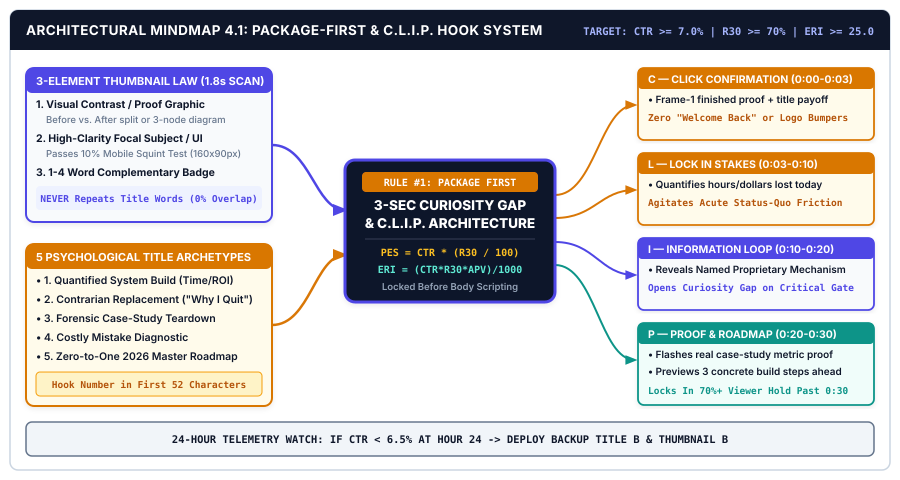
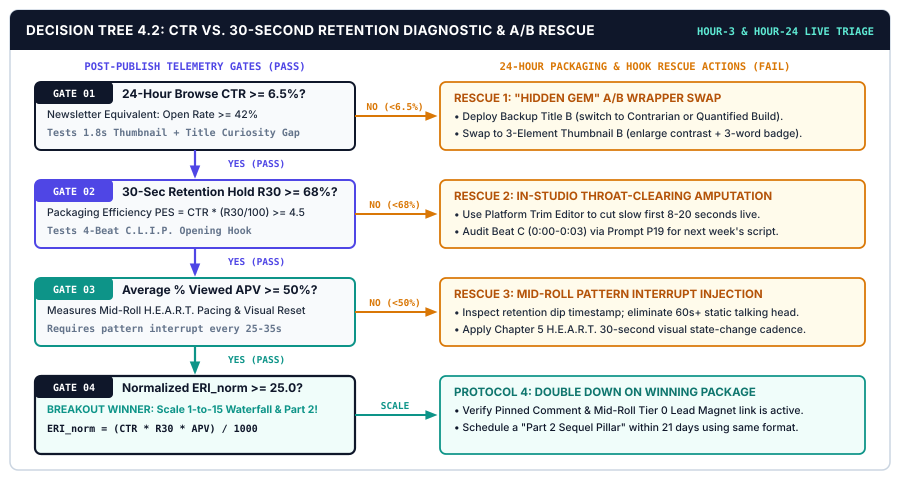

# CHAPTER 04: HIGH-RETENTION HOOK ENGINEERING, PACKAGING & THUMBNAIL PSYCHOLOGY

---

## 1. TITLE & CHAPTER METADATA HEADER

| Metadata Field | Operational Specification |
| :--- | :--- |
| **Chapter Number & Title** | Chapter 04: *High-Retention Hook Engineering, Packaging & Thumbnail Psychology* |
| **Part Assignment** | Part II: Idea Validation, Hook Engineering & Pillar Scripting |
| **Estimated Implementation Time** | 2.5 Hours Initial Calibration + 30 Minutes Weekly Pre-Script Packaging |
| **Core Operational Metric** | Packaging Efficiency Score ($\text{PES}$) & Effective Retention Index ($\text{ERI}$) |
| **Primary Framework** | *The 3-Second Curiosity Gap, Package-First Architecture & C.L.I.P. Hook System* |
| **Visual Architecture Assets** | `../04-VISUAL-ASSETS/svg/chapter-04-mindmap.svg` & `../04-VISUAL-ASSETS/svg/chapter-04-flowchart.svg` |
| **Included AI Workflow Prompts** | Prompts `P16`, `P17`, `P18`, `P19`, and `P20` |
| **Companion Action Workbook** | `../05-WORKBOOKS/markdown/worksheet-04.md` (*The Pre-Production Packaging Canvas, Thumbnail Wireframe & 10-Hook Stress-Test Sheet*) |
| **Deliverable Outcome** | A pre-scripted Package-First workflow generating 15 psychological title angles, a 3-Element Thumbnail/Carousel Cover wireframe, and a 4-Beat C.L.I.P. 30-second hook achieving $\text{CTR} \ge 6.5\%$ and $\text{R}_{30} \ge 70\%$. |

---

## 2. LEARNING OBJECTIVES

By executing the packaging laws, visual hierarchy rules, and hook engineering protocols in this chapter, you will achieve five measurable operational outcomes:

1. **Calculate** your asset's Packaging Efficiency Score ($\text{PES}$) and Effective Retention Index ($\text{ERI}$) across Click-Through Rate ($\text{CTR}$), 30-Second Retention Rate ($\text{R}_{30}$), and Average Percentage Viewed ($\text{APV}$).
2. **Enforce** the *Package-First Law*—engineering and stress-testing the unified triad of **Title + 3-Element Visual Thumbnail/Cover + First-15-Second Hook** before drafting a single sentence of body script.
3. **Design** high-contrast thumbnails and carousel covers governed by **The 3-Element Visual Harmony Law** that pass the `1.8-second mobile feed scan` test without repeating the title verbatim (`[SRC-06]`).
4. **Script** airtight first-30-second openings using **The 4-Beat C.L.I.P. Hook Architecture** (*Click Confirmation*, *Lock In Stakes & Friction*, *Information Loop Opening*, and *Proof & Roadmap Preview*), holding $\ge 70\%$ of viewers past the `0:30` mark (`[SRC-05]`).
5. **Deploy** Prompts `P16` through `P20` to generate 15 psychological title variations, architect 3-element thumbnail wireframes, write multi-format C.L.I.P. hooks, strip out throat-clearing intros, and rescue underperforming uploads within 24 hours of release.

---

## 3. THE REAL-WORLD FRICTION POINT

Suppose you have executed Chapters 1 through 3 flawlessly. You have a high-margin B2B or prosumer sub-niche ($\text{NMPI} \ge 50.0$) and a pre-validated outlier topic ($\text{SPI} \ge 65.0$). You spend four hours scripting, filming, and assembling a masterclass tutorial packed with genuine practitioner insight.

Then, at 4:45 PM right before hitting publish, you treat the **Packaging**—the Title, the Thumbnail (or Newsletter Subject Line / Carousel Cover), and the Opening 30 Seconds—as a five-minute administrative afterthought:
* You slap on an academic, descriptive title (*"Episode 14: Understanding Notion Database Relations and Rollups"*).
* You open Canva, grab a cluttered template, paste a screenshot of your screen, add your headshot, throw in four software logos, and type the exact same 9-word title across the thumbnail in 18-point font.
* You start the video with 35 seconds of **"Throat-Clearing"**: *"Hey guys, welcome back to the channel! If you're new here, my name is Alex, make sure to smash that like button and subscribe. Today I wanted to talk a little bit about databases because a lot of you have been asking..."*

### 3.1 The Two-Gate Algorithmic Executioner
Within six hours of publishing, two brutal empirical gates terminate your asset's distribution (`[SRC-04]`, `[SRC-05]`, `[SRC-06]`):

1. **Gate 1 — The 1.8-Second Feed Scan (CTR Collapse):** Eye-tracking telemetry from the *Nielsen Norman Group* (`[SRC-06]`) proves that mobile and desktop users scan algorithmic feeds at a velocity where each thumbnail or headline receives **1.2 to 1.8 seconds of visual fixation**. When a thumbnail contains 6+ competing elements and repeats the title text, cognitive load spikes. The viewer scrolls past without clicking. Your 24-hour Browse CTR stalls at **`2.1%`** (well below the **`6.5%–9.8%` algorithmic distribution threshold** `[SRC-04]`).
2. **Gate 2 — The 30-Second Abandonment Cliff ($\text{R}_{30}$ Collapse):** Even among the 2.1% who click, *Wistia and Retention Science* telemetry across 90 million video plays (`[SRC-05]`) reveals that **32% to 45% of total viewer abandonment occurs within the first 30 seconds**. The moment a high-intent viewer hears *"Hey guys, welcome back to the channel,"* their brain registers slow pacing and uncertain value. Half of your hard-won audience clicks the back button before second `0:30`.

Because modern recommendation algorithms multiply **Click-Through Rate ($\text{CTR}$)** by **First-30-Second Hold ($\text{R}_{30}$)** and **Average View Duration ($\text{APV}$)** to allocate impressions, failing at the Packaging and Hook gates destroys 90% of your content's reach before the viewer ever hears the brilliant framework you put at minute `06:15`.

### 3.2 Time-of-Abandonment & Packaging Telemetry Breakdown

| Packaging & Hook Stage | Time Window |Amateur Creator Habit | Empirical Audience Reaction | Systematized Operator Standard |
| :--- | :---: | :--- | :--- | :--- |
| **Visual Thumbnail Scan** | `0.0 – 1.8 sec` | 7+ cluttered icons, tiny text repeating the title verbatim. | Skips in feed; Browse CTR drops to `1.8% – 3.2%` (`[SRC-06]`). | **3-Element Visual Harmony** + 3-word contrast badge (`CTR >= 7.0%`). |
| **Title Evaluation** | `1.8 – 3.0 sec` | Academic label (*"Guide to Automated Workflows"*). | Zero curiosity gap; no urgency to click today (`[SRC-04]`). | **Curiosity-Gap + Quantified Outcome** title (`CTR >= 7.0%`). |
| **Beat 1: Click Confirmation** | `0:00 – 0:03` | Animated logo bumper + *"Hey guys, welcome back!"* | **18%–25% of viewers bounce immediately** (`[SRC-05]`). | Instant visual/verbal confirmation of the exact thumbnail promise. |
| **Beat 2: Stakes & Friction** | `0:03 – 0:10` | Rambling personal backstory about why they filmed this. | Another **12%–15% drop off** due to self-indulgent pacing. | Quantifies the costly mistake the viewer is making right now. |
| **Beats 3–4: Loop & Proof** | `0:10 – 0:30` | Vague promise (*"So let's get into the tips"*). | Viewer doubts authority; `0:30` retention falls to `< 45%`. | Opens mechanism loop + shows live visual proof (`R30 >= 72%`). |

---

## 4. WHY STANDARD APPROACHES FAIL

When creators attempt to fix low CTR and poor 30-second retention, they frequently overcorrect into three counterproductive habits that destroy buyer trust.

### 4.1 Failure Mode 1: Cheap Clickbait & The "Bait-and-Switch" Penalty
Desperate for clicks, some creators copy consumer entertainment shock-value tactics: exaggerated shocked-face expressions, red arrows pointing at nothing, and deceptive titles (*"AI Just Ended All Programming Jobs Forever!!"*).

While cheap clickbait can temporarily spike initial CTR to `9%`, it triggers an immediate **Retention Cliff at second 0:15**. When a serious B2B buyer or prosumer clicks a sensationalized package and realizes the content is a mundane tutorial that does not match the hype, they abandon the video within 10 seconds (`[SRC-05]`). Recommendation algorithms interpret **High CTR + Low 30-Second Retention** as *dissatisfying clickbait* and throttle impressions immediately (`[SRC-04]`). Worse, sensationalism repels high-purchasing-power buyers who only buy $149 systems from calm, credible practitioners.

### 4.2 Failure Mode 2: Designing the Package After the Script Is Finished
In 95% of traditional workflows, the creator writes the entire 2,000-word script on Monday, records and edits on Tuesday, and only thinks about the Title and Thumbnail during the upload screen on Wednesday.

When you write the script first, the body of your content lacks a unified visual and psychological spine. You discover at upload time that your video has no compelling visual artifact to put on the thumbnail and no clean curiosity loop to put in the title. **The Package-First Law reverses this sequence permanently:** you lock the Title, Thumbnail Wireframe, and 30-Second Hook *first*, and then build the script specifically to deliver on that package.

### 4.3 Failure Mode 3: Treating Written Newsletters & Carousels as "Hook-Exempt"
Many text-first creators assume that packaging and hook psychology apply only to YouTube videos. In reality, every digital platform operates on the exact same two-gate physics:
* **In Email Newsletters:** The **Subject Line + 45-Character Preview Text** is your Title/Thumbnail package (governing your Open Rate, targeting `42%–55%`), and the **First 4 Lines above the fold** are your 30-Second Hook (governing whether the reader scrolls down and clicks your offer `[SRC-09]`).
* **In LinkedIn/Instagram Carousels & X Threads:** **Slide 1 (or Tweet 1)** is your Thumbnail/Title package (governing the 3-second stop-scroll rate `[SRC-08]`), and **Slide 2 (or Tweet 2)** is your Click-Confirmation Hook.

---

## 5. CORE FRAMEWORK: THE 3-SECOND CURIOSITY GAP, PACKAGE-FIRST ARCHITECTURE & C.L.I.P. HOOK SYSTEM

To guarantee that every Pillar Asset and derivative captures maximum algorithmic distribution while building deep practitioner authority, your studio operates on **The Package-First & C.L.I.P. Hook Architecture**.

### 5.1 Rule #1: The Package-First Synergy Triad
Before writing a single paragraph of body script, you must engineer three distinct components that interlock without redundancy:

1. **Component A — The Visual Thumbnail / Cover (Creates the *Visual Pattern Interrupt*):**
   * Answers: *"What am I looking at, and why does it contrast with everything else in my feed?"*
2. **Component B — The Curiosity-Gap Title (Creates the *Cognitive Tension*):**
   * Answers: *"Why does this matter to my acute pain point right now, and what specific outcome is at stake?"*
3. **Component C — The First-30-Seconds C.L.I.P. Hook (Delivers *Immediate Payoff Confirmation*):**
   * Answers: *"Did clicking this just pay off in the first 3 seconds, and what exact roadmap am I about to get?"*

### 5.2 The 3-Element Visual Thumbnail Harmony Law
Based on mobile eye-tracking benchmarks (`[SRC-06]`), your thumbnail or carousel cover must never exceed **3 distinct focal elements**:

* **Element 1: The Visual Anchor / Structural Contrast Graphic (Left or Center-Right Focus)**
  * A high-clarity visual proof artifact: a clean before/after metric split (`32 Hrs -> 5.5 Hrs`), a simplified 3-node system diagram, or a recognizable workflow contrast (`Messy Spreadsheet X -> Clean Dashboard Check`).
* **Element 2: The Human or Authority Focal Subject**
  * Either a clean, well-lit expression of focused practitioner authority (for talking-head channels) OR a zoomed, high-contrast UI/chart focal highlight (for faceless channels).
* **Element 3: The 1-to-4 Word Complementary Curiosity Badge**
  * Set in bold `Inter` (`#0F172A` or `#FFFFFF` on a `#4F46E5` Indigo, `#0D9488` Teal, or `#D97706` Amber pill).
  * **The Golden Non-Redundancy Rule:** Your thumbnail text must **NEVER** repeat your video title verbatim. If your title is *"How I Automated My Client Onboarding in 20 Minutes,"* wasted thumbnail text says *"Automate Client Onboarding."* Complementary thumbnail text says **`"ZERO MANUAL ADMIN"`** or **`"$0 -> $14K SYSTEM"`** or **`"DELETE ZAPIER?"`**—creating a two-part cognitive loop between image and title.

---

### 5.3 The 5 High-CTR Psychological Title Archetypes

Every week during Block 1, you generate 15 candidate titles across five proven B2B/prosumer psychological angles:

1. **Archetype 1 — The Quantified System Build (Time/Money Compression):**
   * *Formula:* `How I Built a [Quantified Result System] in [Short Timeframe] (Full [Tool] Blueprint)`
   * *Example:* *"How I Built a $10k/Mo Automated Newsletter Engine in 6 Hours a Week (Full Notion + Kit OS)"*
2. **Archetype 2 — The Contrarian Replacement (Killing the Status Quo):**
   * *Formula:* `Why I Stopped Using [Popular Broken Method] (And the [Proprietary Mechanism] I Use Instead)`
   * *Example:* *"Why I Deleted All Daily Standup Meetings (And the 15-Minute Async System We Run Instead)"*
3. **Archetype 3 — The Forensic Teardown / Case Study Proof:**
   * *Formula:* `How [Specific Avatar] Went From [Acute Pain Baseline] to [Quantified Win] in [Days]`
   * *Example:* *"How a Solo Consultant Replaced 32 Hours of Admin With 4 AI Workflows ($429/Hr Breakdown)"*
4. **Archetype 4 — The Costly Mistake Diagnostic:**
   * *Formula:* `The [Number] [Sub-Niche] Mistakes Costing You [Quantified Loss] Every Week`
   * *Example:* *"The 3 Packaging Mistakes Killing 70% of Your Views Before Second 0:30"*
5. **Archetype 5 — The "Start From Zero" Tactical Roadmap:**
   * *Formula:* `If I Had to Build a [Desired Asset/Outcome] From Scratch in 2026, Here Is My Exact 5-Step Blueprint`

---

### 5.4 The 4-Beat First-30-Seconds Hook Architecture (C.L.I.P.)

Once the viewer clicks your title and thumbnail, you have exactly **30 seconds** (roughly `75 to 85 spoken words`, or the `first 4 sentences` of a newsletter) to lock in a **$\ge 70\%$ retention hold (`[SRC-05]`)**. Every Pillar script opens with the **4-Beat C.L.I.P. Sequence**:

#### Beat 1: C — Click Confirmation (`Seconds 0:00 – 0:03` | `1 Sentence / ~15 Words`)
* **Rule:** Zero logos, zero "welcome back," zero biographies. Repeat the core promise of the title and show the finished visual proof artifact on screen in the very first frame so the viewer's brain confirms: *"Yes, I am in the exact right place."*
* **Verbatim Example:** *"This single Notion and Make workflow replaced 26 hours of manual client onboarding every week—and in the next 11 minutes, I am going to hand you the exact architecture."*

#### Beat 2: L — Lock In Stakes & Friction (`Seconds 0:03 – 0:10` | `1–2 Sentences / ~22 Words`)
* **Rule:** Agitate the specific cost of the status-quo mistake the viewer is currently experiencing.
* **Verbatim Example:** *"Most solo agency owners lose two full workdays a week manually copying contracts, setting up Slack channels, and chasing intake forms—capping their effective hourly rate under $35."*

#### Beat 3: I — Information Loop Opening (`Seconds 0:10 – 0:20` | `1–2 Sentences / ~25 Words`)
* **Rule:** Introduce your **Named Proprietary Mechanism** and open a curiosity gap about the counter-intuitive key that makes it work.
* **Verbatim Example:** *"The fix isn't hiring a full-time operations manager. It's installing what we call the 3-Gate Webhook Bridge—especially Gate #2, which eliminates 90% of client back-and-forth automatically."*

#### Beat 4: P — Proof & Roadmap Preview (`Seconds 0:20 – 0:30` | `1–2 Sentences / ~20 Words`)
* **Rule:** Flash a concrete proof metric or live dashboard on screen and state the 3 clear steps ahead so the viewer stays for the entire runtime.
* **Verbatim Example:** *"We've deployed this across 40+ B2B teams. Let's break down the database schema, the automated trigger setup, and how you can clone the complete template today."*

---

### 5.5 The Governing Mathematical Models: $\text{PES}$ & Effective Retention Index ($\text{ERI}$)

To evaluate packaging and hook performance objectively in your Friday Creator CEO Scorecard, use two complementary equations:

#### 1. The Packaging Efficiency Score ($\text{PES}$ — 24-Hour Early Signal)
Measures how effectively your Title + Thumbnail + 30-Second Hook convert raw feed impressions into engaged viewers past the `0:30` gate:

$$\text{PES} = \text{Click-Through Rate (CTR \%)} \times \left(\frac{\text{30-Second Retention Rate } (\text{R}_{30}\%)}{100}\right)$$

* **Target Benchmark:** With a target $\text{CTR} = 7.5\%$ and $\text{R}_{30} = 72\%$, $\text{PES} = 7.5 \times 0.72 = \mathbf{5.40}$ (meaning **5.40% of all people shown your thumbnail in a feed are still actively watching at second `0:31`**). Unsystematized creators (`CTR = 2.8%`, `R30 = 42%`) score $\text{PES} = \mathbf{1.18}$—nearly **5x lower feed conversion efficiency**.

#### 2. The Effective Retention Index ($\text{ERI}$ — Full Asset Compounding Metric)
Measures total algorithmic distribution power across the entire Pillar Asset:

$$\text{ERI} = \text{Click-Through Rate (CTR \%)} \times \text{30-Second Retention Rate (\%)} \times \text{Average Percentage Viewed (APV \%)}$$

*(Expressed as a normalized index by dividing the product of the three percentage numbers by $1,000$:)*

$$\text{ERI}_{\text{norm}} = \frac{\text{CTR} \times \text{R}_{30} \times \text{APV}}{1,000}$$

* **Amateur Packaging Baseline:** $\text{CTR} = 2.5\%$, $\text{R}_{30} = 40\%$, $\text{APV} = 32\%$ $\rightarrow \text{ERI}_{\text{norm}} = \frac{2.5 \times 40 \times 32}{1,000} = \mathbf{3.20}$ (Algorithmic suppression).
* **Systematized Studio Target:** $\text{CTR} = 7.5\%$, $\text{R}_{30} = 72\%$, $\text{APV} = 54\%$ $\rightarrow \text{ERI}_{\text{norm}} = \frac{7.5 \times 72 \times 54}{1,000} = \mathbf{29.16}$ (**9.1x higher algorithmic distribution velocity** `[SRC-04]`, `[SRC-05]`).

---

## 6. VISUAL ARCHITECTURE — SYSTEM MINDMAP

The vector architecture diagram below maps **The Package-First Architecture & C.L.I.P. Hook Engineering System**, showing how the 3-Element Thumbnail, 5 Psychological Title Angles, and 4-Beat C.L.I.P. Hook converge prior to script drafting to drive $\text{ERI}_{\text{norm}} \ge 25.0$.



### 6.1 Architectural Walkthrough of the System Nodes

1. **Central Packaging Engine (`PACKAGE-FIRST & C.L.I.P. HOOK ENGINE`):**
   * Positioned at the center (`#0F172A` Deep Studio Navy), this core gate enforces **Rule #1: Zero Body Scripting Until Package Is Locked**, targeting **Browse $\text{CTR} \ge 7.0\%$**, **30-Second Hold $\text{R}_{30} \ge 70\%$**, and **Normalized $\text{ERI} \ge 25.0$**.
2. **Top-Left Module (`THE 3-ELEMENT VISUAL THUMBNAIL LAW`):**
   * Governed by Creator Indigo (`#4F46E5`), this node restricts visual cognitive load to `<= 3 focal elements` for the `1.8-second mobile scan` window: (1) Visual Contrast/Proof Graphic, (2) High-Clarity Focal Subject/Diagram, and (3) 1–4 Word Complementary Badge (never repeating the title).
3. **Bottom-Left Module (`THE 5 HIGH-CTR TITLE ARCHETYPES`):**
   * Generates 15 candidate headlines across five psychological angles: Quantified System Build, Contrarian Replacement, Forensic Case-Study Teardown, Costly Mistake Diagnostic, and Zero-to-One Roadmap.
4. **Right Sequential Pipeline (`THE 4-BEAT C.L.I.P. 30-SECOND HOOK`):**
   * Highlighted with Retention Amber (`#D97706`) and Conversion Teal (`#0D9488`) checkpoints, this timeline breaks the first 30 seconds (`80 words`) into four precision beats:
     * **Beat C (`0:00–0:03 Click Confirmation`):** Immediate visual + verbal payoff match.
     * **Beat L (`0:03–0:10 Lock In Stakes & Friction`):** Quantifies the cost of the status-quo mistake.
     * **Beat I (`0:10–0:20 Information Loop Opening`):** Names the proprietary mechanism and opens the curiosity gap.
     * **Beat P (`0:20–0:30 Proof & Roadmap Preview`):** Displays concrete metric proof and previews the 3 build steps.
5. **Bottom Telemetry Bar (`24-HOUR ERI & A/B PACKAGING RESCUE LOOP`):**
   * Tracks live post-publish $\text{CTR}$ and $\text{R}_{30}$ at Hour 3 and Hour 24, triggering automated Title/Thumbnail A/B swaps whenever $\text{CTR} < 6.5\%$.

---

## 7. STEP-BY-STEP IMPLEMENTATION PROTOCOL: THE 30-MINUTE PRE-SCRIPT PACKAGING SOP

Execute this chronological **30-Minute Packaging & Hook Protocol** during `Minutes 00:30 to 01:00` of your **Monday Block 1 Sprint**—immediately after selecting your validated S.I.G.N.A.L. topic and *before* writing your body script.

### Step 1: Generate 15 Psychological Title Variations & Lock Your Top 2 for A/B Testing (8 Minutes)
1. Take your greenlit S.I.G.N.A.L. topic from Chapter 3 and run **Prompt P16** (*15-Variation High-CTR Title & Curiosity-Gap Generator*).
2. Review the 15 generated titles across the 5 psychological archetypes.
3. Apply the **55-Character Mobile Truncation Check**: ensure the primary curiosity hook or quantified number appears within the **first 50 to 55 characters** so it never gets cut off on smartphone screens.
4. Select **Title Variation A (Primary Launch Title)** and **Title Variation B (24-Hour Backup / A/B Test Title)** and record both in `worksheet-04.md`.

### Step 2: Wireframe Your 3-Element Thumbnail / Carousel Cover (10 Minutes)
1. Run **Prompt P17** (*Thumbnail Visual Concept & 3-Word Complementary Overlay Architect*) paired with your locked Title A.
2. Sketch or assemble your 3-Element Canvas inside your standardized Figma/Canva master template (`1920x1080px` for YouTube; `1080x1350px` for LinkedIn/IG Carousel Cover):
   * **Check 1 (The 3-Element Limit):** Count the distinct visual objects on the canvas. If there are more than 3, delete the extras immediately (`[SRC-06]`).
   * **Check 2 (The Non-Redundancy Rule):** Verify that your 1–4 word overlay badge complements—and shares zero identical phrases with—your Title.
   * **Check 3 (The 10% Mobile Squint Test):** Zoom your canvas out to **10% size** (`160x90px`—the size of a mobile feed thumbnail). If you cannot read the 3-word badge and recognize the visual contrast graphic in `1.5 seconds`, increase font weight (`Inter ExtraBold 800`), boost color contrast (`#0F172A`, `#FFFFFF`, `#4F46E5`, `#D97706`), and enlarge the focal diagram.

### Step 3: Script & Stress-Test the 4-Beat C.L.I.P. 30-Second Hook (12 Minutes)
1. Execute **Prompt P18** (*First-30-Seconds C.L.I.P. Hook Scriptwriter*) to generate 3 distinct 80-word hook variations (plus the matching Newsletter Subject/Lead and Short-Form 3-second hook).
2. Run your chosen hook through **Prompt P19** (*Hook Retention Diagnostic & Throat-Clearing Eliminator*) to verify four mandatory physical constraints:

| C.L.I.P. Beat | Timestamp Window | Word Count Cap | Mandatory Visual Cue on Screen | Zero-Tolerance Forbidden Elements |
| :--- | :---: | :---: | :--- | :--- |
| **C — Click Confirmation** | `0:00 – 0:03` | `12 – 18 words` | Show the finished dashboard, metric result, or core diagram in Frame 1. | No "Hey guys," no channel intro bumper, no name/bio, no "Today we will..." |
| **L — Lock In Stakes** | `0:03 – 0:10` | `18 – 24 words` | Cut to B-roll or red-highlighted graphic of the broken manual process. | No rambling backstory; must state a specific hour or dollar loss. |
| **I — Information Loop** | `0:10 – 0:20` | `20 – 25 words` | Display the Named Proprietary Framework diagram (`Stage 1 -> 5`). | Do not give away the complete answer in Beat 3; highlight the critical gate. |
| **P — Proof & Roadmap** | `0:20 – 0:30` | `15 – 20 words` | Flash concrete case-study proof + 3 numbered roadmap chapters on screen. | No begging for likes/subscribes before delivering value. |
| **TOTAL HOOK BLOCK** | **`0:00 – 0:30`** | **`65 – 87 words`** | **4 Visual State Changes in 30 Seconds (`1 every 7.5s`)** | **Target Hold Rate: $\text{R}_{30} \ge 70\%$** |

---

## 8. OPERATIONAL DECISION TREE: THE CTR VS. 30-SECOND RETENTION DIAGNOSTIC & PACKAGING A/B TEST FLOWCHART

Publishing a Pillar Asset is not the end of packaging—it is the start of your **24-Hour Telemetry Watch**. At **Hour 3** and **Hour 24** post-publish, inspect your live analytics and route your asset through **The CTR vs. 30-Second Retention Diagnostic & Packaging A/B Test Flowchart** below.



### 8.1 Quantitative Diagnostic Quadrant & 24-Hour Rescue Rules

By cross-referencing **24-Hour Browse/Suggested CTR** (or Newsletter Open Rate) against **30-Second Retention ($\text{R}_{30}$)**, every published asset falls into one of four diagnostic quadrants (`Gate 01` through `Gate 04`):

#### Gate 01: Low CTR ($< 6.5\%$) + High 30-Second Hold ($\text{R}_{30} \ge 68\%$) — *The "Hidden Gem / Weak Wrapper" Quadrant*
* **Diagnosis:** Viewers who click *love* the hook and stay, proving your topic and C.L.I.P. script are strong. However, your Title and Thumbnail are failing to stop the scroll in the `1.8-second` feed scan (`[SRC-04]`, `[SRC-06]`).
* **Immediate 24-Hour Rescue Protocol:**
  1. Deploy **Title Variation B** (switching from a descriptive angle to a *Contrarian Replacement* or *Quantified System Build* angle).
  2. Replace the Thumbnail with a high-contrast 3-Element variation (enlarging the focal metric contrast and shortening the badge to 2–3 bold words).
  3. Run **Prompt P20** (*Post-Publish CTR & Retention Drop-Off A/B Packaging Rescue Protocol*) to generate 3 emergency swaps.

#### Gate 02: High CTR ($\ge 6.5\%$) + Low 30-Second Hold ($\text{R}_{30} < 68\%$) — *The "Click-Disconnect / Throat-Clearing" Quadrant*
* **Diagnosis:** Your Title and Thumbnail triggered strong curiosity, but the first 15 seconds failed to confirm the click or opened with slow introductory fluff (`[SRC-05]`).
* **Immediate 24-Hour Rescue Protocol:**
  1. Open your platform's built-in **Video Trim / Editor Tool** (e.g., YouTube Studio Trim) and physically snip out the first `8 to 20 seconds` of throat-clearing so the video starts directly on your first hard tactical visual or statement.
  2. Ensure your Title and Thumbnail did not promise a different visual outcome than what appears in Frame 1.

#### Gate 03: High CTR ($\ge 6.5\%$) + High $\text{R}_{30}$ ($\ge 68\%$) + Low Mid-Roll APV ($< 45\%$) — *The "Pacing Sag" Quadrant*
* **Diagnosis:** Your Package and 30-Second C.L.I.P. Hook succeeded, but viewer attention decayed between minutes `02:00 and 08:00` due to long static talking-head blocks or unstructured rambling.
* **Corrective Protocol (Applied in Chapter 5 Scripting):**
  * Insert **Visual Pattern Interrupts every 25 to 35 seconds** (switching between full-screen SVG diagrams, live screenflows, and B-roll metric callouts `[SRC-05]`) and tighten your H.E.A.R.T. body outline.

#### Gate 04: High CTR ($\ge 6.5\%$) + High $\text{R}_{30}$ ($\ge 68\%$) + High APV ($\ge 50\%$) — *The "Breakout Outlier" Quadrant ($\text{ERI}_{\text{norm}} \ge 25.0$)*
* **Diagnosis:** Full packaging and retention harmony achieved.
* **Immediate Scaling Action:**
  1. Verify that your **Pinned Comment** and **Top-of-Description Rented-to-Owned Bridge** to your Tier 0 Lead Magnet are active (`[SRC-09]`).
  2. Log the exact Title Archetype and Thumbnail Layout in your `Outlier Winner Vault` and schedule a **"Part 2 / Advanced Follow-Up"** Pillar within 21 days to ride the algorithmic session loop.

---

## 9. TESTED AI WORKFLOW PROMPTS (PROMPTS P16 TO P20)

Execute Prompts `P16` through `P20` during your 30-minute Monday pre-script packaging block (and 24-hour post-publish audit) to engineer high-CTR titles, 3-element thumbnails, and 70%+ retention C.L.I.P. hooks.

---

### Prompt P16: 15-Variation High-CTR Title & Curiosity-Gap Generator (Across 5 Psychological Angles)

```text
PROMPT ID: P16 — 15-Variation High-CTR Title & Curiosity-Gap Generator (Across 5 Psychological Angles)

ROLE:
You are a Master Packaging Copywriter and Algorithmic CTR Engineer for high-growth B2B and prosumer media channels.

CONTEXT:
I have selected a validated S.I.G.N.A.L. Pillar topic. Before I write a single line of my script or newsletter, I must lock my primary Launch Title (Title A) and my 24-hour A/B Test Backup Title (Title B). Generate 15 high-CTR title variations across the 5 Proven Psychological Archetypes, engineered specifically for my high-purchasing-power buyer avatar.

INPUT VARIABLES:
- [VALIDATED_PILLAR_TOPIC]: e.g., Automating Client Onboarding & Project Portals with Notion and Make.com
- [TARGET_BUYER_AVATAR]: e.g., Boutique Agency Owners & B2B Consultants ($10k-$50k/mo revenue)
- [QUANTIFIED_OUTCOME_OR_PROOF]: e.g., Cuts onboarding setup from 4 hours to 90 seconds; saves 18 hrs/week
- [PROPRIETARY_MECHANISM_NAME]: e.g., The 3-Gate Webhook Portal Engine
- [STATUS_QUO_MISTAKE_ATTACKED]: e.g., Manually duplicating folders, chasing contract PDFs, and paying for bloated CRM seats

EXECUTION STEPS:
1. Generate 15 Distinct Titles (3 Variations per Psychological Archetype):
   - Archetype 1 (3 Titles): The Quantified System Build (Time/Money Compression + Concrete Blueprint)
   - Archetype 2 (3 Titles): The Contrarian Replacement (Killing [STATUS_QUO_MISTAKE_ATTACKED])
   - Archetype 3 (3 Titles): The Forensic Teardown / Case Study Proof (Specific ROI Breakdown)
   - Archetype 4 (3 Titles): The Costly Mistake Diagnostic (Urgent Loss-Aversion Hook)
   - Archetype 5 (3 Titles): The "From Scratch in 2026" Master Roadmap
2. Mobile Truncation Audit: Count the character length of every title and ensure the core curiosity hook and quantified number appear within the first 52 characters.
3. Recommend Title A (Primary Launch) and Title B (24-Hour A/B Backup), plus 3 matching Email Newsletter Subject Lines + 45-Character Preview Texts.

QUALITY CONSTRAINTS:
- Zero cheap clickbait, all-caps screaming, or vague buzzwords.
- Every title must open an explicit curiosity loop that can only be resolved by clicking.

OUTPUT TEMPLATE:
1. 15-Title Matrix by Psychological Archetype (Archetype | Title Text | Char Count | Curiosity Loop Mechanism | Est. CTR Score 1-10)
2. Locked A/B Recommendation (Title A vs. Title B + Why They Contrast)
3. Companion Newsletter Subject Line & Preview Text Trio
```

---

### Prompt P17: Thumbnail Visual Concept & 3-Word Complementary Overlay Architect

```text
PROMPT ID: P17 — Thumbnail Visual Concept & 3-Word Complementary Overlay Architect

ROLE:
You are a Visual Hierarchy Director and Eye-Tracking Thumbnail Psychologist specializing in the 3-Element Visual Harmony Law.

CONTEXT:
I have locked my Primary Launch Title (Title A) and Backup Title (Title B). Now I need to wireframe 3 high-contrast Thumbnail / Carousel Cover concepts that pass the 1.8-second mobile feed scan test, contain strictly <= 3 visual elements, and use a 1-to-4 word Complementary Visual Badge that NEVER repeats words from my title.

INPUT VARIABLES:
- [LOCKED_TITLE_A]: [PASTE_TITLE_A]
- [LOCKED_TITLE_B]: [PASTE_TITLE_B]
- [CHANNEL_VISUAL_STYLE]: e.g., Talking-Head + System Diagram OR 100% Faceless UI/Architecture Graphic
- [CORE_TRANSFORMATION_CONTRAST]: e.g., Before: 14 messy manual steps ($12/hr) -> After: 1 automated 3-node pipeline ($380/hr)

EXECUTION STEPS:
1. Design 3 Distinct Thumbnail Wireframe Concepts:
   - Concept 1: The "Before vs. After Split-Screen Contrast" (Red/Amber Pain vs. Teal/Indigo Payoff)
   - Concept 2: The "Zoomed Architecture / Live Metric Proof" (Highlighting a specific shocking number or locked node)
   - Concept 3: The "Contrarian Replacement / Cross-Out" (Visually crossing out the broken old tool/habit in favor of the new mechanism)
2. Enforce the 3-Element Law for Each Concept: Explicitly define:
   - Element 1 (Visual Contrast / Proof Graphic)
   - Element 2 (Subject / Focal Highlight)
   - Element 3 (1-to-4 Word Complementary Text Badge — verified 0% word overlap with [LOCKED_TITLE_A])
3. Specify Exact Studio Color Tokens: Assign exact hex colors from our locked palette (#0F172A Deep Navy, #4F46E5 Creator Indigo, #0D9488 Conversion Teal, #D97706 Retention Amber, #FFFFFF Canvas) to maximize mobile squint-test legibility.

QUALITY CONSTRAINTS:
- Strictly forbid >3 elements on the canvas.
- Badge text must be <= 4 words (ideally 2-3 words, <= 18 characters total).

OUTPUT TEMPLATE:
1. 3 Thumbnail Wireframe Specifications Table (Concept | Element 1 | Element 2 | Element 3 Badge Text | Color Token Assignment | Non-Redundancy Check)
2. Left-to-Right Eye-Tracking Flow Description (Where the viewer's eye lands at 0.5s, 1.0s, and 1.5s)
3. LinkedIn / Instagram Square Carousel Slide-1 Adaptation Notes
```

---

### Prompt P18: First-30-Seconds C.L.I.P. Hook Scriptwriter (Video, Short-Form & Newsletter Lead)

```text
PROMPT ID: P18 — First-30-Seconds C.L.I.P. Hook Scriptwriter (Video, Short-Form & Newsletter Lead)

ROLE:
You are a High-Retention Script Architect specializing in First-30-Second viewer hold rates (R30 >= 72%).

CONTEXT:
I have locked my Title and 3-Element Thumbnail. Before drafting my body script, I need to write the exact First-30-Seconds Hook (75-85 spoken words) using the 4-Beat C.L.I.P. Architecture, along with its 3-Second Vertical Short-Form adaptation and 4-Sentence Newsletter Opening Lead.

INPUT VARIABLES:
- [LOCKED_TITLE_AND_THUMBNAIL_BADGE]: [TITLE_AND_BADGE]
- [VISUAL_PROOF_SHOWN_IN_FRAME_1]: e.g., Live screen recording of the finished Notion dashboard + Stripe/time-saved metric
- [STATUS_QUO_PAIN_AND_COST]: e.g., Losing 15 hours a week to manual content rewriting and earning under $10/hr RPPH
- [NAMED_PROPRIETARY_MECHANISM]: e.g., The 5-Stage Content-to-Cash Waterfall
- [3_STEP_ROADMAP_PREVIEW]: Step 1: [STEP_1], Step 2: [STEP_2], Step 3: [STEP_3]

EXECUTION STEPS:
1. Write 2 Complete Variations of the 30-Second Pillar Video Hook (75-85 words each) structured strictly into the 4 C.L.I.P. Beats:
   - Beat C (0:00-0:03 | ~15 words): Click Confirmation + Frame-1 Visual Cue
   - Beat L (0:03-0:10 | ~22 words): Lock In Stakes & Quantified Friction
   - Beat I (0:10-0:20 | ~25 words): Information Loop Opening + Named Mechanism
   - Beat P (0:20-0:30 | ~20 words): Proof Flash + 3-Step Roadmap Preview
2. Write the Companion 60-Second Vertical Short / Reel Hook (First 3 seconds / 12 words + visual pattern interrupt).
3. Write the Companion Flagship Newsletter Above-the-Fold Lead (First 4 crisp sentences that compel readers to scroll past the fold).

QUALITY CONSTRAINTS:
- Zero "Hey guys," zero channel introductions, zero throat-clearing.
- Include explicit [ON-SCREEN VISUAL CUE] brackets at every 7-second beat transition.

OUTPUT TEMPLATE:
1. Pillar Video Hook Variation 1 (Direct Proof & ROI Angle — Beat-by-Beat Table with Word Counts & Visual Cues)
2. Pillar Video Hook Variation 2 (Contrarian Mistake Angle — Beat-by-Beat Table with Word Counts & Visual Cues)
3. Vertical Short-Form 3-Second Hook + Newsletter 4-Sentence Above-the-Fold Lead
```

---

### Prompt P19: Hook Retention Diagnostic & Throat-Clearing Eliminator

```text
PROMPT ID: P19 — Hook Retention Diagnostic & Throat-Clearing Eliminator

ROLE:
You are a Ruthless Retention Editor and Script Pacing Auditor.

CONTEXT:
I have drafted an opening hook (or full intro section) for my upcoming video, podcast, or newsletter. Audit my draft line-by-line to detect and amputate any "Throat-Clearing," slow biographical setup, redundant phrasing, or missing visual pattern interrupts that would cause viewers to abandon before the 0:30 mark.

INPUT VARIABLES:
- [PROMISED_TITLE_AND_THUMBNAIL]: [TITLE_AND_THUMBNAIL]
- [DRAFT_INTRO_OR_HOOK_TEXT]:
  [PASTE_YOUR_FIRST_150_WORDS_HERE]

EXECUTION STEPS:
1. Run the 5-Point Retention Audit:
   - Check 1 (First-3-Second Payoff Match): Does sentence 1 immediately confirm [PROMISED_TITLE_AND_THUMBNAIL]?
   - Check 2 (Throat-Clearing Detection): Highlight every word of self-introduction, channel housekeeping, vague truisms ("As we all know..."), or premature subscribe begging.
   - Check 3 (Quantified Stakes Check): Is the cost of the problem quantified with a concrete number by second 0:10?
   - Check 4 (Curiosity Loop Check): Is a named framework or counter-intuitive mechanism introduced by second 0:20?
   - Check 5 (Visual Cadence Check): Are there at least 4 distinct visual state changes scheduled across the first 30 seconds?
2. Compute Predicted R30 Hold Score (0-100%) for the original draft vs. the surgical rewrite.
3. Produce the Surgical C.L.I.P. Rewrite: Trim the draft to a razor-sharp 75-80 words with exact timestamp and visual cues.

QUALITY CONSTRAINTS:
- Cut at least 30% to 50% of unnecessary words from bloated drafts.
- Maintain a peer-to-peer, authoritative practitioner tone.

OUTPUT TEMPLATE:
1. Forensic Line-by-Line Audit Table (Original Sentence | Retention Flaw Detected | Verdict: CUT / REWRITE / KEEP)
2. Surgical 30-Second C.L.I.P. Rewrite (Timestamped 0:00 to 0:30 with Visual Cues)
3. Predicted Retention Lift Summary (Original Est. R30 vs. Rewritten Target R30)
```

---

### Prompt P20: Post-Publish CTR & Retention Drop-Off A/B Packaging Rescue Protocol

```text
PROMPT ID: P20 — Post-Publish CTR & Retention Drop-Off A/B Packaging Rescue Protocol

ROLE:
You are a Live-Telemetry Packaging Triage Specialist.

CONTEXT:
I published a Pillar Asset 6 to 24 hours ago, and its early performance metrics are below studio thresholds (CTR < 6.5% or 30-Second Retention R30 < 68%). Based on my live telemetry numbers, diagnose which exact packaging quadrant my asset is stuck in and generate an immediate 15-minute rescue intervention.

INPUT VARIABLES:
- [CURRENT_LIVE_TITLE]: [LIVE_TITLE]
- [CURRENT_LIVE_THUMBNAIL_DESCRIPTION]: [LIVE_THUMBNAIL]
- [FIRST_30_SECONDS_SPOKEN_TRANSCRIPT]: [FIRST_30_SEC_TEXT]
- [LIVE_24H_METRICS]:
  * Impressions: [IMPRESSIONS]
  * Browse/Suggested CTR (%): [CTR_PERCENT]%
  * 30-Second Retention R30 (%): [R30_PERCENT]%
  * Average Percentage Viewed APV (%): [APV_PERCENT]%

EXECUTION STEPS:
1. Calculate Live Packaging Efficiency Score (PES) and Normalized Effective Retention Index (ERI_norm):
   - PES = CTR * (R30 / 100)
   - ERI_norm = (CTR * R30 * APV) / 1000
2. Classify Diagnostic Quadrant (Gate 01: Weak Wrapper | Gate 02: Click-Disconnect | Gate 03: Mid-Roll Pacing Sag | Gate 04: Breakout Winner).
3. Generate Immediate Rescue Assets:
   - Provide 3 Emergency High-Contrast Replacement Titles (switching psychological archetypes).
   - Provide 2 Emergency 3-Element Thumbnail Swaps (specifying exact badge text and visual contrast).
   - If R30 < 68%, specify the exact timestamp (e.g., "Trim 0:00 to 0:14 in Studio Editor") where the video should be cut so it opens on the strongest line.

QUALITY CONSTRAINTS:
- Base the intervention strictly on whether CTR or R30 is the primary mathematical bottleneck.

OUTPUT TEMPLATE:
1. Live Telemetry Scorecard (Calculated PES | Calculated ERI_norm | Diagnosed Bottleneck Quadrant)
2. Emergency Title Swap Trio (Ranked 1 to 3)
3. Emergency 3-Element Thumbnail Redesign Spec + Exact In-Platform Trim Timestamp Instruction
```

---

## 10. REAL-WORLD IMPLEMENTATION CASE STUDY: SADIA RAHMAN (SOLO DESIGN SYSTEMS & SAAS UI EDUCATOR)

To see how Package-First Architecture and the C.L.I.P. 30-second hook transform the commercial output of an existing technical creator without adding a single hour of filming time, examine the 60-day turnaround of **Sadia Rahman**, a 31-year-old product designer teaching *Figma Design Systems & SaaS UI Architecture*.

### 10.1 Baseline Situation (Day 0 — Great Tutorials Trapped Inside Invisible Packaging)
Sadia had `14,200 YouTube subscribers` and `4,800 newsletter subscribers`. Her technical knowledge was world-class—senior designers who watched her full 18-minute tutorials praised their depth. Yet her channel growth and revenue were stagnant:
* **The Packaging Bottleneck:** Sadia wrote and filmed her entire tutorial first, then spent 5 minutes before upload naming the video like a university syllabus (*"Figma Variables Tutorial: Building Multi-Brand Tokens Part 2"*) and pasting 6 tiny UI screenshots onto a cluttered dark-gray thumbnail that repeated the title text.
* **The Hook Bottleneck:** She opened every video with a 12-second lo-fi music animation followed by 25 seconds of channel updates and syllabus recaps.
* **Baseline Telemetry:**
  * **24-Hour Browse CTR:** **`2.4%`** (Algorithm stopped showing her videos on home feeds within 8 hours).
  * **30-Second Retention ($\text{R}_{30}$):** **`38.0%`** (62% of viewers abandoned before minute `0:30`).
  * **Average Percentage Viewed ($\text{APV}$):** **`31.0%`**.
  * **Baseline $\text{PES}$:** $2.4 \times 0.38 = \mathbf{0.91}$.
  * **Baseline $\text{ERI}_{\text{norm}}$:** $\frac{2.4 \times 38 \times 31}{1,000} = \mathbf{2.83}$.
  * **Baseline Monthly Revenue:** **$1,850.00 / month** ($290 AdSense + $1,560 from her $79 Figma Component Kit).

### 10.2 The Package-First & C.L.I.P. Intervention (Days 1–60)
Sadia did not change her niche, her camera gear, or her $79/$199 product stack. She changed only her **30-minute Monday Pre-Script Packaging SOP**:
1. **Enforced Package-First Before Scripting:** Using Prompts `P16` and `P17`, Sadia refused to open Figma to record until she had locked a high-contrast Title and a 3-Element Thumbnail on a crisp `#FFFFFF` / `#0F172A` split canvas. Instead of *"Figma Variables Tutorial Part 2,"* she packaged her next Pillar as:
   * **Title:** *"Why 90% of SaaS Design Systems Break at Scale (And the 3-Tier Token Architecture That Fixes It)"*
   * **3-Element Thumbnail:** Element 1: Messy 40-style panel crossed out in Amber `#D97706` vs. Clean 3-Token Matrix in Teal `#0D9488`; Element 2: Sadia pointing to the matrix; Element 3: Bold Indigo `#4F46E5` badge reading **`"3-TIER TOKEN OS"`**.
2. **Deleted the Music Intro & Installed C.L.I.P. Hooks:** Using Prompts `P18` and `P19`, Sadia cut her lo-fi bumper completely. Frame `0:00` opened directly on her production SaaS dashboard with a 78-word C.L.I.P. hook that confirmed the click in 3 seconds, quantified the 12 hours/week front-end devs waste on broken tokens by second 10, introduced the *3-Tier Token OS* by second 18, and previewed the build by second 28.
3. **Executed Retroactive Packaging Swaps on Top 8 Archive Videos:** Using Prompt `P20`, she updated the titles and thumbnails on her 8 best historical tutorials and trimmed their first 20 seconds in YouTube Studio.

### 10.3 Financial & Operational Results (Day 60 Telemetry)

| Operational & Financial Metric | Baseline (Day 0 — Post-Script Packaging) | Day 60 (Package-First + C.L.I.P. Hook System) | Net Operational Delta |
| :--- | :---: | :---: | :---: |
| **Pre-Script Packaging Time** | 5 mins (Afterthought at upload) | **30 mins (Locked before scripting)** | +25 mins high-ROI prep |
| **24-Hour Browse CTR** | 2.4% | **7.8%** | **+5.4% CTR points (+225% lift)** |
| **30-Second Retention Rate ($\text{R}_{30}$)** | 38.0% | **74.0%** | **+36.0% hold points (+94.7% lift)** |
| **Average Percentage Viewed ($\text{APV}$)** | 31.0% | **53.5%** | **+22.5% completion points** |
| **Packaging Efficiency Score ($\text{PES}$)** | `0.91` | **`5.77`** | **6.3x Feed-to-Watch Conversion** |
| **Normalized Retention Index ($\text{ERI}_{\text{norm}}$)** | `2.83` | **`30.88`** | **10.9x Algorithmic Velocity Score** |
| **Monthly Channel Views** | 22,000 views / mo | **134,000 views / mo** | **+509% organic view expansion** |
| **Monthly New Email Opt-Ins ($C_{\text{opt}} = 2.7\%$)** | 210 opt-ins / mo | **3,618 opt-ins / mo** | **+1,622% subscriber velocity** |
| **Monthly AdSense + Sponsor Revenue** | $290.00 / mo | **$3,400.00 / mo** | **+$3,110.00 / mo** |
| **Monthly Figma UI Kit & OS Sales ($79/$199)** | $1,560.00 / mo | **$11,200.00 / mo** | **+$9,640.00 / mo** |
| **TOTAL MONTHLY NET REVENUE** | **$1,850.00 / month** | **$14,600.00 / month** | **+$12,750.00 / mo (+689.2%)** |

---

## 11. COMMON OPERATIONAL PITFALLS & FIXES TABLE

Eliminate these six packaging and hook engineering mistakes during your Monday Block 1 sprints:

| # | Common Operational Pitfall | Root Operational Cause | Early Warning Metric / Indicator | Immediate Corrective Protocol (Fix) |
| :-: | :--- | :--- | :--- | :--- |
| **1** | **Repeating the Title on the Thumbnail** | Typing the exact same 6–8 words from your video title onto your thumbnail graphic. | Browse CTR stalls below `4.0%` because the image and title waste half their cognitive bandwidth (`[SRC-06]`). | Apply the **Non-Redundancy Rule** (Prompt `P17`): If the title states the *How/Outcome*, the 2–3 word thumbnail badge must state the *Contrarian Mechanism, Cost Contrast, or Proof Metric*. |
| **2** | **The 7-Element Canva Collage** | Stuffing 4 tool logos, 2 screenshots, a headshot, arrows, and 3 lines of text onto one canvas. | Mobile viewers scrolling at `1.5 seconds` per post cannot parse the focal point and skip (`[SRC-06]`). | Enforce the **3-Element Visual Harmony Law** and the **10% Mobile Squint Test**. Delete every visual object beyond your 3 primary focal elements. |
| **3** | **The "Welcome Back / Logo Bumper" Opening** | Opening with an animated logo, music track, or *"Hey everyone, welcome back to my channel."* | Retention graph shows a steep **25%–35% vertical cliff between `0:00 and 0:15`** (`[SRC-05]`). | Start Frame `0:00` on **Beat C (Click Confirmation)** with your strongest visual proof on screen. Never say your name until you have earned trust via the hook. |
| **4** | **Spoiling the Entire Answer at Second 0:12** | Giving away the complete solution in Beat 3 instead of opening an Information Loop. | Viewer gets the quick answer at `0:15` and clicks away; $\text{R}_{30}$ drops below `50%`. | In **Beat I (`0:10–0:20`)**, name the *Proprietary Framework* and highlight why Step/Gate #2 is the critical multiplier—requiring the viewer to watch the build. |
| **5** | **Academic Syllabus Titles ("Part 3: Advanced Setup")** | Labelling uploads like internal documentation chapters rather than standalone psychological hooks. | Only existing hardcore fans click (`< 1,000 views`); Browse/Suggested impressions flatline (`[SRC-04]`). | Every Pillar Asset must wear a standalone high-CTR package chosen from the **5 Psychological Title Archetypes** (Prompt `P16`). Never put *"Episode #"* or *"Part 3"* in the first 40 characters. |
| **6** | **Abandoning Underperforming Uploads at Hour 24** | Accepting a `3.2% CTR` flop passively instead of swapping the wrapper. | A great 4-hour tutorial dies at `900 views` solely because Title A missed the mark. | Run the **24-Hour Telemetry Check (Section 8)**. If $\text{R}_{30} \ge 68\%$ but $\text{CTR} < 6.5\%$, deploy Backup Title B and Thumbnail B immediately via Prompt `P20`. |

---

## 12. CHAPTER ACTION WORKSHEET SUMMARY (`worksheet-04.md`)

Open your companion workbook: **`../05-WORKBOOKS/markdown/worksheet-04.md`** (*Worksheet 04: The Pre-Production Packaging Canvas, Thumbnail Wireframe & 10-Hook Stress-Test Sheet*) to standardize your weekly pre-script packaging workflow.

### 12.1 What You Will Complete Inside Worksheet 04
1. **Part 1: The 15-Title Psychological Archetype Matrix:** Draft 3 titles across each of the 5 archetypes and run the 52-character mobile truncation check to lock Title A and Title B.
2. **Part 2: The 3-Element Thumbnail & Carousel Cover Wireframe Canvas:** Specify Elements 1, 2, and 3, verify 0% title word overlap, and pass the 10% Mobile Squint Test.
3. **Part 3: The 4-Beat C.L.I.P. First-30-Seconds Hook Script Grid:** Write your exact 75–85 word opening across Beats C, L, I, and P with locked word caps and 4 visual state changes.
4. **Part 4: Omnichannel Hook Adaptation Block:** Adapt your Pillar hook into a 3-Second Short-Form Video Hook, a Newsletter Subject + 4-Sentence Lead, and a Carousel Slide-1/Slide-2 pair.
5. **Part 5: The 24-Hour Post-Publish $\text{PES}$ & $\text{ERI}$ Telemetry Tracker:** Log Hour-3 and Hour-24 $\text{CTR}$, $\text{R}_{30}$, and $\text{APV}$ across your next 4 uploads and trigger A/B swaps.
6. **Part 6: Chapter 04 Stage-Gate Verification Rubric:** Score $\ge 80 / 100$ points before advancing to Chapter 5 Pillar Scripting.

---

## 13. EXECUTIVE SUMMARY & IMPLEMENTATION CHECKLIST

Verify all 10 binary stage-gate criteria below before advancing to **Chapter 5 (*The AI-Assisted Pillar Scripting & Voice Calibration System*)**:

- [ ] **1. Package-First Rule Enforced:** You have committed to locking Title A/B, Thumbnail Wireframe, and the 30-Second C.L.I.P. Hook *before* writing body prose for every weekly Pillar.
- [ ] **2. 15 Title Variations Generated:** Prompt `P16` has been executed for your upcoming Pillar, generating 3 titles across all 5 Psychological Archetypes inside `worksheet-04.md`.
- [ ] **3. Mobile 52-Character Truncation Verified:** Both Locked Launch Title A and Backup Title B place their primary curiosity hook and quantified number within the first 52 characters.
- [ ] **4. 3-Element Thumbnail Wireframe Locked:** Your thumbnail/cover contains $\le 3$ distinct visual elements (Contrast Graphic, Subject/Diagram, and 1–4 Word Badge) via Prompt `P17`.
- [ ] **5. Zero Title/Thumbnail Text Redundancy:** Your thumbnail overlay badge shares zero verbatim phrases with your video title, creating a complementary curiosity gap.
- [ ] **6. 10% Mobile Squint Test Passed:** Your thumbnail wireframe remains instantly legible and high-contrast when viewed at `160x90px` mobile scale.
- [ ] **7. 4-Beat C.L.I.P. Hook Scripted (`65–87 Words`):** Beats C (`0:00–0:03`), L (`0:03–0:10`), I (`0:10–0:20`), and P (`0:20–0:30`) are scripted with 4 explicit visual state changes via Prompt `P18`.
- [ ] **8. Zero Throat-Clearing Verified:** Prompt `P19` has audited your opening 30 seconds, confirming zero logo bumpers, zero "welcome back" fluff, and Frame-1 visual proof.
- [ ] **9. Newsletter & Short-Form Hooks Aligned:** Your companion Email Subject Line + 4-Sentence Lead and Vertical Short 3-Second Hook are locked in `worksheet-04.md`.
- [ ] **10. 24-Hour $\text{PES}$ & $\text{ERI}$ Rescue Protocol Armed:** Your Hour-24 telemetry check ($\text{CTR} \ge 6.5\%$, $\text{R}_{30} \ge 68\%$, $\text{ERI}_{\text{norm}} \ge 25.0$) and Backup Package B are ready for deployment via Prompt `P20`.

---

## 14. SOURCES & OPERATIONAL REFERENCES

All eye-tracking windows, retention drop-off curves, and CTR thresholds in Chapter 4 trace directly to `01-MARKET-RESEARCH/sources.md`:

1. **`[SRC-05]` Wistia & Retention Science — *The 30-Second Hook & Mid-Roll Retention Curve Analysis (2024–2025):*** Primary telemetry across 90 million video plays proving that **32%–45% of viewer abandonment occurs within the first 30 seconds** and that opening with an immediate curiosity gap + visual proof by second `0:15` retains **71%–78%** of viewers past the `0:30` gate.
2. **`[SRC-06]` Nielsen Norman Group & Eye-Tracking Digital Media Lab — *Thumbnail Visual Hierarchy & Cognitive Load Benchmarks (2024):*** Empirical source for the **1.2–1.8 second feed scan fixation window** and the finding that thumbnails with **$\le 3$ distinct visual elements** outperform cluttered 6+ element designs by **38% in mobile CTR**.
3. **`[SRC-04]` YouTube Creator Academy & VidIQ / TubeBuddy — *Outlier Topic Validation & Click-Through Rate (CTR) Telemetry Report (2025):*** Establishes the **6.5%–9.8% 24-hour Browse/Suggested CTR threshold** and the multiplicative interaction between CTR and 30-second hold rate in algorithmic distribution.
4. **`[SRC-07]` Edelman & Gartner Digital Content Trust Index — *Audience Reaction to Uncalibrated AI Content (2025):*** Documents why sensationalist clickbait and generic AI introductions trigger a **49% higher immediate bounce rate** among B2B and prosumer audiences.
5. **`[SRC-08]` Buffer & LinkedIn Algorithm Insights — *Short-Form Video, Carousel & Text Thread Engagement Multiplier Study (2025):*** Validates the **>65% 3-second swipe-stay hook threshold** on vertical short-form video and the **2.9x dwell-time lift** of well-packaged Slide-1 document carousels.
6. **`[SRC-09]` Beehiiv & Substack — *Newsletter Growth, Lead Magnet Conversion & Welcome Sequence Benchmark Report (2025):*** Benchmarks for newsletter subject line + preview text open rates (`42%–55%`) and above-the-fold hook click-through mechanics.
