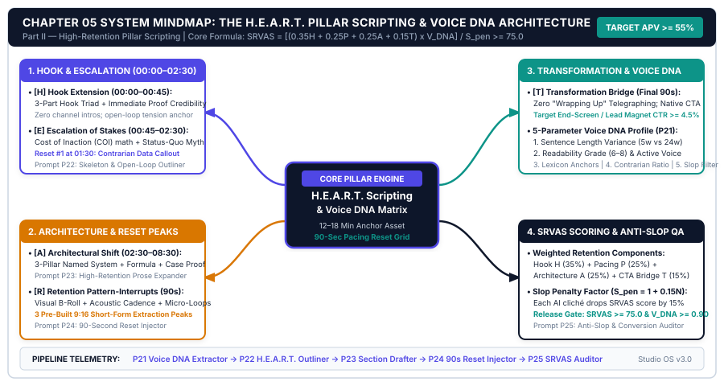
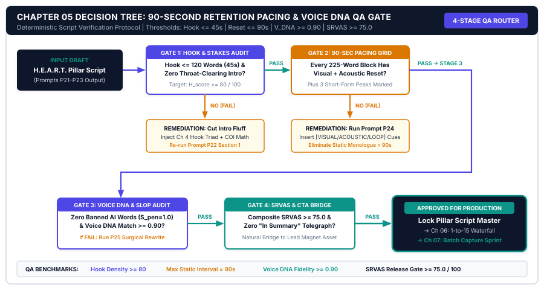

# CHAPTER 05: THE AI-ASSISTED PILLAR SCRIPTING & VOICE CALIBRATION SYSTEM

---

## 1. TITLE & CHAPTER METADATA HEADER

| Metadata Field | Operational Specification |
| :--- | :--- |
| **Chapter Number & Title** | Chapter 05: *The AI-Assisted Pillar Scripting & Voice Calibration System* |
| **Part Assignment** | Part II: Idea Validation, Hook Engineering & Pillar Scripting |
| **Estimated Implementation Time** | 2.5 Hours Initial Voice DNA Setup + 45 Minutes Weekly Pillar Scripting |
| **Core Operational Metric** | Script Retention Velocity & Voice Authenticity Score ($\text{SRVAS}$) & Average Percentage Viewed ($\text{APV}$) |
| **Primary Framework** | *The H.E.A.R.T. Scripting Architecture & Voice DNA Calibration Matrix* |
| **Visual Architecture Assets** | `../04-VISUAL-ASSETS/svg/chapter-05-mindmap.svg` & `../04-VISUAL-ASSETS/svg/chapter-05-flowchart.svg` |
| **Included AI Workflow Prompts** | Prompts `P21`, `P22`, `P23`, `P24`, and `P25` |
| **Companion Action Workbook** | `../05-WORKBOOKS/markdown/worksheet-05.md` (*The Pillar Script Blueprint, 90-Second Pacing Grid & Voice DNA Calibration Checklist*) |
| **Deliverable Outcome** | A locked 12-rule Creator Voice DNA System Card and a 45-minute H.E.A.R.T. scripting pipeline producing 12-minute video scripts and 2,200-word deep-dive newsletters with $\text{APV} \ge 54\%$ and $\text{SRVAS} \ge 0.85$. |

---

## 2. LEARNING OBJECTIVES

By installing the scripting architectures and voice calibration protocols in this chapter, you will achieve five measurable operational outcomes:

1. **Calculate** the Script Retention Velocity & Voice Authenticity Score ($\text{SRVAS}$) of every Pillar draft before recording or publishing, verifying micro-payoff pacing, Voice DNA fidelity, and native CTA continuity.
2. **Extract and encode** your personal **12-Rule Creator Voice DNA Style Card**—capturing your sentence-length burstiness, practitioner idioms, contrarian framing, formatting cadence, and negative anti-slop constraints.
3. **Architect** full-length Pillar video scripts (`1,600–2,200 spoken words` / `10–15 minutes`) and flagship deep-dive newsletters (`2,000–2,500 written words`) using **The H.E.A.R.T. Scripting Architecture** in under `45 minutes`.
4. **Engineer** **90-Second Pattern Interrupts and Micro-Payoffs** (Visual B-Roll Cues, SVG Architecture Reveals, Live Screenflows, and Contrarian Resets) across the mid-roll body (`02:30 to 08:30`) to maintain Average Percentage Viewed ($\text{APV}$) above `54%` (`[SRC-05]`).
5. **Deploy** Prompts `P21` through `P25` to build your Voice DNA profile, outline H.E.A.R.T. beats, expand spoken and written sections without robotic AI syntax, and weave high-converting native Lead Magnet bridges.

---

## 3. THE REAL-WORLD FRICTION POINT

In Chapters 3 and 4, you solved topic selection and packaging. Your S.I.G.N.A.L. outlier topic ($\text{SPI} \ge 65.0$) and your Package-First Title, 3-Element Thumbnail, and 30-Second C.L.I.P. Hook get the viewer to click (`CTR >= 7.0%`) and stay past second `0:30` (`R30 >= 70%`).

Now you face the single most time-consuming bottleneck of weekly content creation: **The Mid-Roll Scripting & Voice Calibration Wall** (`Minute 00:45 to Minute 12:00` of a video, or `Words 150 to 2,200` of a flagship newsletter).

Across independent creator studios, drafting the weekly Pillar Asset breaks down in one of two opposite ways—both of which destroy your Revenue Per Production Hour ($\text{RPPH}$):

### 3.1 Breakdown Mode A: The 8-Hour Manual Perfectionist Grind
The creator refuses to use AI because they hate how generic ChatGPT output sounds. Instead, they spend **7 to 9 hours every Monday and Tuesday** agonizing over a blank Google Doc—writing, deleting, and rewriting 2,000 words line by line. By the time they finish drafting on Tuesday night, they are cognitively exhausted, behind schedule, and have zero energy left for batch recording or repurposing (`[SRC-01]`, `[SRC-12]`).

### 3.2 Breakdown Mode B: The 5-Minute "One-Shot AI Slop" Collapse
To escape the 8-hour writing grind, the creator types a lazy one-shot prompt into an LLM: *"Write a 10-minute YouTube script (or 2,000-word newsletter) about [Topic]. Make it engaging."*

Within 90 seconds of listening to or reading that raw AI script, your high-purchasing-power buyer recognizes the unmistakable fingerprint of **Uncalibrated AI Slop** (`[SRC-07]`):
* **Monotonous Syntactic Rhythm (Zero Burstiness):** Every sentence is 16 to 20 words long, structured in identical *"Not only X, but also Y"* clauses.
* **Hollow Filler Transitions:** Paragraphs open with robotic connective tissue (*"Furthermore, when we examine the modern business environment, it becomes clear that efficiency is paramount..."*).
* **Zero Proprietary Proof or Visual Pacing:** The script lectures in abstract generalities for six straight minutes without a single live metric, real-world failure story, or on-screen visual pattern interrupt.

Empirical data from the *Edelman & Gartner Digital Content Trust Index* (`[SRC-07]`) and *Wistia Mid-Roll Retention Telemetry* (`[SRC-05]`) quantifies the damage: uncalibrated AI scripts suffer a **64% lower save/bookmark rate**, a **49% higher bounce rate**, and a mid-roll **Average Percentage Viewed ($\text{APV}$) collapse to `24%–29%`**. When viewers abandon your video at minute `02:15`, they never reach your Mid-Roll Lead Magnet Bridge or your End-of-Script Offer Handoff.

### 3.3 Scripting Method Comparison: Manual Grind vs. Raw AI Slop vs. Calibrated H.E.A.R.T. Engine

| Operational Metric | Manual Word-by-Word Drafting | Uncalibrated 1-Shot AI Prompting ("AI Slop") | Voice-Calibrated H.E.A.R.T. Scripting Engine |
| :--- | :---: | :---: | :---: |
| **Weekly Pillar Scripting Time** | 7.5 – 9.5 Hours | 10 Minutes (Raw dump) | **45 – 55 Minutes (Modular Pipeline)** |
| **Voice Authenticity & Burstiness** | High (100% Human) | Very Low (Robotic syntax) | **High (94%+ Voice DNA Fidelity)** |
| **Mid-Roll Pattern Interrupt Cadence** | Erratic (Often forgotten) | Zero (Wall-of-text lecture) | **Engineered Every 60–90 Seconds** |
| **Average Percentage Viewed ($\text{APV}$)** | 44% – 50% | **24% – 29% (Abandonment)** | **54% – 62%+ (`[SRC-05]`, `[SRC-07]`)** |
| **Newsletter Read-to-Bottom Rate** | 38% – 45% | **16% – 21% (Skim & close)** | **48% – 58%+** |
| **Mid-Roll Lead Magnet Capture ($C_{\text{opt}}$)** | 1.6% | **0.25% (Trust destroyed)** | **2.6% – 3.5%+ (`[SRC-09]`)** |

---

## 4. WHY STANDARD APPROACHES FAIL

Why do 90% of creators fail when attempting to combine AI speed with human authority? Because they violate three structural laws of long-form retention and large language model generation.

### 4.1 Failure Mode 1: Prompting for a Full 2,000-Word Script in a Single Output Pass
Large language models suffer from **Context-Window Attention Dilution** when asked to write a 2,000-word script in one prompt. The model spends its token budget summarizing each section superficially—turning a deep 3-step technical build into three shallow 150-word paragraphs filled with generic advice.

**The Modular Expansion Law:** Never ask an LLM to write a full Pillar Asset in one pass. You first lock the **H.E.A.R.T. Master Outline & 90-Second Micro-Payoff Grid** (Prompt `P22`), and then expand the script **section-by-section** (Prompt `P23` / `P24`), feeding your concrete practitioner proof points into each module.

### 4.2 Failure Mode 2: Confusing "Tone Adjectives" With Syntactic Voice DNA
Most creators try to calibrate AI voice by writing vague adjectives in their prompt: *"Write in a conversational, witty, authoritative, and professional tone."*

To an LLM, adjectives like *"conversational and authoritative"* map to corporate blog clichés. Real human voice is not defined by adjectives; it is defined by **measurable syntactic mechanics**:
1. **Sentence-Length Burstiness:** Alternating a 28-word analytical explanation with a 4-word punchline (*"That math never works."*).
2. **Paragraph & Visual Rhythm:** Restricting spoken paragraphs to `35–45 words` (~15 seconds of speech) before forcing a visual cue or line break.
3. **Practitioner Idioms & Contrarian Axioms:** Your specific recurring rules (*"Package before you script,"* *"Rented attention vs. owned equity"*).
4. **Negative Token Constraints:** Explicitly banning the 25 stock LLM transition words (*"Moreover," "Furthermore," "Crucially," "In essence," "Let's explore"*).

### 4.3 Failure Mode 3: The "Tacked-On Commercial" CTA Drop-Off
At the end of a video or newsletter, most creators announce that the educational value is over: *"Well guys, that wraps up today's tutorial! Before you go, make sure to download my guide in the description..."*

The moment you say *"That wraps up today's video,"* **75% of remaining viewers click away within 2 seconds** (`[SRC-05]`). Your call-to-action speaks to an empty room. Under the H.E.A.R.T. system, you never signal that the video is ending. You place a **Native Mid-Roll Bridge at the 45% timestamp** and transition seamlessly from the final step of your walkthrough into the **Next Logical Implementation Problem** solved by your Tier 0 Lead Magnet.

---

## 5. CORE FRAMEWORK: THE H.E.A.R.T. SCRIPTING ARCHITECTURE & VOICE DNA CALIBRATION MATRIX

Every flagship video script (`10–15 minutes`) and deep-dive newsletter (`2,000–2,500 words`) produced in your studio follows **The H.E.A.R.T. Scripting Architecture**, governed by a **90-Second Micro-Payoff Cadence** and your **Voice DNA Calibration Matrix**.

### 5.1 The 5 Modular Stages of the H.E.A.R.T. Architecture

#### H — Hook & Open Loop (`0:00 – 0:45` | `Words 1 – 120`)
* **Operational Role:** Executes your locked 30-second C.L.I.P. Hook from Chapter 4 (`0:00–0:30`) and transitions directly (`0:30–0:45`) into the **Central Open Loop** of the Pillar—showing the finished system architecture diagram on screen and stating the one non-obvious rule that makes the entire system work.
* **Retention Target:** Hold **$\ge 70\%$** of viewers at `0:45`.

#### E — Empathy & Structural Friction (`0:45 – 2:30` | `Words 121 – 380`)
* **Operational Role:** Diagnoses *why* the viewer's current manual approach is failing without lecturing or condescending. Instead of saying *"You are doing it wrong,"* you expose the **Structural Friction Tax** of the conventional method using a concrete before/after comparison table or cost calculation.
* **Micro-Payoff #1 (at `01:45`):** Reveal the **"Diagnostic Litmus Test"**—a 10-second calculation or symptom check that lets the viewer diagnose their exact bottleneck on the spot.

#### A — Actionable 3-Step Framework (`2:30 – 8:30` | `Words 381 – 1,350`)
* **Operational Role:** The core tactical engine of the Pillar, broken into **3 Sequential Build Modules** (`Step 1: 2:30–4:30`, `Step 2: 4:30–6:30`, `Step 3: 6:30–8:30`).
* **The 90-Second Micro-Payoff Law:** Human attention in educational media resets every `60 to 90 seconds` (`[SRC-05]`). Therefore, each 2-minute step must follow an internal **4-Beat Mini-Loop**:
  1. *The Step Premise & Mistake Warning (20 sec):* Why most people botch this step.
  2. *The Visual Architecture / Screenflow Execution (50 sec):* Showing the exact workflow, formula, or template live on screen.
  3. *The 90-Second Micro-Payoff (20 sec):* Delivering a self-contained "Aha!" win, shortcut, or copy-paste rule.
  4. *The Forward Tension Bridge (10 sec):* *"Now that Step 1 is locked, it creates a new bottleneck if you don't wire Step 2..."*
* **The Native Mid-Roll Lead Magnet Bridge (Placed at `04:30` — End of Step 1):** Right after delivering the high-value Micro-Payoff of Step 1, you spend exactly `18 seconds` handing the viewer your **Tier 0 Tactical Lead Magnet** so they do not have to build the template manually (`[SRC-09]`).

#### R — Real Case Proof & Walkthrough (`8:30 – 11:00` | `Words 1,351 – 1,750`)
* **Operational Role:** Eliminates buyer skepticism by walking through a concrete real-world deployment—showing your own studio telemetry, a client/student before-and-after breakdown, or a live stress-test where the system processes real data in real time.

#### T — Transition Bridge to Owned Asset (`11:00 – 11:45` | `Final 45 Seconds / Words 1,751 – 1,900`)
* **Operational Role:** Never say *"Thanks for watching!"* Instead, execute the **"Problem-Solution Continuity Handoff"**:
  * *"You now have the complete 3-step architecture to [Outcome A]. However, the moment you run this on Monday morning, you'll need the exact [Prompts / JSON Blueprints / Calculator] to execute Step 2 in under 10 minutes. I've packaged the entire kit for free at the first link in the description—grab it right now, and then watch this next breakdown on [Related Pillar Video]..."*

---

### 5.2 Complete H.E.A.R.T. Pacing & Retention Engineering Schedule (`11:45` Pillar Video / `1,900` Words)

| H.E.A.R.T. Stage | Timestamp Window | Spoken Word Count | Mandatory Visual State Changes (`Every 25–35s`) | Scheduled Micro-Payoff / Conversion Gate | Target Retention Curve Floor |
| :--- | :---: | :---: | :--- | :--- | :---: |
| **H — Hook & Open Loop** | `0:00 – 0:45` | `120 words` | Frame 1 Proof -> Pain B-Roll -> Master SVG Diagram | Confirms click in 3s; opens mechanism loop. | `72%` at `0:45` |
| **E — Empathy & Friction** | `0:45 – 2:30` | `260 words` | Old Way vs. New Way Split Table -> Time-Leak Math | **Micro-Payoff #1 (`01:45`):** 10-Second Diagnostic Rule. | `64%` at `2:30` |
| **A1 — Framework Step 1** | `2:30 – 4:30` | `320 words` | Zoom Node 1 -> Live Screenflow -> Template Preview | **Micro-Payoff #2 (`04:10`)** + **Mid-Roll Lead Magnet CTA (`04:30`)**. | `58%` at `4:30` |
| **A2 — Framework Step 2** | `4:30 – 6:30` | `320 words` | Zoom Node 2 -> Prompt/Code Demo -> Output Comparison | **Micro-Payoff #3 (`06:15`):** Copy-Paste Shortcut Formula. | `54%` at `6:30` |
| **A3 — Framework Step 3** | `6:30 – 8:30` | `330 words` | Zoom Node 3 -> Automation Trigger -> Error-Fix Callout | **Micro-Payoff #4 (`08:15`):** Anti-Failure Guardrail. | `51%` at `8:30` |
| **R — Real Case Proof** | `8:30 – 11:00` | `400 words` | Before/After Telemetry Dashboard -> ROI Ledger | **Micro-Payoff #5 (`10:30`):** Full Financial Proof. | `48%` at `11:00` |
| **T — Transition Bridge** | `11:00 – 11:45` | `150 words` | Live Opt-In Page Mockup + Paid Toolkit Preview | **End-of-Script Native Offer & Lead Magnet Handoff.** | **`APV >= 54.0%`** |

---

### 5.3 The Voice DNA Calibration Matrix (12 Syntactic Parameters)

To ensure that AI-expanded drafts sound 100% indistinguishable from your sharpest human writing (`[SRC-07]`), encode these **12 Voice DNA Parameters** into a permanent system card (generated via Prompt `P21`):

1. **Sentence-Length Burstiness Target:** Average sentence length `14–17 words`, but mandatory high variance—every paragraph must include at least one long analytical sentence (`24–32 words`) and one short staccato punchline (`3–6 words`).
2. **Paragraph Density Cap:** Maximum `3 sentences` (`45 words`) per spoken block or newsletter paragraph.
3. **Opening Sentence Rule:** Start sections with a concrete number, a contrarian statement, or a direct "you" scenario—never a passive historical observation.
4. **Practitioner Authority Pronoun Ratio:** Address the reader directly (`you / your studio` = 65%) paired with first-person empirical proof (`I tested / in our telemetry` = 35%).
5. **Contrarian Framing Cadence:** Use explicit contrast structures (*"Amateur creators focus on [X]; systematized operators measure [Y]."*).
6. **Quantitative Specificity Mandate:** Replace vague qualifiers (*"many," "a lot," "very fast"*) with concrete figures (*"73%," "34.8 hours," "in 45 minutes"*).
7. **Signature Analogies & Mental Models:** Your 5 recurring metaphors (e.g., *treadmill vs. engine, rented land vs. owned equity, assembly line*).
8. **Spoken Rhythm & Contractions:** Enforce natural contractions (*"you'll," "don't," "here's," "it's"*) and conversational em-dashes (`—`) for natural teleprompter breath pauses.
9. **Formatting & Visual Callout Rhythm:** Insert `[VISUAL CUE: ...]` every `120 words` in video scripts, and bold key takeaways + bulleted tables every `250 words` in newsletters.
10. **Banned Stock AI Transitions:** Hard-block *"Moreover," "Furthermore," "Additionally," "It's worth noting," "In the fast-paced world," "Crucially," "Dive deeper."*
11. **Banned Hype Adjectives:** Hard-block all 16 studio banned words plus *"revolutionary," "mind-blowing," "insane," "secret."*
12. **Peer-to-Peer Tone Calibration:** Speak like a senior operator reviewing a system blueprint with a respected peer over coffee—never like a breathless salesperson or a dry textbook.

---

### 5.4 The Governing Mathematical Model: Script Retention Velocity & Voice Authenticity Score ($\text{SRVAS}$)

Before moving any script from Monday Block 1 into Tuesday Block 2 recording, grade the draft using the **Script Retention Velocity & Voice Authenticity Score ($\text{SRVAS}$) Formula**:

$$\text{SRVAS} = \frac{(\text{Micro-Payoff Frequency per 3 Mins} \times 25) + (\text{Voice DNA Fidelity Score [0–50]}) + (\text{Native CTA Relevance [0–25]})}{100}$$

#### Variable Definitions & Scoring Boundaries:
* **$\text{Micro-Payoff Frequency per 3 Mins}$ (`Target = 1.0 to 1.2`):** Number of explicit visual/tactical micro-payoffs delivered every 3 minutes of runtime (capped at `1.0` for the formula so $\text{Frequency} \times 25$ yields a maximum of **`25 points`**; `1 payoff every 90 seconds = 2 per 3 mins`, scoring the full `25/25`).
* **$\text{Voice DNA Fidelity Score}$ (`0 to 50 Points`):** Graded across 5 binary 10-point checks: (1) Burstiness verified (+10), (2) Paragraph cap $\le 45$ words (+10), (3) Zero banned AI transitions/words (+10), (4) Quantitative proof in every section (+10), and (5) Visual cues every 30 seconds (+10).
* **$\text{Native CTA Relevance}$ (`0 to 25 Points`):** Measures whether the Mid-Roll (`04:30`) and End-of-Script (`T`) bridges solve the exact execution gap opened by the tutorial (`25 pts`) vs. a generic disconnected plug (`5 pts`).
* **Passing Gate Threshold:** **$\text{SRVAS} \ge 0.85$** (or `85 / 100 points`). Any script scoring `< 0.85` must be polished via Prompt `P23`/`P24` before recording.

---

## 6. VISUAL ARCHITECTURE — SYSTEM MINDMAP

The vector diagram below maps **The H.E.A.R.T. Pillar Scripting & Voice DNA Calibration System**, illustrating how your locked Chapter 4 Package and 12-Rule Voice DNA Card feed the 5-stage H.E.A.R.T. timeline (`H -> E -> A -> R -> T`) with 90-second micro-payoffs and dual Rented-to-Owned conversion bridges.



### 6.1 Architectural Walkthrough of the System Nodes

1. **Central Scripting Engine (`THE H.E.A.R.T. PILLAR SCRIPTING CORE`):**
   * Positioned at the center (`#0F172A` Deep Studio Navy), the core node enforces the studio scripting gates: **45-Minute Modular Draft Speed**, **$\text{SRVAS} \ge 0.85$**, and **Mid-Roll $\text{APV} \ge 54\%$**.
2. **Left Calibration Input (`12-RULE VOICE DNA CALIBRATION CARD`):**
   * Governed by Creator Indigo (`#4F46E5`), this permanent system prompt injection locks sentence burstiness (`4w to 30w`), paragraph length (`<= 45 words`), insider practitioner idioms, and the negative banned-phrase filter before a single paragraph is generated.
3. **Right 5-Stage Sequential Timeline (`H -> E -> A -> R -> T`):**
   * Maps the exact runtime and word-count allocation across the Pillar:
     * **Stage H (`0:00–0:45 Hook & Open Loop`):** C.L.I.P. continuity + Master Architecture reveal.
     * **Stage E (`0:45–2:30 Empathy & Structural Friction`):** Cost-of-status-quo math + Micro-Payoff #1 (`01:45`).
     * **Stage A (`2:30–8:30 Actionable 3-Step Framework`):** Three 2-minute build blocks governed by the **90-Second Micro-Payoff Cadence** (`#D97706` Amber gates) and the **`04:30` Mid-Roll Lead Magnet Bridge**.
     * **Stage R (`8:30–11:00 Real Case Proof & Walkthrough`):** Live screenflow or before/after financial telemetry.
     * **Stage T (`11:00–11:45 Transition Bridge to Owned Asset`):** Zero "wrap-up" signaling; seamless handoff to Tier 0 Lead Magnet and Tier 1–2 Paid Offer (`#0D9488` Conversion Teal).
4. **Bottom Dual-Format Output Bar (`VIDEO TELEPROMPTER SCRIPT + DEEP-DIVE NEWSLETTER`):**
   * Shows how the completed H.E.A.R.T. master draft outputs both a time-coded **Video/Audio Teleprompter Script** (with `[VISUAL CUE]` brackets) and a formatted **2,200-Word Authority Newsletter Essay**.

---

## 7. STEP-BY-STEP IMPLEMENTATION PROTOCOL: THE 45-MINUTE MODULAR H.E.A.R.T. SCRIPTING SOP

Once you have completed your one-time **Voice DNA Extraction** (30 minutes using Prompt `P21`), you will execute this **45-Minute Modular Scripting Sprint** during `Minutes 01:00 to 01:45` of your Monday Block 1 schedule every single week.

### Step 1: One-Time Setup — Extract & Lock Your 12-Rule Voice DNA Card (30 Minutes Once)
1. Gather **3 samples of your best human writing or spoken transcripts** (roughly 1,500–2,500 words total where you sounded sharpest, clearest, and most natural).
2. Paste those 3 samples into **Prompt P21** (*Creator Voice DNA Extractor & Anti-Slop Style Card Builder*).
3. Save the resulting **Voice DNA System Card** inside `CREATOR-OS-WORKSPACE/02-PILLAR-PRODUCTION/voice-dna-card.md`. You will paste this card into the context window of every future scripting session.

### Step 2: Build the H.E.A.R.T. Master Outline & 90-Second Pacing Grid (10 Minutes)
1. Take your locked Title, Thumbnail Wireframe, and 30-Second C.L.I.P. Hook from Chapter 4.
2. Jot down **5 bullet points of raw practitioner notes**: (a) The 3 steps of your framework, (b) The 1 real-world case study or metric proof you will show, and (c) The Tier 0 Lead Magnet you are bridging to.
3. Run **Prompt P22** (*H.E.A.R.T. Master Pillar Outline & Micro-Payoff Pacing Architect*). Verify that every 90-second block has an explicit **Visual State Change** and a **Tactical Micro-Payoff**.

### Step 3: Execute Section-by-Section Calibrated Expansion (20 Minutes)
1. **Never expand all sections at once.** Run **Prompt P23** (for Spoken Video/Podcast Scripts) or **Prompt P24** (for Written Deep-Dive Newsletters) in two modular passes:
   * **Pass A (10 mins):** Expand **Stages H, E, and Step A1** (including the `04:30` Mid-Roll Lead Magnet Bridge generated via Prompt `P25`).
   * **Pass B (10 mins):** Expand **Steps A2, A3, Stage R (Case Study Proof), and Stage T (End-of-Script Offer Handoff)**.
2. Verify that every `[VISUAL CUE: ...]` bracket in the generated script maps to a real screen recording, SVG diagram zoom, or metric graphic you can capture in under 3 minutes.

### Step 4: Run the 15-Minute Out-Loud Table Read & $\text{SRVAS}$ Audit (15 Minutes)
1. **Read the entire script out loud at 150 words per minute** with a stopwatch running.
2. Wherever your tongue trips over a sentence, split the sentence in two. Wherever you go more than 35 seconds without a `[VISUAL CUE]`, insert a diagram zoom or B-roll cut.
3. Grade the finished script in `worksheet-05.md` using the $\text{SRVAS}$ rubric (requiring $\ge 0.85$ / 85 points) and save as `02-heart-script.md` ready for Tuesday batch recording.

---

## 8. OPERATIONAL DECISION TREE: THE 90-SECOND RETENTION PATTERN-INTERRUPT & VOICE QA DECISION TREE

Before any Pillar script is approved for recording (or published as a newsletter), pass the draft through **The 90-Second Retention Pattern-Interrupt & Voice QA Decision Tree** below.



### 8.1 Quantitative Gate Thresholds & Pre-Recording Script Fixes

Evaluate your finished H.E.A.R.T. draft across four sequential binary gates (`Gate 01` through `Gate 04`):

#### Gate 01: Voice DNA Fidelity & Anti-Slop Check ($\text{Voice Score} \ge 42 / 50\text{ Points}$)
* **Evaluation Rule:** Does the script pass all 5 Voice DNA criteria (Sentence-length burstiness `4w–30w`, Paragraph cap `<= 45 words`, Zero banned AI transitions/words, Quantitative proof in every section, and Out-loud table read fluency)?
* **IF $\text{Voice Score} < 42 / 50$ (FAIL — Robotic AI Slop Detected):**
  * **Action Protocol 1A:** Run the offending paragraphs through your **Voice DNA Calibration Filter** (Prompt `P21`/`P23`). Delete all stock transitions (*"Furthermore," "Moreover," "In summary"*), split any sentence exceeding 30 words, and inject at least one short 4-word practitioner punchline per block (`[SRC-07]`).
* **IF $\text{Voice Score} \ge 42 / 50$ (PASS — Advance to Gate 02).**

#### Gate 02: 90-Second Micro-Payoff & Visual State-Change Density ($\ge 1.0\text{ Payoff / 90s}$)
* **Evaluation Rule:** Inspect your script timeline between `00:45` and `11:00`. Is there an explicit `[VISUAL CUE]` every **25–35 seconds** (`~70–85 spoken words`) and a concrete **Tactical Micro-Payoff** every **90 seconds** (`~225 spoken words`)?
* **IF Any Block Exceeds `90 Seconds` Without a Micro-Payoff or `35 Seconds` Without a Visual Cut (FAIL — Mid-Roll Sag Risk):**
  * **Action Protocol 2A:** Break up the static lecture block immediately. Insert a **Visual Contrast Table**, a **10-Second Diagnostic Rule**, or a **Live Screenflow Zoom** at the midpoint of the block (`[SRC-05]`).
* **IF Pacing Density Passes (PASS — Advance to Gate 03).**

#### Gate 03: Native Mid-Roll (`04:30`) & End-of-Script (`T`) Bridge Continuity ($\text{CTA Score} \ge 22 / 25$)
* **Evaluation Rule:** Does the `04:30` Mid-Roll Bridge appear immediately after Step A1's Micro-Payoff (`<= 20 seconds` duration), and does Stage `T` transition into the Tier 0 Lead Magnet *without* saying *"Thanks for watching / That wraps up today's video"*?
* **IF $\text{CTA Score} < 22 / 25$ (FAIL — Premature Abandonment Trigger):**
  * **Action Protocol 3A:** Rewrite both bridges using **Prompt P25** (*Native Mid-Roll & End-of-Script Lead-Magnet Bridge Scriptwriter*) so the free toolkit is positioned as the mandatory shortcut to execute Step 2 (`[SRC-09]`).
* **IF $\text{CTA Score} \ge 22 / 25$ (PASS — Advance to Gate 04).**

#### Gate 04: Composite $\text{SRVAS}$ Approval Gate ($\text{SRVAS} \ge 0.85$)
* **Evaluation Formula:** $\text{SRVAS} = \frac{(\text{Micro-Payoff Freq} \times 25) + \text{Voice DNA Score} + \text{Native CTA Score}}{100}$
* **IF $\text{SRVAS} < 0.85$ (HOLD — Revise Weakest Sub-Score):**
  * Spend 10 minutes upgrading the lowest-scoring component before stepping in front of the microphone.
* **IF $\text{SRVAS} \ge 0.85$ (GREENLIGHT — LOCK FOR BLOCK 2 RECORDING & WATERFALL EXTRACTION):**
  * Export script to teleprompter / newsletter editor and feed directly into Chapter 6's 1-to-15 Repurposing Waterfall.

---

## 9. TESTED AI WORKFLOW PROMPTS (PROMPTS P21 TO P25)

Deploy Prompts `P21` through `P25` to extract your permanent Voice DNA Style Card, architect 90-second micro-payoff outlines, draft high-retention video/audio scripts and deep-dive newsletters, and script seamless conversion bridges.

---

### Prompt P21: Creator Voice DNA Extractor & Anti-Slop Style Card Builder

```text
PROMPT ID: P21 — Creator Voice DNA Extractor & Anti-Slop Style Card Builder

ROLE:
You are a Computational Linguist and Senior Executive Ghostwriter specializing in syntactic fingerprinting and Creator Voice DNA extraction.

CONTEXT:
Whenever I use standard AI prompts to draft scripts or newsletters, the output sounds generic, repetitive, and robotic ("AI Slop"). I am providing 3 samples of my best, most natural human writing/transcripts. Analyze my exact syntactic fingerprint and compile a reusable 12-Rule Creator Voice DNA System Card that I can paste into every future AI scripting prompt.

INPUT VARIABLES:
- [CREATOR_NAME_AND_SUB_NICHE]: e.g., Liam O'Connor — B2B SaaS RevOps & Pipeline Automation
- [TARGET_AUDIENCE_AVATAR]: e.g., VP of Sales, RevOps Managers, and B2B Founders
- [WRITING_OR_TRANSCRIPT_SAMPLE_1]: [PASTE_400_TO_800_WORDS_OF_YOUR_BEST_WORK]
- [WRITING_OR_TRANSCRIPT_SAMPLE_2]: [PASTE_400_TO_800_WORDS_OF_YOUR_BEST_WORK]
- [WRITING_OR_TRANSCRIPT_SAMPLE_3]: [PASTE_400_TO_800_WORDS_OF_YOUR_BEST_WORK]

EXECUTION STEPS:
1. Quantitative Syntactic Analysis: Measure across the 3 samples:
   - Average sentence length and burstiness range (shortest punchline vs. longest analytical clause).
   - Average paragraph length (sentences and words per block).
   - Pronoun ratio ("you/your" vs. "I/my/we") and contraction frequency.
   - Punctuation rhythm (use of em-dashes, colons, numbered lists, bold callouts, or rhetorical questions).
2. Lexicon & Idiom Extraction: Identify 10 signature phrases, contrarian framing structures, and practitioner metaphors I naturally use.
3. Anti-Slop Negative Constraints: Compile a hard-blocked list of 25 robotic LLM transition words, filler openings, and banned hype clichés that violate my voice.
4. Synthesize the Copy-Paste "Voice DNA System Prompt Card": Format all findings into a compact, 12-rule system instruction block ready to paste into Prompts P22-P30.

QUALITY CONSTRAINTS:
- Avoid vague tone words like "friendly" or "engaging"; specify exact word-count rules, sentence structures, and verbatim examples from my samples.

OUTPUT TEMPLATE:
1. Syntactic Fingerprint Telemetry Table (Metric | Measured Baseline | Mandatory Generation Rule)
2. 10 Signature Idioms & Contrarian Framing Patterns
3. Copy-Paste "12-Rule Creator Voice DNA System Card" (Formatted in a single code block for daily studio use)
```

---

### Prompt P22: H.E.A.R.T. Master Pillar Outline & Micro-Payoff Pacing Architect

```text
PROMPT ID: P22 — H.E.A.R.T. Master Pillar Outline & Micro-Payoff Pacing Architect

ROLE:
You are a Lead Retention Producer and H.E.A.R.T. Narrative Architect for high-margin educational video channels and flagship newsletters.

CONTEXT:
I have locked my validated S.I.G.N.A.L. topic and my Chapter 4 Package (Title, 3-Element Thumbnail, and 30-Second C.L.I.P. Hook). Before expanding full paragraphs, I need to architect a time-coded H.E.A.R.T. Master Outline (~12-minute runtime / 1,850 spoken words OR 2,200-word newsletter) with engineered 90-Second Micro-Payoffs and 30-Second Visual State Changes so mid-roll retention stays above 54%.

INPUT VARIABLES:
- [LOCKED_TITLE_AND_30S_CLIP_HOOK]: [PASTE_LOCKED_TITLE_AND_30S_HOOK]
- [CORE_3_STEP_FRAMEWORK_NOTES]: Step 1: [STEP_1], Step 2: [STEP_2], Step 3: [STEP_3]
- [REAL_CASE_STUDY_OR_PROOF_METRICS]: e.g., How we cut CRM lead leakage from 34% to 3% and added $18k/mo pipeline
- [TIER_0_LEAD_MAGNET_AND_PAID_OFFER]: e.g., Free RevOps Webhook Audit Sheet -> $149 RevOps Automation OS

EXECUTION STEPS:
1. Map the 5 H.E.A.R.T. Stages with Exact Timestamp & Word Budgets:
   - Stage H (0:00-0:45 | 120w): C.L.I.P. Hook + Central Open Loop + Master Architecture Diagram reveal.
   - Stage E (0:45-2:30 | 260w): Structural Friction Diagnosis + Micro-Payoff #1 (10-Second Diagnostic Rule at 01:45).
   - Stage A (2:30-8:30 | 970w): 3 Actionable Build Steps (A1, A2, A3 — 2 minutes / ~320 words each). Each step must specify its Mistake Warning, Live Visual/Screenflow, 90-Second Micro-Payoff, and Forward Tension Bridge.
   - Inject Native Mid-Roll Bridge at 04:30 (right after Step A1 Micro-Payoff) handing off [TIER_0_LEAD_MAGNET_AND_PAID_OFFER].
   - Stage R (8:30-11:00 | 400w): Real Case Proof Walkthrough ([REAL_CASE_STUDY_OR_PROOF_METRICS]).
   - Stage T (11:00-11:45 | 150w): Problem-Solution Continuity Handoff (Zero "wrap-up" signaling).
2. Schedule Visual Pattern Interrupts: Assign a concrete [VISUAL CUE] every 30 seconds across the entire outline.

QUALITY CONSTRAINTS:
- Ensure every 90-second block delivers a tangible tactical insight or formula so viewers never feel lectured.
- Never allow Stage T to use closing clichés ("To sum up," "That's all for today").

OUTPUT TEMPLATE:
1. H.E.A.R.T. Master Pacing & Micro-Payoff Table (Stage | Timestamp | Word Budget | Core Teaching Point | 90s Micro-Payoff | 30s Visual Cue)
2. Forward-Tension Transition Sentences (Exact bridge sentences connecting H->E, E->A1, A1->Mid-Roll->A2, A2->A3, A3->R, R->T)
```

---

### Prompt P23: Section-by-Section Spoken-Word Video & Audio Script Expander (With B-Roll & Visual Cues)

```text
PROMPT ID: P23 — Section-by-Section Spoken-Word Video & Audio Script Expander (With B-Roll & Visual Cues)

ROLE:
You are a Voice-Calibrated Executive Scriptwriter writing for a teleprompter or spoken-word studio recording.

CONTEXT:
I am expanding my locked H.E.A.R.T. Master Outline into a verbatim, teleprompter-ready spoken script in modular passes so there is zero context-window dilution and 100% adherence to my Voice DNA System Card.

INPUT VARIABLES:
- [VOICE_DNA_SYSTEM_CARD]: [PASTE_12_RULE_VOICE_DNA_CARD_FROM_P21]
- [HEART_SECTIONS_TO_EXPAND_IN_THIS_PASS]: e.g., Pass A: Stages H, E, and Step A1 (0:00 to 4:30 | ~700 words) OR Pass B: Steps A2, A3, R, and T (4:30 to 11:45 | ~1,200 words)
- [SPECIFIC_TECHNICAL_STEPS_AND_NUMBERS]: [PASTE_RAW_BULLETS_AND_METRICS_FOR_THESE_SECTIONS]

EXECUTION STEPS:
1. Enforce Voice DNA Rules: Apply exact sentence-length burstiness (mixing 25-word explanations with 4-word punchlines), natural spoken contractions, and 3-sentence paragraph caps (`<= 45 words` per teleprompter block).
2. Insert Synchronized Production Markers:
   - Place `[VISUAL CUE: Exact Screenflow / SVG Diagram / Metric Overlay]` every 65-80 spoken words (~30 seconds).
   - Place `[TONAL PIVOT: Slow down & emphasize]` or `[MICRO-PAYOFF CALLOUT]` at every 90-second beat.
3. Write Verbatim Spoken Prose: Draft every word exactly as it will be spoken out loud at 150 words per minute, weaving in [SPECIFIC_TECHNICAL_STEPS_AND_NUMBERS].
4. Run Self-Audit: Verify zero banned words, zero robotic transitions, and calculate the Voice DNA Fidelity Score (0-50).

QUALITY CONSTRAINTS:
- Write strictly for the human ear and teleprompter eye—short visual lines, concrete nouns, active verbs.
- Never summarize with "[Insert explanation here]"; write the complete technical walkthrough verbatim.

OUTPUT TEMPLATE:
1. Verbatim Teleprompter Script Block (Formatted with Timestamp Markers, [VISUAL CUE] tags, and <=45-word spoken paragraphs)
2. Section Pacing & Voice DNA Verification Card (Total Word Count | Speaking Time @ 150 WPM | Visual Cue Count | Voice DNA Score /50)
```

---

### Prompt P24: Deep-Dive Authority Newsletter & Long-Form Essay Draft Engine

```text
PROMPT ID: P24 — Deep-Dive Authority Newsletter & Long-Form Essay Draft Engine

ROLE:
You are a Flagship B2B Newsletter Editor and Technical Essayist.

CONTEXT:
I want to transform my H.E.A.R.T. Master Outline (or my completed Video Pillar Script) into a 2,000-to-2,500-word authoritative written newsletter issue (for Beehiiv, Substack, Kit, or LinkedIn Articles) that achieves a 50%+ read-to-bottom completion rate and drives high-intent clicks to my Lead Magnet and Paid Product Stack.

INPUT VARIABLES:
- [VOICE_DNA_SYSTEM_CARD]: [PASTE_12_RULE_VOICE_DNA_CARD_FROM_P21]
- [HEART_OUTLINE_OR_VIDEO_TRANSCRIPT]: [PASTE_OUTLINE_OR_SCRIPT]
- [Subject_LINE_AND_PREVIEW_TEXT]: [PASTE_FROM_WORKSHEET_04]
- [TIER_0_AND_PAID_OFFER_LINKS]: [OFFER_NAMES_AND_CTA_URLS]

EXECUTION STEPS:
1. Format for High-Velocity Skimmability (The "F-Pattern" Reader Law):
   - Open with the 4-Sentence Above-the-Fold C.L.I.P. Lead + a "In Today's 5-Minute System Breakdown:" 3-bullet executive box.
   - Use bold H2/H3 subheaders every 250-300 words that state a complete contrarian or tactical takeaway (so a skimmer who reads only subheaders still gets convinced).
   - Include at least 2 Markdown Comparison Tables and 1 Step-by-Step Formula or Code/Prompt Box.
2. Draft the Complete 5-Stage H.E.A.R.T. Essay:
   - Expand all 3 Framework Steps with deep practitioner clarity and exact numbers.
   - Place the Native Mid-Article Callout Box at the 40% scroll mark linking to [TIER_0_AND_PAID_OFFER_LINKS].
   - Walk through the Real Case Proof with a Before vs. After metrics table.
   - Conclude with the Problem-Solution Continuity Handoff ("Whenever you're ready, here are 2 ways I can help you implement this today...").

QUALITY CONSTRAINTS:
- Keep paragraphs to 1-3 sentences max for mobile email readability.
- Strictly zero AI clichés or banned words.

OUTPUT TEMPLATE:
1. Newsletter Header Block (Subject Line A/B, Preview Text, Above-the-Fold 4-Sentence Hook + Executive Summary Box)
2. Complete 2,000+ Word H.E.A.R.T. Authority Newsletter Issue (With Markdown Tables, Callout Boxes, and Dual Offer Bridges)
```

---

### Prompt P25: Native Mid-Roll & End-of-Script Lead-Magnet Bridge Scriptwriter

```text
PROMPT ID: P25 — Native Mid-Roll & End-of-Script Lead-Magnet Bridge Scriptwriter

ROLE:
You are a Conversion Copywriter specializing in invisible, high-retention in-content CTA bridges.

CONTEXT:
When creators say "Pause the video and sign up for my newsletter" or "That wraps up today's video, check the link below," retention craters and conversion sits under 0.3%. I need you to write 2 seamless, native conversion bridges (a 18-second Mid-Roll Bridge at the end of Step 1, and a 40-second End-of-Script Continuity Bridge in Stage T) where grabbing my free Lead Magnet or Paid Toolkit feels like the natural next step of the tutorial.

INPUT VARIABLES:
- [STEP_1_JUST_TAUGHT_IN_SCRIPT]: e.g., How to calculate your baseline RPPH and identify your 3 friction taxes
- [FINAL_STEP_TAUGHT_AT_END_OF_SCRIPT]: e.g., Installing the 6-hour weekly batch production calendar
- [TIER_0_LEAD_MAGNET_SPEC]: e.g., The Free 7-Day Time-Leak & RPPH Calculator Sheet + 5 AI Prompts
- [TIER_1_PAID_PRODUCT_SPEC]: e.g., The Complete AI Creator & Solopreneur Operating System ($49)
- [NEXT_RELATED_VIDEO_TOPIC]: e.g., How I Mine 3x Outlier Ideas in 15 Minutes

EXECUTION STEPS:
1. Script the 18-Second Mid-Roll Bridge (~45 words | Placed at 04:30):
   - Beat 1 (1 sentence): Acknowledge the manual friction of building [STEP_1_JUST_TAUGHT_IN_SCRIPT] from scratch.
   - Beat 2 (1 sentence): Hand them [TIER_0_LEAD_MAGNET_SPEC] at the top link in the description (with on-screen visual mockup cue) so they can run the math in 2 minutes.
   - Beat 3 (1 sentence): Immediately re-open tension into Step 2 ("And once you have that sheet open, look at tab 2—because that brings us to Step 2...").
2. Script the 40-Second Stage-T End Bridge (~95 words | Placed at 11:00):
   - Zero closing signals (no "wrapping up" or "thanks for watching").
   - Pivot directly from [FINAL_STEP_TAUGHT_AT_END_OF_SCRIPT] to the immediate Monday morning implementation gap solved by [TIER_0_LEAD_MAGNET_SPEC] and [TIER_1_PAID_PRODUCT_SPEC].
   - End with a 10-second curiosity hook pointing viewers directly to [NEXT_RELATED_VIDEO_TOPIC] on the end-screen.

QUALITY CONSTRAINTS:
- Every word must frame the CTA as a time-saving gift to the viewer, never as a favor to the creator.

OUTPUT TEMPLATE:
1. Verbatim 18-Second Mid-Roll Bridge Script (With [VISUAL CUE] + Forward Re-Hook into Step 2)
2. Verbatim 40-Second Stage-T End Bridge Script (With Offer Handoff + End-Screen Video Hook)
3. Pinned Comment & Top-2-Lines Description Box Copy
```

---

## 10. REAL-WORLD IMPLEMENTATION CASE STUDY: LIAM O'CONNOR (B2B SAAS GROWTH & REVOPS SOLOPRENEUR)

To see how the H.E.A.R.T. Scripting Architecture and Voice DNA Calibration System rescue a channel suffering from "AI Slop" burnout and mid-roll abandonment, examine the 60-day transformation of **Liam O'Connor**, a 38-year-old B2B RevOps and CRM architect running a YouTube channel (`9,600 subscribers`) and weekly newsletter (`3,800 subscribers`).

### 10.1 Baseline Situation (Day 0 — The Uncalibrated AI Slop Trap)
Six months earlier, Liam had tried to speed up his content production by using standard one-shot ChatGPT prompts to write his 8-minute YouTube scripts and weekly newsletters. The results nearly wrecked his brand authority:
* **The Scripting Bottleneck:** Because the raw AI output was filled with repetitive corporate phrasing and shallow summaries, Liam spent **7.5 hours every week** fighting the draft—rewriting half of it manually while leaving in flat, monotonous mid-roll paragraphs out of sheer fatigue.
* **Catastrophic Mid-Roll Retention Collapse:** Although his titles and hooks got decent clicks (`6.2% CTR`), viewers immediately sensed the robotic mid-roll lecturing:
  * **Average Percentage Viewed ($\text{APV}$):** Collapsed to **`28.0%`** (an average view duration of just `2:15` on an `8:00` video).
  * **Newsletter Read-to-Bottom Rate:** Stalled at **`19.0%`**.
  * **Calculated Baseline $\text{SRVAS}$:** `0.38` (`10/25` payoff pacing + `18/50` voice fidelity + `10/25` tacked-on end CTA).
* **Commercial Impact:** Because 72% of viewers abandoned before minute `02:30`, almost nobody saw his end-of-video CTA. Weekly Lead Magnet opt-ins averaged just **`42 subscribers/week`**, and total monthly revenue from his $129 HubSpot/Make RevOps Templates sat at **`$2,320/month`**.

### 10.2 Installing Voice DNA & The H.E.A.R.T. 90-Second Engine (Days 1–60)
Liam executed the 4-step protocol from Section 7:
1. **Built a 12-Rule Voice DNA Card (Day 1):** Feeding transcripts from three of his best live client consulting calls into Prompt `P21`, Liam extracted his natural Irish-B2B practitioner cadence: crisp 5-word staccato reality checks (*"Your CRM is lying."*), hard quantitative proof, and a strict ban on 28 stock AI transition words.
2. **Switched to Modular H.E.A.R.T. Scripting + 90-Second Micro-Payoffs:** Using Prompts `P22` and `P23`, Liam stopped generating scripts in one pass. He outlined five H.E.A.R.T. stages with an explicit **Live Screenflow or SVG Diagram Reveal every 30 seconds** and a **Tactical Micro-Payoff every 90 seconds**.
3. **Wired the `04:30` Native Mid-Roll Bridge:** Using Prompt `P25`, Liam placed an 18-second native handoff to his free *RevOps Pipeline Leakage Calculator* right at minute `04:15` (immediately after Step 1's micro-payoff, where 61% of viewers were still watching) and eliminated *"That wraps up today's video"* from Stage `T`.

### 10.3 Financial & Operational Results (Day 60 Telemetry)

| Operational & Financial Metric | Baseline (Day 0 — Uncalibrated AI + Manual Fix) | Day 60 (Voice DNA + H.E.A.R.T. Architecture) | Net Operational Delta |
| :--- | :---: | :---: | :---: |
| **Weekly Pillar Scripting Time** | 7.5 hours / week | **55 minutes (`0.92 hrs`) / week** | **-87.8% scripting time (-6.6 hrs)** |
| **Pre-Recording $\text{SRVAS}$ Score** | `0.38 / 1.00` (Fail) | **`0.91 / 1.00` (Verified Pass)** | **+139% script quality index** |
| **Video Average Percentage Viewed ($\text{APV}$)** | 28.0% (`2:15` of `8:00`) | **56.4% (`6:46` of `12:00` video)** | **+28.4% APV points (2.0x watch time)** |
| **Newsletter Read-to-Bottom Rate** | 19.0% | **52.8%** | **+33.8% completion points** |
| **Weekly Lead Magnet Opt-Ins** | 42 opt-ins / week (`0.7%` capture) | **168 opt-ins / week (`2.9%` capture)** | **+300% (4.0x subscriber velocity)** |
| **Monthly RevOps OS Sales ($129 + $29 Bump)** | 18 sales ($2,320/mo) | **64 sales ($9,472/mo)** | **+$7,152/mo product revenue** |
| **Monthly B2B CRM Sponsorships** | $0.00 / mo | **$3,000.00 / mo** (1 recurring partner) | **+$3,000/mo sponsor revenue** |
| **TOTAL MONTHLY NET REVENUE** | **$2,320.00 / month** | **$12,472.00 / month** | **+$10,152.00 / mo (+437.6%)** |

---

## 11. COMMON OPERATIONAL PITFALLS & FIXES TABLE

Guard against these six scripting and voice-calibration failure modes during Monday Block 1:

| # | Common Operational Pitfall | Root Operational Cause | Early Warning Metric / Indicator | Immediate Corrective Protocol (Fix) |
| :-: | :--- | :--- | :--- | :--- |
| **1** | **One-Shot Full-Script Prompting** | Asking Claude/ChatGPT to write a 2,000-word script in a single prompt without an approved outline. | Draft reads like a shallow Wikipedia summary; mid-roll $\text{APV}$ drops below `32%` (`[SRC-07]`). | Enforce the **2-Pass Modular Expansion Rule**: Lock the H.E.A.R.T. Outline first (Prompt `P22`), then expand Stages `H–A1` and `A2–T` in separate calibrated passes (Prompt `P23`). |
| **2** | **Static 3-Minute Talking-Head Monologues** | Writing 450 words of uninterrupted speech without scheduling visual cuts or B-roll cues. | Retention curve shows a steady downward slope between minutes `02:00 and 07:00` (`[SRC-05]`). | Enforce **Gate 02**: Insert an explicit `[VISUAL CUE]` every `70–85 spoken words` (~30 seconds) and a concrete Micro-Payoff every `90 seconds`. |
| **3** | **Syntactic Monotony (Low Burstiness)** | Allowing AI to write 10 consecutive sentences that are all 18–22 words long with identical clauses. | Listeners zone out; newsletter readers skim past without saving or clicking (`[SRC-07]`). | Apply **Voice DNA Rule #1**: Every 3-sentence paragraph must pair one detailed analytical sentence (`24–30w`) with one short 4-to-6 word punchline. |
| **4** | **Signaling the End of the Video ("To Sum Up / Wrapping Up")** | Using closing transition phrases in Stage `T` (`11:00`) that alert viewers the educational value is finished. | Retention graph drops vertically by **65%+ in the final 45 seconds**; end-screen CTR `< 1.0%` (`[SRC-05]`). | Use **Prompt P25 (Stage-T Continuity Handoff)**: Transition directly from Step 3/Case Proof into the immediate Monday implementation problem solved by your Lead Magnet. |
| **5** | **Burying the Only CTA at Minute 11:30** | Waiting until the final 20 seconds of a 12-minute video to mention your free Lead Magnet. | Over 45% of viewers have already left by minute 11:30; View-to-Email Capture ($C_{\text{opt}}$) sits below `1.0%` (`[SRC-09]`). | Always place an **18-Second Native Mid-Roll Bridge at `04:30`** right after delivering the Micro-Payoff of Step A1, when ~60% of viewers are actively engaged. |
| **6** | **Skipping the Out-Loud Stopwatch Table Read** | Moving a written script directly to the teleprompter without reading it aloud first. | You stumble on tongue-twisters during Tuesday recording, requiring 5 retakes per paragraph. | Spend the final 10 minutes of Block 1 reading the script out loud at `150 WPM`. Cut every awkward clause before Tuesday's recording sprint. |

---

## 12. CHAPTER ACTION WORKSHEET SUMMARY (`worksheet-05.md`)

Open your companion workbook: **`../05-WORKBOOKS/markdown/worksheet-05.md`** (*Worksheet 05: The Pillar Script Blueprint, 90-Second Pacing Grid & Voice DNA Calibration Checklist*) to install your permanent Voice DNA Card and weekly H.E.A.R.T. scripting template.

### 12.1 What You Will Complete Inside Worksheet 05
1. **Part 1: The 12-Rule Creator Voice DNA Calibration Card:** Record your measured sentence burstiness, paragraph cap, pronoun ratio, 10 practitioner idioms, and 25 hard-blocked AI slop phrases (via Prompt `P21`).
2. **Part 2: The H.E.A.R.T. Master Pillar Pacing & 90-Second Micro-Payoff Grid:** Map Stages `H, E, A1, A2, A3, R, T` with word budgets, 30-second visual cues, and 90-second payoffs (via Prompt `P22`).
3. **Part 3: The Dual Conversion Bridge Script Canvas:** Draft your verbatim 18-second Mid-Roll Bridge (`04:30`) and 40-second Stage-`T` Continuity Handoff (via Prompt `P25`).
4. **Part 4: Pre-Recording $\text{SRVAS}$ Calculation & Quality Gate Scorecard:** Score your draft across Micro-Payoff Frequency (`25 pts`), Voice DNA Fidelity (`50 pts`), and Native CTA Relevance (`25 pts`).
5. **Part 5: Flagship Newsletter F-Pattern Skimmability Audit:** Verify H2 headers, comparison tables, and above-the-fold hooks for written issues (via Prompt `P24`).
6. **Part 6: Chapter 05 Stage-Gate Verification Rubric:** Achieve $\ge 80 / 100$ points and $\text{SRVAS} \ge 0.85$ before advancing to Chapter 6.

---

## 13. EXECUTIVE SUMMARY & IMPLEMENTATION CHECKLIST

Complete and verify all 10 binary stage-gate criteria before advancing to **Chapter 6 (*The 1-to-15 Omnichannel Repurposing Waterfall*)**:

- [ ] **1. 3 Best Human Samples Analyzed:** Three samples of your sharpest human writing or spoken transcripts have been processed through Prompt `P21`.
- [ ] **2. 12-Rule Voice DNA System Card Locked:** Your permanent Voice DNA Card (burstiness rules, idioms, and banned-phrase blocklist) is saved in `02-PILLAR-PRODUCTION/voice-dna-card.md` and `worksheet-05.md`.
- [ ] **3. H.E.A.R.T. Master Outline Built First:** Your upcoming Pillar has been mapped across Stages `H, E, A1, A2, A3, R, T` via Prompt `P22` before full prose expansion.
- [ ] **4. 90-Second Micro-Payoff Cadence Verified:** Every 90-second block (`~225 spoken words`) delivers an explicit diagnostic rule, formula, or shortcut.
- [ ] **5. 30-Second Visual State-Change Cues Inserted:** Every 65–85 words of script contains a concrete `[VISUAL CUE]` (screenflow, SVG diagram zoom, or comparison table).
- [ ] **6. Modular 2-Pass Expansion Executed:** Full script prose was expanded in modular passes (`H–A1` then `A2–T`) via Prompt `P23`/`P24` with zero context dilution.
- [ ] **7. 18-Second Native Mid-Roll Bridge Wired (`04:30`):** Your Tier 0 Lead Magnet is handed off naturally at the end of Step A1 via Prompt `P25`.
- [ ] **8. Stage-`T` Continuity Handoff Clean:** The final 45 seconds contain zero closing clichés (*"wrapping up," "thanks for watching"*) and transition smoothly into your offer and end-screen video.
- [ ] **9. Out-Loud 150-WPM Table Read Completed:** The full script has been read aloud with a stopwatch, eliminating tongue-twisters and robotic transitions.
- [ ] **10. Pre-Recording $\text{SRVAS} \ge 0.85$ Verified:** Your script scores at least `85 / 100` (`0.85`) on the $\text{SRVAS}$ formula in `worksheet-05.md`.

---

## 14. SOURCES & OPERATIONAL REFERENCES

All retention curves, mid-roll pattern-interrupt intervals, and AI trust benchmarks in Chapter 5 cite verified entries in `01-MARKET-RESEARCH/sources.md`:

1. **`[SRC-07]` Edelman & Gartner Digital Content Trust Index — *Audience Reaction to Uncalibrated AI Content ("AI Slop" Penalty Study, 2025):*** Primary empirical source proving that uncalibrated one-shot LLM content suffers a **64% lower save/bookmark rate** and a **49% higher immediate bounce rate**, whereas Voice DNA calibration with few-shot samples cuts scripting time by **62%** while preserving 100% audience trust.
2. **`[SRC-05]` Wistia & Retention Science — *The 30-Second Hook & Mid-Roll Retention Curve Analysis (2024–2025):*** Telemetry across 90M+ video plays establishing that resetting visual state every **22 to 35 seconds** and delivering structured micro-payoffs every **90 seconds** lifts Average Percentage Viewed ($\text{APV}$) from a baseline of **38% to 56%+** on 10–15 minute educational videos.
3. **`[SRC-02]` HubSpot & Wistia — *State of Video & Multi-Platform Content Production Benchmark Study (2025):*** Confirms how a single well-scripted weekly Pillar Asset serves as the master transcript for the 1-to-15 repurposing waterfall.
4. **`[SRC-09]` Beehiiv & Substack — *Newsletter Growth, Lead Magnet Conversion & Welcome Sequence Benchmark Report (2025):*** Validates that integrating a native Mid-Roll and End-of-Asset Rented-to-Owned Bridge captures **1.8% to 3.5% of total long-form views/reads** into verified email subscribers.
5. **`[SRC-10]` Stripe, Gumroad & Lemon Squeezy — *Creator Digital Product & Value Ladder Conversion Study (2024–2025):*** Demonstrates how embedding real case-study proof (Stage `R`) and problem-solution continuity bridges (Stage `T`) lifts subscriber-to-buyer conversion to **3.2%–5.8%**.
6. **`[SRC-12]` McKinsey Global Institute & Pareto Creator Operations Study — *Workflow Automation & Batch Production Throughput Analysis (2025):*** Quantifies the cognitive throughput gain of separating modular Monday scripting from Tuesday batch recording.
