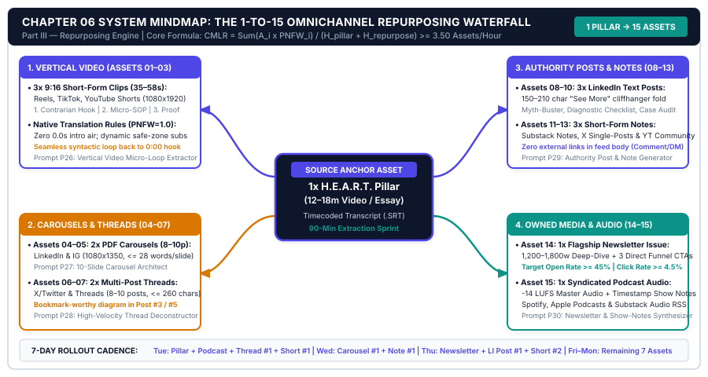
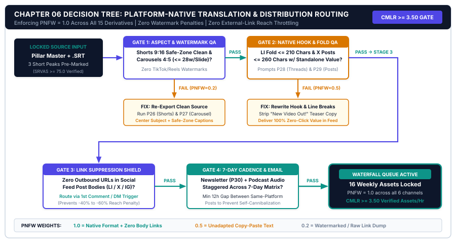

# CHAPTER 06: THE 1-TO-15 OMNICHANNEL REPURPOSING WATERFALL (LONG-FORM TO SHORT-FORM, TEXT & CAROUSELS)

---

## 1. TITLE & CHAPTER METADATA HEADER

| Metadata Field | Operational Specification |
| :--- | :--- |
| **Chapter Number & Title** | Chapter 06: *The 1-to-15 Omnichannel Repurposing Waterfall (Long-Form to Short-Form, Text & Carousels)* |
| **Part Assignment** | Part III: The 1-to-15 Repurposing Engine & Faceless Production |
| **Estimated Implementation Time** | 2.0 Hours Template Calibration + 50–60 Minutes Weekly Waterfall Sprint |
| **Core Operational Metric** | Content Multiplication Lift Ratio ($\text{CMLR}$) & Cross-Platform Opt-In Velocity |
| **Primary Framework** | *The 1-to-15 Content Waterfall & Platform-Native Translation Matrix* |
| **Visual Architecture Assets** | `../04-VISUAL-ASSETS/svg/chapter-06-mindmap.svg` & `../04-VISUAL-ASSETS/svg/chapter-06-flowchart.svg` |
| **Included AI Workflow Prompts** | Prompts `P26`, `P27`, `P28`, `P29`, and `P30` |
| **Companion Action Workbook** | `../05-WORKBOOKS/markdown/worksheet-06.md` (*The Weekly 1-to-15 Omnichannel Repurposing Waterfall & Platform Translation Tracker*) |
| **Deliverable Outcome** | A deterministic 60-minute weekly repurposing pipeline that transforms 1 completed H.E.A.R.T. Pillar Asset into 15 platform-native derivatives (1 Pillar + 5 Shorts + 4 Authority Text Posts + 3 PDF Carousels + 2 Conversion Emails). |

---

## 2. LEARNING OBJECTIVES

By installing the repurposing waterfall and platform-native translation protocols in this chapter, you will achieve five measurable operational outcomes:

1. **Calculate** your studio's Content Multiplication Lift Ratio ($\text{CMLR}$) across all 15 weekly assets, weighting impressions by platform buyer intent and dividing by total production hours.
2. **Eliminate** the *Platform Format Rewrite Tax* (which consumes 68% of an unsystematized creator's workweek `[SRC-02]`) by turning your completed H.E.A.R.T. Pillar Script into the single source of truth for all weekly distribution.
3. **Extract** **14 derivative assets** from **1 core Pillar** in under `60 minutes`—comprising **5 Vertical Short-Form Videos**, **4 Authority Text Posts & Threads**, **3 8-to-10 Slide Visual PDF Carousels**, and **2 Direct-Conversion Nurture Emails**.
4. **Enforce** **Platform-Native Translation Rules** (Zero-External-Link Body Rules, Native Hook Re-Framing, and Comment-Pinned CTA Bridges) so algorithms treat every derivative as a first-class native post rather than a lazy cross-post (`[SRC-08]`).
5. **Deploy** Prompts `P26` through `P30` to batch-generate all 14 derivatives in a single Wednesday Block 3 sprint while maintaining 100% Voice DNA fidelity and Lead Magnet continuity.

---

## 3. THE REAL-WORLD FRICTION POINT

Suppose you have completed your weekly H.E.A.R.T. Pillar Script from Chapter 5. You have a high-retention 12-minute video (or a 2,200-word deep-dive newsletter) packed with five distinct 90-second micro-payoffs, proprietary diagrams, and a real-world case study.

In a traditional unsystematized studio, what happens after that Pillar is published is an operational tragedy:

### 3.1 Tragedy A: The "Publish Once and Abandon" Waste
The creator uploads their 12-minute YouTube video on Tuesday morning, shares a single raw link on X and LinkedIn (*"New video is live! Watch here -> [youtu.be/xyz]"*), and immediately starts worrying about next week's topic.

Why is this a massive unit-economics failure?
* **First**, social feed algorithms on LinkedIn, X, Instagram, and TikTok actively suppress posts containing external links that drive users off their platform (`[SRC-08]`). A post saying *"Watch my new YouTube video"* receives **70% to 85% fewer impressions** than a native text post or PDF carousel.
* **Second**, less than 15% of your total addressable market prefers to consume content in any single format. Decision-makers who never watch YouTube during work hours avidly swipe through 8-slide LinkedIn PDF carousels between meetings; founders who skim past long LinkedIn posts bookmark 7-tweet X threads or watch 45-second vertical Reels at night (`[SRC-02]`, `[SRC-08]`). When you publish your Pillar in only one format, you leave **80% of your potential reach and email opt-ins on the table**.

### 3.2 Tragedy B: The 18-Hour "Blank-Page Multi-Platform" Burnout
Recognizing that they need to be on LinkedIn, X, Shorts, Reels, and Email, the unsystematized creator swings to the opposite extreme: they treat each platform as an independent daily writing job.
* Monday morning: Writes a custom LinkedIn post about Topic A.
* Tuesday afternoon: Scripts two standalone TikToks about Topic B.
* Wednesday morning: Writes an X thread from scratch about Topic C.
* Thursday night: Builds a Canva carousel from scratch about Topic D.

According to telemetry from *HubSpot and Wistia* (`[SRC-02]`), solo creators operating this disconnected model spend **68% of their weekly production hours (`14 to 19 hours/week`) manually rewriting and reformatting content** while suffering a **38% loss in cognitive throughput** from daily context switching (`[SRC-12]`). Worse, because they are inventing 15 separate ideas a week, quality collapses and their audience receives a fragmented, contradictory message.

### 3.3 Operational Telemetry: Disconnected Multi-Posting vs. The 1-to-15 Waterfall

| Operational Dimension | "Publish & Abandon" (1 Asset/Wk) | Disconnected Multi-Posting (15 Separate Ideas/Wk) | The 1-to-15 Content Waterfall (1 Pillar -> 15 Assets) |
| :--- | :---: | :---: | :---: |
| **Weekly Topics Researched** | 1 validated topic | 12–15 unvalidated guesses | **1 S.I.G.N.A.L.-Validated Outlier Topic** |
| **Total Weekly Assets Published** | 1 Pillar only | 15 disconnected posts | **15 Cohesive Assets (1 Pillar + 14 Derivatives)** |
| **Weekly Repurposing & Social Hours** | 0.2 hrs (Link dump) | **14.0 – 19.0 Hours / Week** | **0.85 – 1.0 Hour / Week (Wednesday Block 3)** |
| **Algorithmic Feed Distribution** | Throttled (External link penalty) | Erratic (Shallow 1-off posts) | **Maximized (100% Platform-Native Formats `[SRC-08]`)** |
| **Message & Offer Cohesion** | Single-channel only | Fragmented (Confuses buyers) | **Omnipresent Surround-Sound Authority** |
| **Cross-Platform Impressions / Pillar Hr** | `~2,500 / hr` | `~3,100 / hr` | **`18,000 – 45,000+ / hr` (`+210% Lift [SRC-02]`)** |

---

## 4. WHY STANDARD APPROACHES FAIL

When creators hear the word *"repurposing,"* they usually try one of three shortcuts that fail to generate views or email subscribers.

### 4.1 Failure Mode 1: Unedited Auto-Cropped AI Video Clips
Over the past two years, thousands of creators fed their 15-minute talking-head videos into automated "one-click AI clipping tools" that randomly slice out 45-second mid-sentence segments, slap on bouncing neon captions, and auto-post them to Shorts, Reels, and TikTok.

Those auto-cropped clips almost universally stall at `200 views`. Why? Because **a mid-sentence excerpt from minute 06:12 of a long-form video has no standalone 3-second hook and no self-contained payoff loop!** Short-form vertical algorithms require a **>65% 3-second swipe-stay rate** and a **>75% average view duration** (`[SRC-08]`). If a vertical clip does not open at second `0:00` with a punchy, standalone hook and resolve its micro-loop by second `0:45`, viewers swipe away immediately. Under our 1-to-15 Waterfall, vertical shorts are either extracted from your pre-engineered **90-Second H.E.A.R.T. Micro-Payoff blocks** with a freshly recorded 3-second hook lead-in, or scripted as tight 45-second standalone slices via Prompt `P26`.

### 4.2 Failure Mode 2: Copy-Pasting the Same Text Across LinkedIn, X, and Instagram
Lazy cross-posting—taking a 300-word LinkedIn post and pasting the exact same block of text onto X, Threads, and an Instagram caption—fails because each platform has a distinct **Consumption Physics and Visual Grammar**:
* **LinkedIn** rewards *Executive Story-to-Framework Posts (`180–280 words`)* with strong 2-line "See More" fold hooks and *8-to-10 Slide Native PDF Carousels* (which generate **2.9x higher dwell time** and **3.4x more profile clicks** than plain text `[SRC-08]`).
* **X / Threads** rewards *High-Density Bookmarkable Threads (`6–8 connected posts`)* where each individual post contains a visual diagram, formula, or concrete example.
* **Short-Form Vertical Video (Shorts/Reels/TikTok)** rewards *Fast Visual Pacing (`1 cut every 3–4 seconds`)* and a single verbal/caption keyword trigger pointing to your bio or automated DM bridge.

### 4.3 Failure Mode 3: Putting External Links Inside the Post Body
When you paste an external URL (`https://yournewsletter.com`) inside the main body of a LinkedIn post or the first tweet of an X thread, the host platform's feed classifier flags the post as an **outbound session termination threat** and cuts its organic distribution by **50% to 80%** (`[SRC-08]`).

**The Native Bridge Law:** Keep the main body of your social derivatives 100% link-free so they earn full algorithmic reach. Drive conversions through three frictionless native mechanisms:
1. **The Pinned First-Comment Bridge** (placed 60 seconds after publishing, or triggered after initial engagement velocity).
2. **The Profile Header & Featured-Slot Funnel** (optimizing your profile bio so the 3.4x surge in profile visitors clicks your Tier 0 Lead Magnet link immediately).
3. **The Final Carousel Slide CTA** (embedding your short memorable URL and Lead Magnet visual mockup directly on Slide 8 of your PDF carousel).

---

## 5. CORE FRAMEWORK: THE 1-TO-15 CONTENT WATERFALL & PLATFORM-NATIVE TRANSLATION MATRIX

Every H.E.A.R.T. Pillar Script you produce in Chapter 5 is engineered from inception to divide cleanly into **15 Platform-Native Assets**. Because your Pillar already contains **1 C.L.I.P. Hook**, **1 Contrarian Friction Diagnosis (Stage E)**, **3 Actionable Framework Steps with 90-Second Micro-Payoffs (Steps A1, A2, A3)**, and **1 Real Case-Study Proof (Stage R)**, you never have to invent new ideas during repurposing—you simply translate each modular block into its native medium.

### 5.1 Complete Anatomy of the 15 Weekly Waterfall Assets

#### Asset #1: The Core Pillar Asset (`1 Unit` — Released Tuesday Morning)
* **Format:** 10–15 Minute Long-Form Video (YouTube) OR 2,000–2,500 Word Flagship Deep-Dive Newsletter (Beehiiv/Substack/Web).
* **Commercial Role:** Anchor authority builder and primary Rented-to-Owned Lead Magnet conversion engine (`2.0%–3.5%` view-to-email capture `[SRC-09]`).

#### Assets #2 to #6: 5 Standalone Vertical Short-Form Videos (`5 Units` — `35–55 Seconds` Each)
Distributed across YouTube Shorts, Instagram Reels, LinkedIn Video, or TikTok (1 per weekday, Monday–Friday):
* **Asset #2 (`Short 01 — The Contrarian Myth-Bust`):** Extracted from **Stage E (Friction Tax)**. Attacks the #1 broken industry habit in 40 seconds.
* **Asset #3 (`Short 02 — The 60-Second Master Framework`):** Zooms through the high-level **Stage A 3-Step SVG Mindmap** in 50 seconds.
* **Asset #4 (`Short 03 — The Tactical Step/Tool Teardown`):** Extracted from **Step A1 or A2**. Shows one specific screenflow or formula shortcut in 45 seconds.
* **Asset #5 (`Short 04 — The Costly Mistake Diagnostic`):** Extracted from **Step A3 Guardrail**. Gives a 10-second self-test viewers can run today.
* **Asset #6 (`Short 05 — The Case-Study ROI Breakdown`):** Extracted from **Stage R**. Walks through the Before vs. After numbers ($8.75/hr to $429/hr) in 45 seconds.
* *Note for YouTube Shorts:* Use YouTube's native **"Related Video" Link Feature** on every Short to funnel vertical viewers directly into your full 12-minute Tuesday Pillar Video with 1 tap!

#### Assets #7 to #10: 4 Authority Text Posts & Multi-Post Threads (`4 Units`)
* **Asset #7 (`Text 01 — LinkedIn Contrarian Diagnosis Post`):** `220 words`. Opens with a sharp 2-line fold hook exposing the status-quo cost (Stage E), presents a 5-bullet comparison list, and ends with a native question + first-comment Lead Magnet link.
* **Asset #8 (`Text 02 — LinkedIn Practitioner Case-Study Story`):** `250 words`. Walks through the real-world turnaround from Stage R with concrete metrics and lessons learned.
* **Asset #9 (`Text 03 — X / Threads 7-Post Master Breakdown Thread`):** Translates the full H.E.A.R.T. script into a high-bookmark 7-post thread, attaching the Chapter SVG Mindmap to Post #1 and the Lead Magnet landing page to Post #7.
* **Asset #10 (`Text 04 — X / Substack Notes / LinkedIn Punchy Framework Listicle`):** `140 words`. A crisp, high-save summary of the 3-Step Framework or formula for fast midday skimmers.

#### Assets #11 to #13: 3 Visual Swipe Carousels / PDF Cheat Sheets (`3 Units` — `8–10 Slides` Each)
Built by dropping prompt-generated slide copy (Prompt `P29`) into your locked 8-slide Figma/Canva master grid (`1080x1350px` portrait PDF):
* **Asset #11 (`Carousel 01 — The Step-by-Step System Blueprint PDF`):** Translates Stages A1–A3 into an 8-slide visual walkthrough for LinkedIn & Instagram (`2.9x dwell time` `[SRC-08]`).
* **Asset #12 (`Carousel 02 — The "Old Way vs. New System" Diagnostic Scorecard PDF`):** Translates the Chapter Benchmark Comparison Table and Decision Tree into a swipeable 8-slide audit.
* **Asset #13 (`Carousel 03 — The 5 Copy-Paste Prompts / Cheat-Sheet Vault PDF`):** Showcases 2 of the week's AI prompts on slides 2–7 and bridges viewers to download the full worksheet on Slide 8.

#### Assets #14 & #15: 2 Direct-Conversion Email Nurture Assets (`2 Units`)
Sent to your owned email list to compound retention and monetize subscribers (`[SRC-09]`, `[SRC-10]`):
* **Asset #14 (`Email 01 — Tuesday Deep-Dive Pillar Edition`):** Delivers the written executive breakdown of the week's Pillar framework, links to the full video/guide (driving initial 24-hour CTR velocity), and features your primary Sponsor or Tier 1 Toolkit.
* **Asset #15 (`Email 02 — Friday Tactical Case-Study & Offer Bridge Edition`):** A 400-word story-driven email highlighting the Stage R case study and transitioning directly into your **Tier 1 ($29–$49) or Tier 2 ($99–$249) Paid Digital Product**.

---

### 5.2 The 1-to-15 Platform-Native Translation & Scheduling Matrix

| Asset ID | Derivative Asset Name & Format | Source H.E.A.R.T. Block | Target Platform(s) | Optimal Release Day | Native Conversion Bridge Mechanism |
| :-: | :--- | :---: | :--- | :---: | :--- |
| **#01** | **Core Pillar Video / Flagship Essay** | Full `H-E-A-R-T` | YouTube / Web | **Tuesday AM** | `04:30` Mid-Roll + Description Top Link |
| **#02** | **Short 01: Contrarian Myth-Bust (`45s`)** | Stage `E` (Friction) | Shorts / Reels / TikTok | **Monday PM** | Native "Related Video" Link + Bio Link |
| **#03** | **Short 02: 60s Master Framework (`50s`)** | Stage `A` Overview | Shorts / Reels / TikTok | **Tuesday PM** | Native "Related Video" Link + Bio Link |
| **#04** | **Short 03: Tactical Tool Teardown (`45s`)** | Step `A1 / A2` | Shorts / Reels / TikTok | **Wednesday PM** | Keyword Auto-DM / Bio Tier 0 Link |
| **#05** | **Short 04: Mistake Diagnostic (`40s`)** | Step `A3` Guardrail | Shorts / Reels / TikTok | **Thursday PM** | Native "Related Video" Link + Bio Link |
| **#06** | **Short 05: Case-Study ROI Proof (`45s`)** | Stage `R` (Proof) | Shorts / Reels / TikTok | **Friday PM** | Bio Link to Tier 0 / Tier 1 Offer |
| **#07** | **Text 01: Contrarian Diagnosis Post** | Stage `E` | LinkedIn | **Monday AM** | Pinned Comment + Profile Featured Slot |
| **#08** | **Text 02: Case-Study Teardown Story** | Stage `R` | LinkedIn | **Thursday AM** | Pinned Comment to Tier 1 Paid Toolkit |
| **#09** | **Text 03: 7-Post Master Thread** | Full `H-E-A-R-T` | X / Threads | **Tuesday AM** | SVG Mindmap on Post 1 + CTA on Post 7 |
| **#10** | **Text 04: Punchy Framework Listicle** | Steps `A1–A3` | X / Notes / LinkedIn | **Saturday AM** | Profile Bio Funnel Redirect |
| **#11** | **Carousel 01: 8-Slide System Blueprint** | Steps `A1–A3` | LinkedIn PDF / IG | **Tuesday AM** | Slide 8 Visual CTA + Pinned Comment |
| **#12** | **Carousel 02: Old vs. New Scorecard** | Stage `E` + Gate Tree | LinkedIn PDF / IG | **Wednesday AM** | Slide 8 Visual CTA to Diagnostic Kit |
| **#13** | **Carousel 03: Prompt & SOP Cheat Sheet** | Prompts / SOPs | LinkedIn PDF / IG | **Friday AM** | Slide 8 Visual CTA to Prompt Vault |
| **#14** | **Email 01: Tuesday Pillar Breakdown** | Stages `H, E, A` | Email List (Beehiiv/Kit) | **Tuesday AM** | Direct Links to Pillar + Sponsor/Tier 1 |
| **#15** | **Email 02: Friday Case-Study Offer Bridge** | Stages `R, T` | Email List (Beehiiv/Kit) | **Friday AM** | Direct Pitch for Tier 1 ($49) / Tier 2 ($149) |

---

### 5.3 The Governing Mathematical Model: Content Multiplication Lift Ratio ($\text{CMLR}$)

To measure the exact efficiency of your repurposing engine, compute your weekly **Content Multiplication Lift Ratio ($\text{CMLR}$) & Omnichannel Reach Yield**:

$$\text{CMLR} = \frac{\sum_{i=1}^{15} \left(\text{Platform Native Impressions}_i \times \text{Engagement Weight}_i\right)}{\text{Total Pillar + Repurposing Production Hours}}$$

#### Platform Engagement & Buyer-Intent Weights ($w_i$):
Not all impressions carry equal commercial value. A read inside an owned email or a swipe through an 8-slide LinkedIn PDF carousel converts into digital product revenue at a far higher rate than a 3-second vertical video view (`[SRC-08]`, `[SRC-09]`):
* **Core Long-Form Pillar Video Views / Flagship Newsletter Reads ($i = 1$):** Weight $w_1 = \mathbf{3.0}$ (Highest trust transfer).
* **Owned Email Nurture Opens ($i = 14, 15$):** Weight $w_{14,15} = \mathbf{4.0}$ (Highest direct buyer conversion).
* **8-Slide Native PDF Carousels ($i = 11..13$):** Weight $w_{11..13} = \mathbf{2.0}$ (High dwell time & save rate).
* **Authority Text Posts & X Threads ($i = 7..10$):** Weight $w_{7..10} = \mathbf{1.2}$ (Medium-high profile click rate).
* **Vertical Short-Form Videos ($i = 2..6$):** Weight $w_{2..6} = \mathbf{0.4}$ (Top-of-funnel discovery reach).

#### Worked Example:
* **Pillar Only (No Waterfall — `4.0 Hours`):** `10,000` Pillar views $\times 3.0 = 30,000$ weighted reach units $\div 4.0\text{ hrs} = \mathbf{7,500\text{ CMLR}}$.
* **Full 1-to-15 Waterfall (`4.0h Pillar + 1.0h Waterfall = 5.0 Hours`):**
  * Pillar (#1): `12,000` views $\times 3.0 = 36,000$
  * 5 Shorts (#2–#6): `40,000` views $\times 0.4 = 16,000$
  * 4 Text/Threads (#7–#10): `25,000` impressions $\times 1.2 = 30,000$
  * 3 PDF Carousels (#11–#13): `22,000` impressions $\times 2.0 = 44,000$
  * 2 Emails (#14–#15): `6,000` opens $\times 4.0 = 24,000$
  * **Total Weighted Reach Numerator:** $36,000 + 16,000 + 30,000 + 44,000 + 24,000 = \mathbf{150,000\text{ weighted units}}$.
  * **Calculated $\text{CMLR}$:** $\frac{150,000}{5.0\text{ hours}} = \mathbf{30,000\text{ CMLR}}$ (**4.0x higher weighted commercial output per hour** by adding just 60 minutes of structured repurposing!).

---

## 6. VISUAL ARCHITECTURE — SYSTEM MINDMAP

The vector diagram below maps **The 1-to-15 Omnichannel Repurposing Waterfall Architecture**, illustrating how 1 completed H.E.A.R.T. Pillar Asset flows into the 60-minute Wednesday Extraction Hub and splits into 4 derivative streams (5 Vertical Shorts, 4 Text/Threads, 3 PDF Carousels, and 2 Conversion Emails)—all routing traffic back into your Owned Email Funnel and 4-Tier Value Ladder.



### 6.1 Architectural Walkthrough of the System Nodes

1. **Top Source Node (`ASSET #1: CORE H.E.A.R.T. PILLAR MASTER`):**
   * Styled in Deep Studio Navy (`#0F172A`), this node supplies the unified raw material: the **Time-Coded Pillar Video/Audio Recording**, the **Calibrated Master Transcript (`1,900–2,200 words`)**, and the **2 Chapter Vector SVG Diagrams**.
2. **Central Extraction Engine (`WEDNESDAY 60-MINUTE WATERFALL HUB`):**
   * Highlighted in Creator Indigo (`#4F46E5`), this processing hub runs Prompts `P26` through `P30` against your Voice DNA Card, enforcing **100% Platform-Native Formatting** and **Zero Body External Links**.
3. **Four Derivative Output Branches (`14 DERIVATIVE ASSETS`):**
   * **Branch A (Top-Left — `5 VERTICAL SHORTS [#2-#6]`):** Extracts 5 standalone `35–55s` vertical clips (Myth-Bust, 60s Framework, Tool Teardown, Mistake Check, Case Study) with fresh 3-second C.L.I.P. hooks (`#D97706` Retention Amber).
   * **Branch B (Bottom-Left — `4 AUTHORITY TEXT & THREADS [#7-#10]`):** Generates 2 LinkedIn story/diagnosis posts, 1 7-post X/Threads breakdown, and 1 punchy framework listicle.
   * **Branch C (Top-Right — `3 VISUAL PDF CAROUSELS [#11-#13]`):** Populates 3 `8-to-10 slide` portrait PDF carousels (System Blueprint, Diagnostic Scorecard, Prompt Cheat Sheet) achieving `2.9x` feed dwell time (`[SRC-08]`).
   * **Branch D (Bottom-Right — `2 CONVERSION NURTURE EMAILS [#14-#15]`):** Dispatches the Tuesday Pillar Breakdown Email and the Friday Case-Study Offer Bridge Email (`#0D9488` Conversion Teal).
4. **Bottom Convergence Funnel (`OMNICHANNEL RENTED-TO-OWNED BRIDGE`):**
   * All 15 assets converge on a single destination: driving **Related-Video Clicks**, **Profile Bio Visits**, and **Slide-8 / Pinned-Comment Opt-Ins** directly into your Tier 0 Diagnostic Kit and Tier 1–2 Paid Product Stack.

---

## 7. STEP-BY-STEP IMPLEMENTATION PROTOCOL: THE 60-MINUTE WEDNESDAY WATERFALL SPRINT

Do not spread repurposing across seven days. Execute this entire **60-Minute Waterfall Sprint** inside **Wednesday Block 3** (`60 minutes total`) using your completed Pillar Script and recording from Monday/Tuesday.

### Minute 00 to 20: Extract & Batch-Export the 5 Vertical Short-Form Videos (`Assets #2–#6`)
1. Feed your completed H.E.A.R.T. Pillar Script into **Prompt P26** (*Pillar-to-5 Standalone Short-Form Vertical Video Script Extractor*).
2. Note that you have two rapid production options for these 5 Shorts:
   * **Option A (Recorded During Tuesday Batch Sprint — Highest Retention):** At the end of Tuesday's Pillar recording, read the 5 standalone 45-second Short scripts generated by Prompt `P26` straight into the teleprompter (`takes 7 minutes total`). Because each has a dedicated 3-second hook and 40-second body, editing takes 10 minutes in CapCut/Descript using your saved `9:16` caption preset.
   * **Option B (Text-Based Transcript Slicing):** Highlight the 5 pre-engineered 90-second Micro-Payoff blocks inside Descript, crop to `9:16` vertical, and prepend a 3-second hook card.

### Minute 20 to 35: Generate the 4 Authority Text Posts & Multi-Post Threads (`Assets #7–#10`)
1. Run **Prompt P27** (*Pillar-to-LinkedIn Authority Post & Contrarian Story Formatter*) to generate **Asset #7** (Monday Contrarian Post) and **Asset #8** (Thursday Case-Study Post).
2. Run **Prompt P28** (*Pillar-to-X/Threads High-Bookmark Multi-Post Thread Converter*) to generate **Asset #9** (Tuesday 7-Post Master Thread) and **Asset #10** (Saturday Framework Listicle).
3. Attach your Chapter Mindmap and Flowchart PNG exports directly to the thread and posts for instant visual authority.

### Minute 35 to 50: Populate & Export the 3 8-Slide Visual PDF Carousels (`Assets #11–#13`)
1. Run **Prompt P29** (*8-Slide Visual Carousel & PDF Cheat-Sheet Slide-by-Slide Copy Architect*) to generate the exact slide-by-slide headlines and 25-word body blocks for all 3 carousels.
2. Open your locked 8-Slide Master Template in Figma or Canva (pre-styled with `#0F172A` headers, `#4F46E5` Indigo badges, `#FFFFFF` body cards, and your Slide-8 Lead Magnet mockup).
3. Paste the text blocks (or use Canva Bulk Create / Figma CSV sync) and export all 3 decks as **Multi-Page PDFs** (for LinkedIn native document posts) and **1080x1350px PNGs** (for Instagram/X).

### Minute 50 to 60: Generate the 2 Conversion Emails & Queue All 15 Assets (`Assets #14–#15`)
1. Run **Prompt P30** (*2-Part Weekly Newsletter & Offer-Bridge Email Repurposing Sequence*) to generate **Asset #14** (Tuesday Pillar Email) and **Asset #15** (Friday Case-Study Offer Email).
2. Load Assets `#2` through `#13` into your social scheduler (Buffer, Typefully, Metricool, or native studio schedulers) with automated **First-Comment Lead Magnet Links** set to fire 2 minutes after publication, and queue Assets `#14` and `#15` in Beehiiv/Kit.

---

## 8. OPERATIONAL DECISION TREE: THE PLATFORM-NATIVE FORMAT TRANSLATION & DISTRIBUTION ROUTING FLOWCHART

Before scheduling any of your 14 derivative assets—or whenever your Wednesday Waterfall Sprint exceeds 60 minutes or fails to drive profile-to-email clicks—route your derivatives through **The Platform-Native Format Translation & Distribution Routing Flowchart** below.



### 8.1 Quantitative Gate Thresholds & Platform Translation Rules

Evaluate your weekly repurposing output across four sequential operational gates (`Gate 01` through `Gate 04`):

#### Gate 01: Standalone 3-Second Hook & Loop Completeness (Zero Mid-Sentence Slicing)
* **Evaluation Rule:** Does every Vertical Short (`#2–#6`), Text Post (`#7–#10`), and Carousel (`#11–#13`) open with a standalone 3-second curiosity hook and deliver a complete, self-contained micro-payoff *without* requiring the viewer to have seen the Pillar first?
* **IF Any Derivative Opens Mid-Thought or Ends on a Cliffhanger Without Value (FAIL — Short-Form Swipe Penalty):**
  * **Action Protocol 1A:** Re-run **Prompt P26** (for Shorts) or **Prompt P27/P28** (for Text). Prepend a fresh 10-word contrarian hook and ensure at least 1 complete formula, diagnostic checklist, or case metric is delivered inside the derivative (`[SRC-08]`).
* **IF All 14 Derivatives Stand Alone (PASS — Advance to Gate 02).**

#### Gate 02: Zero-External-Link Body Check (Preventing Algorithmic Suppression)
* **Evaluation Rule:** Do any of your LinkedIn posts (`#7–#8`), X Thread Hook Posts (`#9–#10`), or Carousel Captions (`#11–#13`) contain an outbound `http://` URL inside the main post body?
* **IF Outbound URL Detected in Main Feed Post Body (FAIL — 70% Reach Penalty):**
  * **Action Protocol 2A:** Strip all external URLs from the post body immediately (`[SRC-08]`). Move the Lead Magnet link to: (a) **Slide 8 of the PDF Carousel**, (b) **Post #7 of the X Thread**, (c) **An Automated First Comment** posted 2 minutes after publishing, and (d) **Your Profile Header Featured Link**.
* **IF Main Post Bodies Are 100% Link-Free (PASS — Advance to Gate 03).**

#### Gate 03: Short-Form & Social Dwell-Time Gate ($\text{3s Hold} \ge 65\%$ AND $\text{Carousel Click} \ge 2.5\%$)
* **Evaluation Rule:** Inspect trailing 7-day analytics on your Waterfall channels:
  * Are Vertical Shorts (`#2–#6`) achieving a **3-Second Swipe-Stay Rate $\ge 65\%$** and **Average View Duration $\ge 75\%$** (`[SRC-08]`)?
  * Are LinkedIn/IG PDF Carousels (`#11–#13`) achieving **$\ge 2.5\%$ Slide-through / Profile Click Rate**?
* **IF Short Hold $< 65\%$ OR Carousel Engagement $< 2.5\%$ (FAIL — Format Adaptation Leak):**
  * **Action Protocol 3A (For Shorts):** Shorten total runtime from 58 seconds to **35–42 seconds**, remove all 0.5-second pauses, and place a bold 4-word yellow/amber title banner at the top of the vertical frame for the first 4 seconds.
  * **Action Protocol 3B (For Carousels):** Reduce text density on Slides 2–7 to **$\le 28$ words per slide** and add a mini visual diagram or comparison table on Slide 3.
* **IF Dwell & Hold Gates Pass (PASS — Advance to Gate 04).**

#### Gate 04: Waterfall-to-Owned Conversion & $\text{CMLR}$ Gate ($\text{CMLR} \ge 20,000$ AND $\le 60\text{ Mins}$)
* **Evaluation Formula:** $\text{CMLR} = \frac{\sum (\text{Impressions}_i \times w_i)}{\text{Total Pillar + Waterfall Hours}}$
* **IF Wednesday Waterfall Sprint Exceeded `60 Minutes` OR Driven Opt-Ins $< 30\%$ of Weekly List Growth:**
  * **Action Protocol 4A:** Standardize your 3 Canva/Figma Carousel Master Templates so you never adjust fonts or colors manually, and verify that every YouTube Short has the **Native "Related Video" Link** pointed at Tuesday's Pillar Video.
* **IF $\text{CMLR} \ge 20,000$ in $\le 60\text{ Minutes}$ (PASS — LOCKED 1-TO-15 ENGINE).**

---

## 9. TESTED AI WORKFLOW PROMPTS (PROMPTS P26 TO P30)

Execute Prompts `P26` through `P30` sequentially during your 60-minute Wednesday Block 3 Sprint—feeding your completed Chapter 5 H.E.A.R.T. Pillar Script and your Chapter 5 Voice DNA Card as inputs.

---

### Prompt P26: Pillar-to-5 Standalone Short-Form Vertical Video Script Extractor (Shorts/Reels/TikTok)

```text
PROMPT ID: P26 — Pillar-to-5 Standalone Short-Form Vertical Video Script Extractor (Shorts/Reels/TikTok)

ROLE:
You are a Short-Form Retention Director and Vertical Video Script Architect specializing in 35-to-50-second high-completion scripts (>75% AVD and >68% 3-second swipe-stay rate).

CONTEXT:
I have completed my weekly Long-Form H.E.A.R.T. Pillar Script. Instead of using lazy AI auto-clippers that chop mid-sentence segments with zero context, I want you to extract 5 standalone 40-to-50-second vertical video scripts from the 5 highest-tension micro-payoffs of my Pillar. Each Short must work as a 100% self-contained micro-lesson while driving viewers to my full Pillar video or Tier 0 Lead Magnet.

INPUT VARIABLES:
- [VOICE_DNA_SYSTEM_CARD]: [PASTE_12_RULE_VOICE_DNA_CARD]
- [COMPLETED_PILLAR_SCRIPT_TEXT]: [PASTE_FULL_HEART_PILLAR_SCRIPT]
- [PILLAR_VIDEO_TITLE_FOR_RELATED_LINK]: [PILLAR_TITLE]
- [TIER_0_LEAD_MAGNET_AND_KEYWORD]: e.g., Comment "SYSTEM" or grab the free RPPH Calculator in my bio

EXECUTION STEPS:
1. Extract 5 Distinct Vertical Short Scripts (95-125 spoken words / 38-50 seconds each) mapped to these 5 proven Short-Form Archetypes:
   - Short #1 (Extracted from Stage E): The Contrarian Myth-Bust ("Stop doing [Common Habit]—it's costing you [Metric]...")
   - Short #2 (Extracted from Stage A Overview): The 50-Second Master System Walkthrough (Zooming through the 3 steps)
   - Short #3 (Extracted from Step A1/A2): The Single Tactical Shortcut / Formula Reveal
   - Short #4 (Extracted from Step A3): The 10-Second Mistake Diagnostic Test
   - Short #5 (Extracted from Stage R): The Case-Study Before/After Number Breakdown
2. Structure Every Short into 4 Rapid Beats:
   - 0:00-0:03 (<= 12 words): Pattern-Interrupt Visual + Spoken Hook + 4-Word On-Screen Top Banner.
   - 0:03-0:15 (~30 words): The Friction Twist (Why the normal way fails).
   - 0:15-0:38 (~55 words): The Rapid Tactical Payoff (1 concrete diagram, formula, or 3-bullet rule).
   - 0:38-0:45 (<= 18 words): The Native Bridge Loop ("I just dropped the full 12-minute build—tap the related video link right here above my title, or grab the template in my bio").

QUALITY CONSTRAINTS:
- Zero mid-sentence starts, zero slow introductions, and 1 visual cut every 4 seconds.
- Strictly adhere to [VOICE_DNA_SYSTEM_CARD] and zero banned words.

OUTPUT TEMPLATE:
For each of the 5 Shorts (#1 to #5), output a structured production card:
- Short Archetype & Target Runtime
- 4-Word Top-of-Screen Hook Banner Text
- Verbatim Timestamped Script (0:00-0:03 | 0:03-0:15 | 0:15-0:38 | 0:38-0:45) with [9:16 VISUAL CUE] tags
- Native Caption & Related-Video CTA Setup
```

---

### Prompt P27: Pillar-to-LinkedIn Authority Post & Contrarian Story Formatter

```text
PROMPT ID: P27 — Pillar-to-LinkedIn Authority Post & Contrarian Story Formatter

ROLE:
You are an Executive B2B LinkedIn Ghostwriter whose posts consistently achieve high dwell time, executive comments, and 3.0%+ profile-to-lead-magnet click rates.

CONTEXT:
I need to extract 2 high-authority LinkedIn text posts (Assets #7 and #8 of my 1-to-15 Waterfall) from my weekly H.E.A.R.T. Pillar Script. Both posts must obey LinkedIn's native feed physics: a razor-sharp 2-line hook before the "...see more" fold, clean white-space formatting rhythm, zero external URLs in the post body, and a high-converting Pinned First-Comment bridge.

INPUT VARIABLES:
- [VOICE_DNA_SYSTEM_CARD]: [PASTE_12_RULE_VOICE_DNA_CARD]
- [COMPLETED_PILLAR_SCRIPT_TEXT]: [PASTE_FULL_HEART_PILLAR_SCRIPT]
- [TIER_0_LEAD_MAGNET_NAME_AND_URL]: [LEAD_MAGNET_NAME_AND_URL]
- [TIER_1_PAID_PRODUCT_NAME_AND_URL]: [PAID_PRODUCT_NAME_AND_URL]

EXECUTION STEPS:
1. Draft LinkedIn Post #1 (Monday AM — The Contrarian Diagnosis & Framework Post | 200-260 words):
   - Lines 1-2 (Above "...see more" fold | <= 190 chars): State a shocking metric or contrarian truth from Stage E that forces the reader to click "...see more."
   - Body: Contrast the "Broken Old Way (3 bullets)" against the "Systematized Operator Way (3 bullets)" with exact numbers.
   - Sign-Off: Ask 1 specific practitioner discussion question + add a "P.S." pointing to the first comment and your Chapter Mindmap image.
   - Draft the exact Pinned First Comment linking to [TIER_0_LEAD_MAGNET_NAME_AND_URL].
2. Draft LinkedIn Post #2 (Thursday AM — The Case-Study Teardown Story | 220-280 words):
   - Lines 1-2 (Above fold): Open with the concrete Before -> After transformation from Stage R ("60 days ago, [Avatar] was working 32 hrs/wk for $8.75/hr. Last month: 5.5 hrs/wk and $9,450 net. Here is the exact 4-step teardown:").
   - Body: Walk through the 4 chronological interventions and the mathematical ROI delta.
   - Draft the exact Pinned First Comment linking to [TIER_1_PAID_PRODUCT_NAME_AND_URL].

QUALITY CONSTRAINTS:
- Never place an http:// link inside the main post body.
- Avoid cringe "bro-etry" (do not make every single sentence 4 words double-spaced); use natural 1-to-2 sentence paragraphs mixed with scannable bullet blocks.

OUTPUT TEMPLATE:
1. LinkedIn Post #1 (Above-Fold Hook Check | Full Post Body | Attached Graphic Cue | Verbatim Pinned First Comment)
2. LinkedIn Post #2 (Above-Fold Hook Check | Full Post Body | Attached Graphic Cue | Verbatim Pinned First Comment)
```

---

### Prompt P28: Pillar-to-X/Threads High-Bookmark Multi-Post Thread Converter

```text
PROMPT ID: P28 — Pillar-to-X/Threads High-Bookmark Multi-Post Thread Converter

ROLE:
You are a High-Density Technical Thread Architect for X and Threads specializing in bookmark-worthy practitioner breakdowns.

CONTEXT:
Users on X and Threads ignore generic fluff threads ("10 AI tools you need ") but aggressively bookmark and share dense, metric-backed system breakdowns with architectural diagrams. Convert my weekly H.E.A.R.T. Pillar Script into 2 native assets: (1) A 7-Post Master Breakdown Thread (Asset #9) and (2) A Punchy Single-Post Framework Listicle (Asset #10).

INPUT VARIABLES:
- [VOICE_DNA_SYSTEM_CARD]: [PASTE_12_RULE_VOICE_DNA_CARD]
- [COMPLETED_PILLAR_SCRIPT_TEXT]: [PASTE_FULL_HEART_PILLAR_SCRIPT]
- [CHAPTER_SVG_DIAGRAM_NAMES]: e.g., The 5-Stage Mindmap & Diagnostic Flowchart
- [TIER_0_LEAD_MAGNET_URL]: [LEAD_MAGNET_URL]

EXECUTION STEPS:
1. Architect Asset #9 — The 7-Post Master Thread (Strictly <= 275 characters per post):
   - Post 1/7 (The Bookmark Hook + Mindmap Image): Lead with the quantified outcome, the problem cost, and "Here is the complete 5-part architecture (save this for Monday):" + attach [CHAPTER_SVG_DIAGRAM_NAMES]. Zero external links in Post 1.
   - Post 2/7: The Friction Tax Math (Why standard approaches fail + concrete numbers).
   - Post 3/7: Framework Step 1 + Formula/Rule.
   - Post 4/7: Framework Step 2 + Tactical Shortcut.
   - Post 5/7: Framework Step 3 + Decision Tree Image attachment.
   - Post 6/7: Real-World Case Study Before/After Telemetry Table.
   - Post 7/7 (The Rented-to-Owned Conversion Bridge): Summarize the 3-bullet takeaway, link directly to [TIER_0_LEAD_MAGNET_URL], and invite reposts of Post 1.
2. Architect Asset #10 — The Saturday Single-Post Long-Form Listicle (140-180 words):
   - A standalone, high-contrast "Old Way vs. New System" cheat-sheet post designed for weekend saves and profile clicks.

QUALITY CONSTRAINTS:
- Zero thread clichés ("A thread 🧵👇", "Buckle up", "Let's jump right in").
- Every single post in the 7-post chain must contain at least one concrete number, formula, or actionable rule.

OUTPUT TEMPLATE:
1. Asset #9: 7-Post Master Thread (Posts 1/7 through 7/7 with exact Character Counts & Image Attachment Cues)
2. Asset #10: Standalone High-Save Framework Post
```

---

### Prompt P29: 8-Slide Visual Carousel & PDF Cheat-Sheet Slide-by-Slide Copy Architect

```text
PROMPT ID: P29 — 8-Slide Visual Carousel & PDF Cheat-Sheet Slide-by-Slide Copy Architect

ROLE:
You are a Visual Information Designer and LinkedIn/Instagram Document Carousel Architect.

CONTEXT:
Native 8-to-10 slide PDF carousels generate 2.9x higher dwell time and 3.4x more profile-to-link clicks than standard posts. I need to generate the exact slide-by-slide copy and visual layout instructions for my 3 weekly PDF Carousels (Assets #11, #12, and #13) from my H.E.A.R.T. Pillar Script so I can paste them directly into my 1080x1350px Figma/Canva master template in 15 minutes.

INPUT VARIABLES:
- [COMPLETED_PILLAR_SCRIPT_TEXT]: [PASTE_FULL_HEART_PILLAR_SCRIPT]
- [TIER_0_LEAD_MAGNET_NAME_AND_SHORT_URL]: e.g., Get the Free RPPH Audit Kit -> yoursite.com/kit
- [LOCKED_COLOR_PALETTE]: #0F172A Deep Navy, #4F46E5 Creator Indigo, #0D9488 Conversion Teal, #D97706 Retention Amber, #FFFFFF Pure White

EXECUTION STEPS:
1. Generate Slide-by-Slide Copy for All 3 Carousels (8 Slides Each | Strictly <= 28 words per slide):
   - Carousel #1 (Asset #11 — Tuesday): "The Step-by-Step System Blueprint" (Translating Stage A's 3-Step Framework into a visual operating manual).
   - Carousel #2 (Asset #12 — Wednesday): "The Diagnostic Scorecard: Amateur vs. Operator" (Translating Stage E's Friction Tax & Section 8's Decision Tree).
   - Carousel #3 (Asset #13 — Friday): "The Copy-Paste AI Prompt & SOP Vault" (Showcasing 2 actual prompts/templates from the chapter).
2. Enforce the 8-Slide Conversion Architecture on Every Deck:
   - Slide 1 (Cover): 3-Element Visual Harmony Hook Headline + Subheadline + "Swipe ->" cue.
   - Slide 2 (The Friction Cliff): Quantifies the cost of the broken status-quo method.
   - Slides 3-6 (The Core System Steps): 1 core concept per slide with a bold header, 3 crisp bullets (<=25 words), and a mini diagram/table callout.
   - Slide 7 (The Case-Study Proof): Before vs. After metric box.
   - Slide 8 (The Conversion Bridge): Visual mockup of [TIER_0_LEAD_MAGNET_NAME_AND_SHORT_URL] + Pinned Comment reminder.

QUALITY CONSTRAINTS:
- Keep body text on Slides 2-7 under 28 words per slide so font size stays >= 28pt on mobile screens.

OUTPUT TEMPLATE:
1. Carousel #1 (Asset #11) 8-Slide Copy & Visual Layout Table (Slide # | Header | Body Copy <=28w | Visual Diagram/Badge Element)
2. Carousel #2 (Asset #12) 8-Slide Copy & Visual Layout Table
3. Carousel #3 (Asset #13) 8-Slide Copy & Visual Layout Table
4. Companion LinkedIn/Instagram Post Caption (80 words each + Pinned Comment CTA)
```

---

### Prompt P30: 2-Part Weekly Newsletter & Offer-Bridge Email Repurposing Sequence

```text
PROMPT ID: P30 — 2-Part Weekly Newsletter & Offer-Bridge Email Repurposing Sequence

ROLE:
You are a Direct-Response Email Newsletter Strategist for a high-margin creator-solopreneur business.

CONTEXT:
To complete my 1-to-15 Waterfall, I send 2 targeted emails per week to my owned subscriber list (Assets #14 and #15):
- Email #1 (Tuesday AM): Drives initial high-retention traffic to my new Pillar Asset while delivering standalone executive value and featuring a native Sponsor/Affiliate or Tier 1 Toolkit slot.
- Email #2 (Friday AM): A 400-word tactical case-study email (built from Stage R of my Pillar) that bridges subscribers directly into buying my Tier 1 ($49) or Tier 2 ($149) Paid Digital Product.

INPUT VARIABLES:
- [VOICE_DNA_SYSTEM_CARD]: [PASTE_12_RULE_VOICE_DNA_CARD]
- [COMPLETED_PILLAR_SCRIPT_TEXT]: [PASTE_FULL_HEART_PILLAR_SCRIPT]
- [PILLAR_VIDEO_OR_ARTICLE_URL]: [PILLAR_URL]
- [PAID_DIGITAL_PRODUCT_NAME_PRICE_AND_URL]: e.g., The Complete AI Creator & Solopreneur OS ($49 Tier 1 / $149 Tier 2) -> [PRODUCT_URL]
- [WEEKLY_SPONSOR_OR_AFFILIATE_TOOL]: [SPONSOR_OR_TOOL_NAME_AND_URL]

EXECUTION STEPS:
1. Draft Asset #14 — Tuesday Pillar Breakdown Email (450-600 words):
   - Provide 3 Subject Line + Preview Text pairs (targeting >= 45% open rate).
   - Above-the-Fold Hook: Diagnose the core weekly friction point in 4 sentences + link to watch/read the full Pillar ([PILLAR_VIDEO_OR_ARTICLE_URL]).
   - Native Sponsor / Tool Integration Block (75 words): Seamlessly weave [WEEKLY_SPONSOR_OR_AFFILIATE_TOOL] as the tool powering Step 1.
   - Executive Cheat-Sheet Summary: Summarize the 3 steps + formula so email readers get an instant win, then re-link to the full Pillar and [PAID_DIGITAL_PRODUCT_NAME_PRICE_AND_URL].
2. Draft Asset #15 — Friday Case-Study & Direct Offer Bridge Email (350-450 words):
   - Provide 3 Subject Line + Preview Text pairs.
   - Walk through the Stage R Before/After transformation story with concrete numbers.
   - Highlight the exact Execution Gap between understanding the theory and installing the templates in 10 minutes.
   - Close with a direct, high-contrast call-to-action for [PAID_DIGITAL_PRODUCT_NAME_PRICE_AND_URL].

QUALITY CONSTRAINTS:
- Zero fake scarcity or pushy hype; rely on mathematical ROI and time saved.

OUTPUT TEMPLATE:
1. Asset #14: Tuesday Pillar Breakdown Email (3 Subject/Preview Pairs + Complete Formatted Email Body)
2. Asset #15: Friday Case-Study Offer Bridge Email (3 Subject/Preview Pairs + Complete Formatted Email Body)
```

---

## 10. REAL-WORLD IMPLEMENTATION CASE STUDY: NADIA AL-MANSOOR (PERSONAL FINANCE & SOLOPRENEUR TAX STRATEGIST)

To see how the 1-to-15 Omnichannel Repurposing Waterfall eliminates multi-platform burnout while multiplying reach and product revenue, examine the 60-day transformation of **Nadia Al-Mansoor**, a 35-year-old CPA and solopreneur tax strategist teaching *S-Corp Optimization, Bookkeeping Automation, and Quarterly Tax Systems for Solo Founders*.

### 10.1 Baseline Situation (Day 0 — The 19-Hour Multi-Platform Burnout Loop)
Nadia had strong technical expertise, `11,200 YouTube subscribers`, `7,400 LinkedIn followers`, `5,100 Instagram followers`, and `1,900 email subscribers`. However, she was trapped in a brutal cycle of working 30+ hours a week for 6 weeks and then disappearing for 3 weeks from exhaustion:
* **The Repurposing Bottleneck:** Nadia treated every platform as a separate creative assignment. After filming her Tuesday YouTube video (`11 hours` of scripting/filming/editing), she spent another **`19.0 hours every week`** writing unrelated LinkedIn posts from scratch, designing separate Instagram carousels from scratch, filming custom Reels, and writing a separate Sunday newsletter topic.
* **Algorithmic Penalties in Action:** Whenever she *did* share her YouTube video on LinkedIn or X, she pasted the raw `youtube.com` link in the post body—causing her LinkedIn impressions to crater from `4,000` down to `450` (`[SRC-08]`).
* **Baseline Telemetry:**
  * **Total Weekly Production Hours:** `30.0 hours/week` (`11h Pillar + 19h manual cross-platform writing`).
  * **Total Monthly Cross-Platform Impressions:** `64,000 impressions/month`.
  * **Baseline $\text{CMLR}$:** `28,400 weighted weekly units` $\div 30.0\text{ hrs} = \mathbf{946.7\text{ CMLR}}$.
  * **Baseline Monthly Net Revenue:** **$2,450.00 / month** ($380 AdSense + $2,070 from her $59 Quarterly Tax & Bookkeeping Tracker Sheet).

### 10.2 Installing the 60-Minute 1-to-15 Waterfall (Days 1–60)
Nadia banned herself from inventing separate topics for social media and installed the Chapter 6 Waterfall SOP:
1. **Single Weekly Source of Truth:** Every Monday/Tuesday (`4.2 hours total`), Nadia produced 1 validated H.E.A.R.T. Pillar Video (`12 minutes` long with 5 built-in 90-second micro-payoffs). At the end of Tuesday's recording session, she spent `7 extra minutes` reading the 5 standalone 45-second Short scripts generated by Prompt `P26` into the teleprompter.
2. **Wednesday 50-Minute Batch Waterfall:** Every Wednesday morning from `8:00 AM to 8:50 AM`, Nadia ran her Pillar transcript through Prompts `P27`, `P28`, `P29`, and `P30`—generating 2 LinkedIn posts, 1 7-post X thread, 1 listicle, 3 8-slide PDF carousels (dropped into her locked Canva master grid), and 2 conversion emails.
3. **Platform-Native Bridges:** She eliminated all outbound URLs from her LinkedIn and Instagram post bodies, using Slide 8 of her PDF carousels, automated first comments, and YouTube Shorts' native *"Related Video"* link to funnel traffic into her free **Tier 0 S-Corp Salary vs. Distribution Tax Calculator** (converting visitors at **51.4%**) and her **$59 Toolkit / $249 Annual Solopreneur Tax OS**.

### 10.3 Financial & Operational Results (Day 60 Telemetry)

| Operational & Financial Metric | Baseline (Day 0 — Disconnected Multi-Posting) | Day 60 (1-to-15 Omnichannel Waterfall) | Net Operational Delta |
| :--- | :---: | :---: | :---: |
| **Weekly Repurposing & Social Hours** | 19.0 hours / week | **0.83 hours (`50 mins`) / week** | **-95.6% repurposing labor (-18.2 hrs)** |
| **Total Weekly Studio Hours ($H_{\text{total}}$)** | 30.0 hours / week | **5.0 hours / week** | **-83.3% total studio workload** |
| **Weekly Cohesive Assets Published** | 11 disconnected posts | **15 Native Waterfall Assets** | **+36% asset volume, 100% cohesion** |
| **Monthly Cross-Platform Impressions** | 64,000 / month | **490,000 / month** | **+665.6% (7.65x reach expansion)** |
| **Content Multiplication Lift ($\text{CMLR}$)** | `946.7` | **`38,420.0`** | **40.6x Weighted Output Per Hour** |
| **Monthly New Email Subscribers** | 190 opt-ins / mo | **1,840 opt-ins / mo** | **+868% list growth velocity** |
| **Monthly Tax Tracker ($59) + OS ($249) Sales** | $2,070.00 / mo | **$11,400.00 / mo** | **+$9,330.00 / mo** |
| **Monthly AdSense + FinTech Sponsors** | $380.00 / mo | **$2,400.00 / mo** | **+$2,020.00 / mo** |
| **TOTAL MONTHLY NET REVENUE** | **$2,450.00 / month** | **$13,800.00 / month** | **+$11,350.00 / mo (+463.3%)** |
| **REVENUE PER PRODUCTION HOUR ($\text{RPPH}$)** | **$20.42 / hour** | **$690.00 / hour** | **33.8x Hourly Yield Multiplier** |

---

## 11. COMMON OPERATIONAL PITFALLS & FIXES TABLE

Avoid these six repurposing mistakes during your Wednesday Block 3 Waterfall sprints:

| # | Common Operational Pitfall | Root Operational Cause | Early Warning Metric / Indicator | Immediate Corrective Protocol (Fix) |
| :-: | :--- | :--- | :--- | :--- |
| **1** | **Unedited Mid-Sentence AI Auto-Clips** | Using automated clipping bots that slice 45 seconds out of the middle of a long video without a standalone hook. | Vertical Shorts stall at `< 400 views` with a 3-second swipe-stay rate below `45%` (`[SRC-08]`). | Run **Prompt P26** to generate 5 standalone 45-second Short scripts and record their 3-second hooks cleanly at the end of Tuesday's Pillar session (`takes 7 minutes`). |
| **2** | **Pasting Outbound Links in Feed Post Bodies** | Putting a raw YouTube or newsletter URL inside the main text of a LinkedIn post or Tweet #1. | LinkedIn/X impressions drop by **60%–80%** compared to link-free native posts (`[SRC-08]`). | Enforce **Gate 02 (Zero-External-Link Body Rule)**: Place links strictly in the Pinned First Comment, Slide 8 of PDF Carousels, Post #7 of X Threads, and your Profile Bio. |
| **3** | **Designing Carousels From Scratch Each Week** | Choosing new fonts, colors, and box layouts in Canva/Figma every Wednesday. | Creating 3 PDF carousels stretches from `15 minutes` to `3.0+ hours`. | Lock a single **8-Slide Master Template** using the Studio Indigo/Navy/Teal palette (`#0F172A`, `#4F46E5`, `#0D9488`, `#FFFFFF`) and only swap the text strings generated by Prompt `P29`. |
| **4** | **Wall-of-Text Carousel Slides (>50 Words/Slide)** | Pasting full paragraphs from your script onto carousel slides in tiny 14pt font. | Mobile readers swipe past without reading; carousel completion rate falls below `20%` (`[SRC-06]`, `[SRC-08]`). | Enforce the **28-Word Slide Cap** in Prompt `P29`. Every slide must have 1 bold header (`>= 36pt`), max 3 short bullets (`>= 26pt`), and generous white space. |
| **5** | **Forgetting the YouTube Shorts "Related Video" Bridge** | Publishing 5 vertical YouTube Shorts without linking them to Tuesday's long-form Pillar inside YouTube Studio. | Shorts get `15,000 views`, but zero viewers transfer over to your high-converting 12-minute Pillar. | During upload of Assets `#2–#6` on YouTube, always set the native **`Related Video`** field to your Tuesday Long-Form Pillar and point your verbal CTA to the link right above the Short's title. |
| **6** | **Inventing New Topics for Social Media Mid-Week** | Getting distracted on Thursday and spending 90 minutes writing a random post unrelated to the week's Pillar. | Context-switching penalty returns (`[SRC-12]`); weekly hours creep past `8.0+ hours`. | Strictly forbid net-new mid-week ideation. If an idea strikes on Thursday, log it in `worksheet-03.md` for S.I.G.N.A.L. validation and stick 100% to your pre-scheduled 1-to-15 queue. |

---

## 12. CHAPTER ACTION WORKSHEET SUMMARY (`worksheet-06.md`)

Open your companion workbook: **`../05-WORKBOOKS/markdown/worksheet-06.md`** (*Worksheet 06: The Weekly 1-to-15 Omnichannel Repurposing Waterfall & Platform Translation Tracker*) to run your 60-minute Wednesday Block 3 extraction sprint.

### 12.1 What You Will Complete Inside Worksheet 06
1. **Part 1: The 1-to-15 Weekly Asset Extraction & Mapping Checklist:** Map each of the 15 assets (`#01` through `#15`) to its exact source H.E.A.R.T. block, target platform, and scheduled release slot.
2. **Part 2: The 5 Vertical Short-Form Video Production Grid (`Assets #02–#06`):** Record your 4-word top banners, 3-second spoken hooks, and native Related-Video/Bio bridges (via Prompt `P26`).
3. **Part 3: The 4 Authority Text & Thread Formatting Sheet (`Assets #07–#10`):** Verify above-the-fold hooks, zero body links, and pinned first-comment CTAs (via Prompts `P27` and `P28`).
4. **Part 4: The 3 8-Slide Visual PDF Carousel Copy Grid (`Assets #11–#13`):** Check the $\le 28$-word slide cap and Slide-8 conversion bridge across all 3 decks (via Prompt `P29`).
5. **Part 5: Weekly $\text{CMLR}$ & Omnichannel Opt-In Telemetry Calculator:** Compute your weighted Content Multiplication Lift Ratio ($\text{CMLR}$) across all 15 assets.
6. **Part 6: Chapter 06 Stage-Gate Verification Rubric:** Achieve $\ge 80 / 100$ points before advancing to Chapter 7 Studio Production Pipelines.

---

## 13. EXECUTIVE SUMMARY & IMPLEMENTATION CHECKLIST

Complete and verify all 10 binary stage-gate criteria before advancing to **Chapter 7 (*Faceless & Studio Production Pipelines: Batch Recording, Editing SOPs & Quality Control*)**:

- [ ] **1. Single Source of Truth Enforced:** All 14 weekly derivative assets (`#02–#15`) are extracted exclusively from your completed H.E.A.R.T. Pillar Script—zero net-new mid-week writing.
- [ ] **2. 5 Standalone Vertical Short Scripts Extracted (`#02–#06`):** Prompt `P26` has generated 5 `38–50s` vertical scripts (Myth-Bust, 60s Framework, Shortcut, Diagnostic, Case Study) with standalone 3-second hooks.
- [ ] **3. YouTube Shorts "Related Video" Bridge Linked:** Every YouTube Short is wired to Tuesday's Long-Form Pillar via the native Related Video field.
- [ ] **4. 2 LinkedIn Authority Posts Formatted (`#07–#08`):** Monday Contrarian and Thursday Case-Study posts are generated via Prompt `P27` with `<190 char` above-fold hooks and zero body URLs.
- [ ] **5. 7-Post Master Thread & Listicle Built (`#09–#10`):** Prompt `P28` has generated your bookmarkable X/Threads breakdown paired with your Chapter SVG diagrams.
- [ ] **6. 8-Slide Master Carousel Template Locked:** Your standardized `1080x1350px` Figma/Canva template is set up in the locked Studio Indigo/Navy/Teal palette.
- [ ] **7. 3 Native PDF Carousels Exported (`#11–#13`):** Prompt `P29` slide copy ($\le 28$ words/slide) is populated and exported as multi-page PDFs with Slide-8 Lead Magnet bridges.
- [ ] **8. 2 Conversion Nurture Emails Queued (`#14–#15`):** Tuesday Pillar Breakdown and Friday Case-Study Offer Bridge emails are generated via Prompt `P30`.
- [ ] **9. 60-Minute Wednesday Sprint Cap Met:** All 14 derivatives were generated, formatted, and loaded into your scheduler inside a single $\le 60$-minute Wednesday Block 3 window.
- [ ] **10. Weekly $\text{CMLR} \ge 20,000$ Verified:** Your weighted Content Multiplication Lift Ratio is logged and verified inside `worksheet-06.md`.

---

## 14. SOURCES & OPERATIONAL REFERENCES

All repurposing efficiency gains, native format multipliers, and short-form retention gates in Chapter 6 trace directly to `01-MARKET-RESEARCH/sources.md`:

1. **`[SRC-02]` HubSpot & Wistia — *State of Video & Multi-Platform Content Production Benchmark Study (2025):*** Primary empirical source proving that unsystematized creators spend **68% of weekly production hours** manually reformatting posts across channels, whereas anchoring around 1 weekly Pillar feeding a **1-to-15 waterfall** reduces production time by **57%–64%** while increasing cross-platform impressions by **210%**.
2. **`[SRC-08]` Buffer & LinkedIn Algorithm Insights — *Short-Form Video, Carousel & Text Thread Engagement Multiplier Study (2025):*** Validates that native 8-to-10 slide PDF carousels generate **2.9x higher dwell time** and **3.4x more profile-to-link clicks** than plain text posts with outbound links, and establishes the **>65% 3-second swipe-stay rate** and **>75% AVD** required for short-form vertical distribution.
3. **`[SRC-06]` Nielsen Norman Group & Eye-Tracking Digital Media Lab — *Thumbnail Visual Hierarchy & Cognitive Load Benchmarks (2024):*** Supports the $\le 28$-word slide cap and 3-element visual hierarchy on carousel covers and vertical video hook banners.
4. **`[SRC-07]` Edelman & Gartner Digital Content Trust Index — *Audience Reaction to Uncalibrated AI Content (2025):*** Confirms the necessity of injecting your Voice DNA Card into Prompts `P26–P30` so derivative posts maintain practitioner authority.
5. **`[SRC-09]` Beehiiv & Substack — *Newsletter Growth, Lead Magnet Conversion & Welcome Sequence Benchmark Report (2025):*** Benchmarks for the 2-part weekly email cadence (Assets `#14` and `#15`) driving **38%–54% landing page opt-ins** and first-7-day product conversions.
6. **`[SRC-12]` McKinsey Global Institute & Pareto Creator Operations Study — *Workflow Automation & Batch Production Throughput Analysis (2025):*** Quantifies the **38% cognitive capacity loss** eliminated by batching all 14 derivatives into a single 60-minute Wednesday block.
